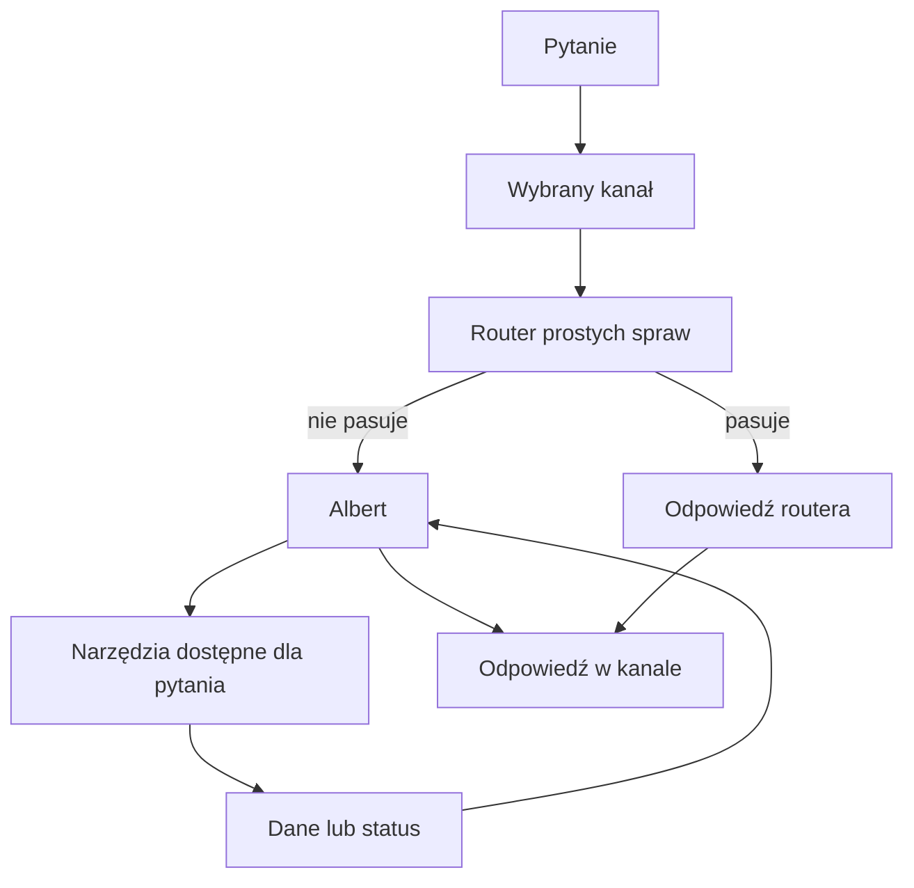

# Albert — asystent QBota

## Co to jest

Albert to część QBota, która rozumie pytania i dobiera do nich dostępne czynności. Część prostych pytań obsługuje szybka ścieżka. Pytania o to, czym coś jest, dlaczego tak działa i jak liczona jest wartość, trafiają do Alberta, który może poszukać odpowiedniego hasła w Wiki.

## Po co

Możesz pytać QBota zwykłymi słowami o trening, zdrowie, jedzenie, trasy i inne podłączone dziedziny. Albert zbiera potrzebne dane i odpowiada; w wybranych sytuacjach może też uruchomić zapis, jeśli pozwalają na to zabezpieczenia.

## Skąd dane

Albert dostaje treść pytania, czasem krótki kontekst rozmowy, oraz listę dostępnych mu czynności. Czynności pobierają dane QBota lub zgłaszają wynik zapisu. Nie każda aplikacja i nie każda wiadomość korzysta z tej samej drogi.

## Jak działa dział

1. Wpisujesz pytanie w obsługiwanym kanale, na przykład w aplikacji połączonej przez [MCP](mcp.md) (protokół połączenia aplikacji z QBotem; [słowniczek](../slowniczek.md#mcp)) albo w [Telegramie](telegram.md).
2. Prosty router sprawdza, czy potrafi odpowiedzieć na znany rodzaj pytania. Jeśli tak, może odpowiedzieć bez uruchamiania Alberta.
3. Jeśli router nie rozpozna pytania lub powinien przekazać je dalej, Albert wybiera potrzebne [narzędzia](narzedzia.md) (czynności serwerowe; [słowniczek](../slowniczek.md#narzędzie-alberta)).
4. Albert buduje odpowiedź z otrzymanych danych. Zapis opisuje jako wykonany tylko wtedy, gdy narzędzie zwróciło potwierdzenie.

## Gdzie to widać

Odpowiedź wraca do kanału, z którego przyszło pytanie. Zrzut poniżej pokazuje stronę główną QBota, a nie okno rozmowy z Albertem. Na nim nie ma licznika ani karty Alberta; szukaj osobnej rozmowy w kliencie MCP albo w Telegramie.

## Jak czytać

Jeżeli odpowiedź jest krótka, nie wynika z tego, że Albert ją przygotował — mógł odpowiedzieć router. Jeśli brakuje danych albo zapis nie doszedł do skutku, odpowiedź powinna to powiedzieć. Szczegóły dróg wejścia opisują hasła [routing](routing.md), [MCP](mcp.md) i [Telegram](telegram.md).

## Co Albert umie

Z rejestru i instrukcji Alberta wynika, że może korzystać z kilku grup czynności:

- sprawdzać trening, formę, ostatnie jazdy oraz plan Trenera;
- analizować zaplanowane trasy i wykonane jazdy, w tym profil, nawierzchnię i czas;
- pobierać pogodę, informacje o zdrowiu i podsumowania jedzenia;
- odczytywać Garaż, wybrane pliki i informacje o systemie;
- zapisywać niektóre zgłoszone fakty lub wykonywać wybrane operacje po spełnieniu warunków.

To zakres obecny w instrukcji, nie gwarancja, że każda czynność zadziała w każdej rozmowie. Planowanej trasy nie należy mylić z jazdą już wykonaną. Zmiana planu Trenera odbywa się na stronie Trenera; Albert może odczytać plan, ale nie powinien obiecywać jego edycji.

## Przykład rozpoznania pytania

1. Pytanie o konkretną jazdę lub plan trasy jest rozpoznawane jako temat tras; instrukcja odróżnia trasę planowaną od zapisanej jazdy.
2. Pytanie „ile czasu zajmie zaplanowana trasa” wymaga osobnego narzędzia czasu. Bez danych kanonicznych odpowiedź ma przekazać brak danych, a nie samodzielnie zgadywać prędkość.
3. Pytanie o trening na tydzień może korzystać z odczytu Trenera. Prośba o zmianę planu kieruje użytkownika do strony Trenera.
4. Przy zapisie Albert opisuje sukces dopiero po potwierdzeniu z narzędzia.

To reguły sprawdzone w instrukcji Alberta, nie zapis przykładowej rozmowy z konkretnym wynikiem.

## Decyzje i historia

19.10.2026: pytania wyjaśniające są kierowane do Alberta, a jego narzędzie Wiki zwraca najlepsze pasujące hasła do odpowiedzi.

Aktualny kod ma pierwszeństwo przed starszym opisem architektury. Adapter MCP buduje listę z sześciu pozycji: pytania do QBota oraz pięciu podglądów tylko do odczytu bazy i Garażu. Dokument architektury podaje jedną pozycję. Ograniczenie etapu pozwalało wyłącznie na HTTP GET, a lista MCP jest pobierana żądaniem POST; dlatego bieżącą odpowiedź działającego serwera oznaczam jako ograniczenie, a nie wynik sprawdzenia.

## Ograniczenia i pułapki

Albert nie ma dowolnego dostępu do wszystkich funkcji QBota. Część zapisów wymaga potwierdzenia, część jest blokowana, a kanały mają oddzielne reguły. Szczegóły: [ograniczenia](ograniczenia.md).
## Powiązane hasła

- [Routing pytań](routing.md)
- [Narzędzia Alberta](narzedzia.md)
- [Pamięć Alberta](pamiec.md)
- [MCP](mcp.md)
- [Telegram](telegram.md)
- [Ograniczenia Alberta](ograniczenia.md)
- [Słowniczek](../slowniczek.md)

## Wpływa na / Zależy od

- Wpływa na: odpowiedzi i wybrane zapisy uruchamiane rozmową
- Zależy od: treści pytania, wybranego kanału, routera i dostępnych narzędzi

## Zrodla

- `/opt/qbot/app/qbot3/agent_runtime.py — orchestrate_query`
- `/opt/qbot/app/qbot3/llm/albert.py — _SYSTEM, run`
- `/opt/qbot/app/qbot3/tool_registry.py — rejestr narzędzi`
- `/opt/qbot/app/qbot3/adapters/mcp_adapter.py — _list_tools`
- `/opt/qbot/app/docs/architecture/QBOT_ARCHITEKTURA_QBOT3.md`
