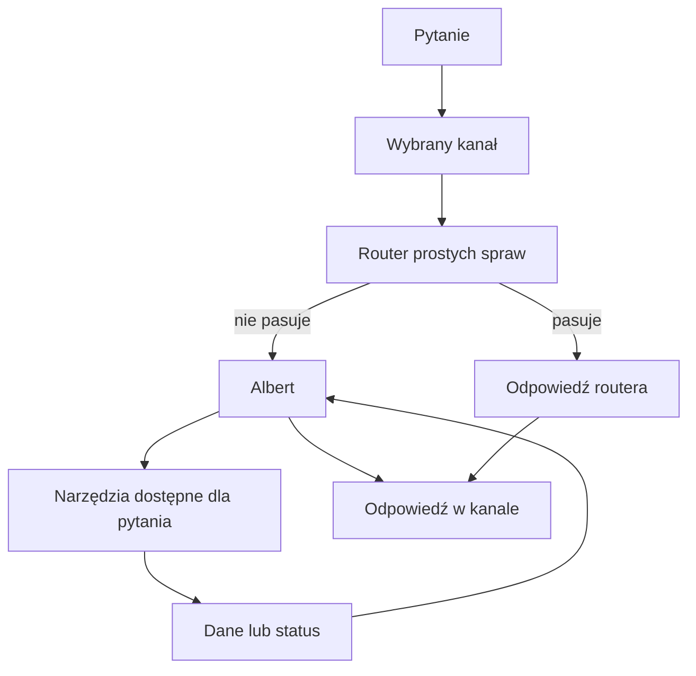

# Albert — asystent QBota

## Co to jest

Albert to część QBota, która rozumie pytania i dobiera do nich dostępne czynności. Proste pytania może obsłużyć wcześniejszy router. Do Alberta trafiają między innymi pytania złożone, niejednoznaczne albo takie, których router nie rozpozna.

## Po co

Możesz pytać QBota zwykłymi słowami o trening, zdrowie, jedzenie, trasy i inne podłączone dziedziny. Albert zbiera potrzebne dane i odpowiada; w wybranych sytuacjach może też uruchomić zapis, jeśli pozwalają na to zabezpieczenia.

## Skąd dane

Albert dostaje treść pytania, czasem krótki kontekst rozmowy, oraz listę dostępnych mu czynności. Czynności pobierają dane QBota lub zgłaszają wynik zapisu. Nie każda aplikacja i nie każda wiadomość korzysta z tej samej drogi.

## Jak działa dział

1. Wpisujesz pytanie w obsługiwanym kanale, na przykład w aplikacji połączonej przez [MCP](mcp.md) albo w [Telegramie](telegram.md).
2. Prosty router sprawdza, czy potrafi odpowiedzieć na znany rodzaj pytania. Jeśli tak, może odpowiedzieć bez uruchamiania Alberta.
3. Jeśli router nie rozpozna pytania lub powinien przekazać je dalej, Albert wybiera potrzebne [narzędzia](narzedzia.md).
4. Albert buduje odpowiedź z otrzymanych danych. Zapis opisuje jako wykonany tylko wtedy, gdy narzędzie zwróciło potwierdzenie.

## Gdzie to widać

Odpowiedź wraca do kanału, z którego przyszło pytanie. Zrzut poniżej pokazuje stronę główną QBota, a nie okno rozmowy z Albertem. Na nim nie ma licznika ani karty Alberta; szukaj osobnej rozmowy w kliencie MCP albo w Telegramie.

## Jak czytać

Jeżeli odpowiedź jest krótka, nie wynika z tego, że Albert ją przygotował — mógł odpowiedzieć router. Jeśli brakuje danych albo zapis nie doszedł do skutku, odpowiedź powinna to powiedzieć. Szczegóły dróg wejścia opisują hasła [routing](routing.md), [MCP](mcp.md) i [Telegram](telegram.md).

## Decyzje i historia

Aktualny kod ma pierwszeństwo przed starszym opisem architektury. Przykładowo bieżący adapter MCP kodem publikuje pytania oraz narzędzia ograniczonego odczytu bazy i Garażu, choć dokument architektury opisuje publiczną listę jako samo `qbot_query`. Rzeczywistej odpowiedzi aktywnego serwera na `tools/list` tu nie pobierano.

## Ograniczenia i pułapki

Albert nie ma dowolnego dostępu do wszystkich funkcji QBota. Część zapisów wymaga potwierdzenia, część jest blokowana, a kanały mają oddzielne reguły. Szczegóły: [ograniczenia](ograniczenia.md).
## Powiązane hasła

- [Routing pytań](routing.md)
- [Narzędzia Alberta](narzedzia.md)
- [Pamięć Alberta](pamiec.md)
- [MCP](mcp.md)
- [Telegram](telegram.md)
- [Ograniczenia Alberta](ograniczenia.md)
- [Słowniczek](../slowniczek.md)

## Wpływa na / Zależy od

- Wpływa na: odpowiedzi i wybrane zapisy uruchamiane rozmową
- Zależy od: treści pytania, wybranego kanału, routera i dostępnych narzędzi

## Zrodla

- `/opt/qbot/app/qbot3/agent_runtime.py — orchestrate_query`
- `/opt/qbot/app/qbot3/llm/albert.py — _SYSTEM, run`
- `/opt/qbot/app/qbot3/tool_registry.py — rejestr narzędzi`
- `/opt/qbot/app/qbot3/adapters/mcp_adapter.py — _list_tools`
- `/opt/qbot/app/docs/architecture/QBOT_ARCHITEKTURA_QBOT3.md`
