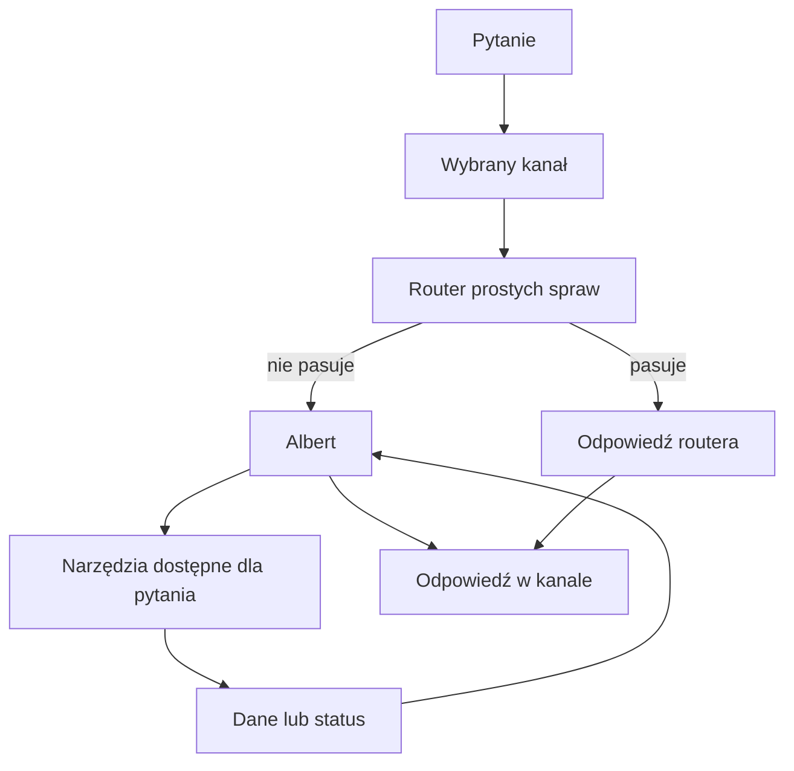

# Albert przez MCP

## Co to jest

MCP to sposób połączenia zgodnej aplikacji z QBotem. W rozmowie użytkownik zadaje pytanie, a odpowiedź przygotowuje QBot po stronie serwera. Wyjaśnienie skrótowca znajduje się w [słowniczku](../slowniczek.md#mcp).

## Po co

Pozwala rozmawiać z QBotem z aplikacji-klienta bez ręcznego wybierania wewnętrznej czynności. Albert może zostać uruchomiony po routerze, jeśli pytanie tego wymaga.

## Skąd dane

Aktualny adapter MCP ogłasza narzędzie do pytań oraz narzędzia tylko do odczytu bazy i Garażu. Dokument architektury opisuje publiczną listę jako samą czynność pytania. Kod jest aktualniejszym dowodem tego, co adapter zamierza zwrócić, ale nie pobrano odpowiedzi aktywnego serwera.

## Jak liczone

1. Aplikacja-klient wysyła tekst pytania jako żądanie QBot.
2. QBot próbuje obsłużyć pytanie krótką regułową ścieżką.
3. Nierozpoznane lub wymagające dalszej analizy pytanie może trafić do Alberta.
4. Albert dobiera wewnętrzne narzędzia, odbiera wyniki i formułuje odpowiedź.
5. Odpowiedź wraca do klienta. Bez odpowiedzi serwera nie można potwierdzić, jaka lista narzędzi jest aktywna w danym momencie.

## Gdzie to widać

W aplikacji połączonej z QBotem. Załączony zrzut strony głównej QBota nie pokazuje klienta MCP ani okna rozmowy.

## Jak czytać

Publiczne czynności klienta i wewnętrzne narzędzia Alberta to dwie różne listy. Istnienie obsługi jakiejś nazwy w kodzie nie oznacza, że klient ją zobaczy. Nie należy utożsamiać MCP z bezpośrednim dostępem do wszystkich danych QBota.

## Decyzje i historia

Bieżący kod MCP zawiera pytanie oraz narzędzia podglądu tylko do odczytu; dokument architektury mówi o jednej pozycji publicznej. Rozjazd pozostaje do rozstrzygnięcia przez wynik działającego serwera. Ścieżka zapisu administracyjnego widoczna w kodzie nie jest dowodem publikacji jej klientowi.

## Ograniczenia i pułapki

- Połączenie i uwierzytelnienie zależą od klienta oraz konfiguracji serwera.
- Narzędzia odczytu bazy nie są narzędziami Alberta do dowolnych zapisów.
- Nie sprawdzono w tym etapie konkretnego klienta ani jego połączenia.
## Powiązane hasła

- [Routing pytań](routing.md)
- [Narzędzia Alberta](narzedzia.md)
- [Telegram](telegram.md)
- [Ograniczenia Alberta](ograniczenia.md)
- [Słowniczek](../slowniczek.md)

## Wpływa na / Zależy od

- Wpływa na: dostępu aplikacji-klienta do pytań QBota i ograniczonego podglądu
- Zależy od: adaptera MCP, klienta i ustawień serwera

## Zrodla

- `/opt/qbot/app/qbot3/adapters/mcp_adapter.py — handle_qbot3_mcp, _list_tools, _call_tool`
- `/opt/qbot/app/qbot3/tool_registry.py — mcp_tools_list`
- `/opt/qbot/app/docs/architecture/QBOT_ARCHITEKTURA_QBOT3.md — Publiczny MCP`
