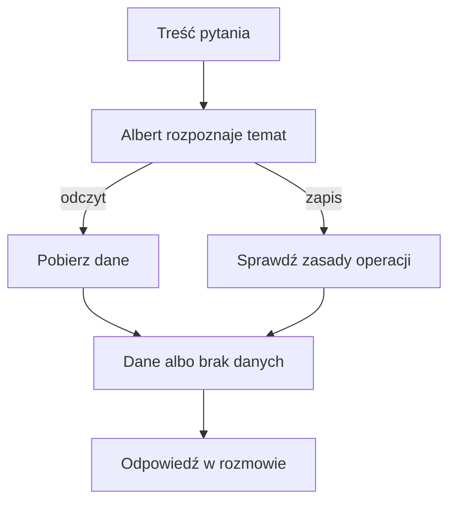

# Narzędzia Alberta

## Co to jest

Narzędzia to czynności dostępne Albertowi: jedne pobierają informacje, inne mogą zapisać zmianę. To Albert dobiera je do pytania; lista narzędzi nie jest menu, które użytkownik musi znać.

## Po co

Dzięki narzędziom odpowiedź może opierać się na danych QBota. Ta sama rozmowa może wymagać jednego odczytu albo kilku kolejnych kroków.

## Skąd dane

Przy uruchomieniu pytania serwer przygotowuje opisy dostępnych czynności. Albert otrzymuje ich opisy i może wywołać te, które pasują do pytania. Nie każda czynność z zaplecza jest bezpośrednio widoczna klientowi MCP.

## Jak liczone

1. Pytanie określa potrzebny temat, np. „jaka była moja ostatnia jazda?”.
2. Albert wybiera odczyt dotyczący jazdy, jeśli jest dostępny w danym uruchomieniu.
3. Czynność zwraca dane albo informację o błędzie/braku danych.
4. Albert odpowiada na podstawie wyniku. Przy zapisie sprawdza status, zamiast zakładać, że zmiana się udała.

## Główne grupy

- Trening i forma: bieżący status formy, gotowość, ostatnie jazdy i tydzień Trenera.
- Trasy: lista, raport i profil zaplanowanej trasy, czas przejazdu oraz wybrane operacje na trasie.
- Pogoda: pogoda teraz, okno jazdy i prognozy powiązane z trasą.
- Zdrowie i jedzenie: sen, wellness, serce, suplementy, podsumowanie i rejestr posiłków.
- Notatki: fakty do planowania i pamięć potwierdzonych informacji.
- System: status i wybrane informacje diagnostyczne.
- Pliki i integracje: odczyt listy artefaktów, RWGPS oraz Garaż.
- Surowy podgląd: ograniczone narzędzia odczytu bazy i Garażu.

To grupy tematyczne potwierdzone w rejestrze; nie oznaczają, że każde narzędzie jest włączone i działa w każdej chwili. Pełne nazwy są celowo pozostawione w źródłach.

## Jak Albert dobiera czynność

Instrukcja Alberta rozróżnia podobnie brzmiące pytania, aby odpowiedź opierała się na właściwym rodzaju danych:

- „Co mnie czeka na trasie?” dotyczy trasy zaplanowanej. „Jak poszła jazda?” dotyczy już zarejestrowanej aktywności.
- Pytanie o szczegóły profilu trasy może pobrać wysokości i podjazdy; pytanie o czas przejazdu korzysta z osobnego wyliczenia czasu.
- Pytanie o zakupy wody lub jedzenia na trasie pobiera punkty i ich godziny otwarcia, jeśli są dostępne.
- Pytanie o plan treningowy może odczytać tydzień Trenera. Zmiana planu jest wykonywana na stronie, nie przez narzędzie odczytowe Alberta.
- Prośba „zapamiętaj, że…” wybiera zapis faktu. Samo pytanie o wcześniejsze ustalenie wymaga wyszukania pamięci lub notatki planowania.

To przykłady z instrukcji, nie gwarancja kompletności listy ani odpowiedź na konkretną jazdę. Jeśli narzędzie zgłasza brak wymaganych danych, Albert ma przekazać brak, zamiast obliczać wynik po swojemu.

## Dostęp z aplikacji MCP

Kod adaptera MCP udostępnia główne wejście pytań oraz pięć podglądów tylko do odczytu. Wewnętrzny rejestr Alberta jest szerszy i obejmuje działania, których klient nie może wywołać bezpośrednio. 19.10.2026 do instrukcji doprecyzowano użycie narzędzia Wiki przy pytaniach wyjaśniających. Zrzut strony głównej poniżej nie pokazuje żadnej z tych list; służy tylko jako orientacja po stronie witryny.

## Gdzie to widać

Zwykle widzisz odpowiedź, nie nazwę czynności. Klient MCP publikuje osobną listę, która według kodu ma sześć pozycji, w tym pięć podglądów odczytowych. Dokument architektury mówi o jednej pozycji; rozbieżność dokumentu z kodem jest potwierdzona. Odpowiedzi działającego serwera nie pobrano, bo wymagałoby to żądania POST, a zakres etapu dopuszczał wyłącznie GET.

## Jak czytać

Jeśli Albert napisał, że coś zapisał, ważny jest potwierdzony wynik operacji. Sama obecność funkcji w kodzie nie potwierdza działania usługi, poprawności danych ani dostępu w każdym kanale.

## Decyzje i historia

19.10.2026: aktualizacja instrukcji dodała wskazówkę, by pytania wyjaśniające korzystały z haseł Wiki. Przy zmianach rejestru aktualizuje się też instrukcję Alberta. Trasy obsługują aktualne narzędzia; nie należy przypisywać ich nieistniejącemu Plannerowi v2.

## Ograniczenia i pułapki

Odczyt i zapis podlegają różnym zabezpieczeniom. Usuwanie lub zmiana danych może mieć dodatkowe potwierdzenia. Lista publiczna MCP nie jest pełną listą wewnętrznych możliwości Alberta.
## Powiązane hasła

- [Routing pytań](routing.md)
- [Pamięć Alberta](pamiec.md)
- [MCP](mcp.md)
- [Ograniczenia Alberta](ograniczenia.md)
- [Słowniczek](../slowniczek.md)

## Wpływa na / Zależy od

- Wpływa na: dane użyte w odpowiedzi oraz wybrane zapisy
- Zależy od: rejestru, instrukcji Alberta, połączeń i zabezpieczeń

## Zrodla

- `/opt/qbot/app/qbot3/tool_registry.py — _init_registry, tool_descriptions, tool loaders`
- `/opt/qbot/app/qbot3/agent_runtime.py — _execute_single_tool, orchestrate_query`
- `/opt/qbot/app/qbot3/llm/albert.py — _SYSTEM, build_tools_spec`
- `/opt/qbot/app/qbot3/adapters/mcp_adapter.py — _list_tools`
