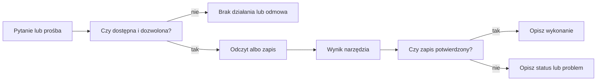

# Ograniczenia Alberta

## Co to jest

Albert działa w granicach dostępnych narzędzi i reguł bezpieczeństwa. Nie może dowolnie przeglądać ani zmieniać wszystkiego, co istnieje w QBot. Ograniczenia różnią się między [kanałami](../zaleznosci.md#albert-i-kanały-rozmowy).

## Po co

To pomaga ocenić odpowiedź: czy pochodzi z danych, czy system zgłosił brak możliwości, i czy zapis rzeczywiście został wykonany.

## Skąd dane

Instrukcja Alberta opisuje dobór narzędzi oraz reguły odpowiedzi. Runtime sprawdza listę czynności i część żądań zapisu. Dodatkowe ograniczenia znajdują się w narzędziach i kanałach.

## Jak liczone

1. QBot sprawdza pytanie i wybiera dopuszczalną ścieżkę.
2. Albert może użyć wyłącznie czynności udostępnionych w tej rozmowie.
3. Zapis przechodzi przez reguły bezpieczeństwa i obsługę konkretnego narzędzia.
4. Wynik narzędzia informuje, czy zapis się udał, został zablokowany czy wymaga dalszego kroku.
5. Odpowiedź powinna oddać ten wynik, a nie obiecywać powodzenie bez potwierdzenia.

## Gdzie to widać

W odpowiedzi o braku danych, odmowie, błędzie lub potrzebie potwierdzenia. Nie ma osobnego kafla ograniczeń na stronie głównej.

## Jak czytać

„Nie mogę” albo „brak danych” oznacza, że odpowiedź nie potwierdza wykonania operacji. Przy zapisie liczy się status narzędzia. Nie należy traktować odpowiedzi Alberta jako diagnozy medycznej ani jako dowodu, że czynność poza QBotem została wykonana.

Przykłady z bieżącej instrukcji:

- Przy pytaniu o zaplanowany trening Albert może odczytać plan, lecz zmiany planu odsyła do strony Trenera.
- Przy kasowaniu trasy ma najpierw pokazać podgląd, a dopiero potem czekać na wyraźną zgodę.
- Przy czasie przejazdu nie ma sam dopisywać prędkości. Jeśli brakuje danych kanonicznych, przekazuje brak danych.
- Przy zapisie potwierdzonego faktu sukces można zgłosić tylko wtedy, gdy wynik narzędzia potwierdza zapis.

Jeżeli prośba dotyczy operacji niedostępnej w bieżącej rozmowie, odpowiedź może być odmową lub prośbą o wykonanie jej na właściwej stronie. Nie dowodzi to, że funkcja nie istnieje w całym QBot: może być dostępna w innym miejscu lub pod inną kontrolą.

## Decyzje i historia

Aktualne instrukcje wymagają, by nie twierdzić, że zapis się udał bez potwierdzenia. W kodzie istnieją starsze i administracyjne ścieżki; ich obecność nie oznacza publicznej dostępności.

## Ograniczenia i pułapki

- Nie wszystkie kanały mają te same reguły.
- Czynność może być zarejestrowana, lecz niedostępna z powodu błędu ładowania lub usługi.
- Usuwanie, import i inne zmiany mogą mieć osobne potwierdzenia.
- Odpowiedź zależy od jakości i kompletności danych zwróconych przez narzędzie.
## Powiązane hasła

- [Narzędzia Alberta](narzedzia.md)
- [Routing pytań](routing.md)
- [MCP](mcp.md)
- [Pamięć Alberta](pamiec.md)
- [Słowniczek](../slowniczek.md)

## Wpływa na / Zależy od

- Wpływa na: zakres operacji i sposób opisywania ich wyników
- Zależy od: dostępnych narzędzi, reguł bezpieczeństwa, danych i usług

## Zrodla

- `/opt/qbot/app/qbot3/llm/albert.py — _SYSTEM`
- `/opt/qbot/app/qbot3/agent_runtime.py — orchestrate_query, _is_destructive_query`
- `/opt/qbot/app/qbot3/safety.py — allowlisty`
- `/opt/qbot/app/qbot3/adapters/mcp_adapter.py — publiczna obsługa MCP`
