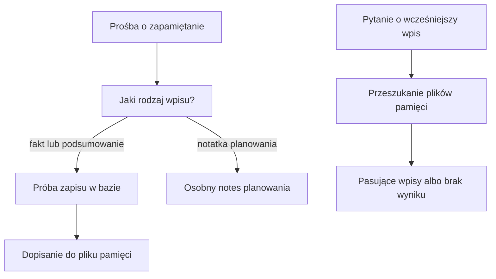

# Pamięć Alberta

## Co to jest

W QBocie działają osobne mechanizmy pamiętania potwierdzonych faktów, podsumowań rozmów i notatek planowania. Nie należy traktować ich jako jednego notesu: różnią się sposobem zapisu i odczytu. JSONL to tekstowy plik z jednym rekordem na wiersz ([słowniczek](../slowniczek.md#jsonl)).

## Po co

Zapisany fakt może pomóc w późniejszej rozmowie, a notatka planowania może przechować ustalenie potrzebne do planu. Użytkownik powinien wiedzieć, o który rodzaj zapisu prosi.

## Skąd dane

Kod pamięci zapisuje pliki JSONL i podejmuje próbę zapisu potwierdzonego faktu do bazy. Wyszukiwanie opisane w kodzie czyta pliki. Notatki planowania mają osobny moduł. Odczyt bazy tylko do odczytu z 18.10.2026 potwierdził tabelę pamięci i liczniki: 14 rekordów typu „potwierdzony fakt” oraz 1 podsumowanie rozmowy. To liczba rekordów tabeli, nie dowód, że każdy plik i każdy odczyt jest zsynchronizowany.

## Jak liczone

1. Użytkownik prosi o zapamiętanie informacji, np. „zapamiętaj, że wolę krótkie odpowiedzi”.
2. Rozpoznana prośba przekazuje treść do zapisu jako fakt albo notatkę planowania.
3. Zapis faktu próbuje utrwalić go w dwóch miejscach: lokalnym pliku oraz tabeli. Błąd zapisu do bazy nie zatrzymuje zapisu plikowego.
4. Późniejsze wyszukiwanie przegląda zawartość plików; notatki planowania są odczytywane oddzielną drogą.
5. Stan tabeli sprawdzony 18.10.2026: 14 + 1 = 15 rekordów w dwóch kategoriach. Nie jest to przeliczenie liczby plików ani liczba faktów dostępnych dla konkretnego pytania.

Odczyt z bazy 18.10.2026 zwrócił 14 potwierdzonych faktów i 1 podsumowanie rozmowy. Wyszukiwanie plikowe sprawdza do 50 ostatnich wpisów każdego rodzaju, porównuje tekst bez rozróżniania wielkości liter i zwraca najwyżej 10 pasujących wpisów. Oznacza to, że brak wyniku nie dowodzi, iż wpisu nigdy nie zapisano: mógł być w bazie, poza ostatnimi wpisami pliku albo mieć inną treść.

## Gdzie to widać

Zapis może być potwierdzony w rozmowie. Nie potwierdziłem aktualnego ekranu, który pokazuje pełną listę pamięci. Na zrzucie strony głównej nie ma takiego widoku.

## Jak czytać

„Potwierdzony fakt” oznacza rodzaj wpisu, a nie automatyczną kontrolę jego prawdziwości. Jeśli ważna informacja jest błędna, należy ją poprawić przez właściwy kanał. Pamięć rozmów i fakty planowania nie są zamienne.

## Decyzje i historia

Kod pamięci opisuje pliki jako bieżącą ścieżkę odczytu. Mimo że zapis podejmuje też próbę bazy, bieżące wyszukiwanie nie pobiera z niej rekordów. Dawne opisy mówiące o bazie jako jedynym źródle są niezgodne z tym przepływem.

## Ograniczenia i pułapki

- Wyszukiwanie jest tekstowe i ma limit liczby przeglądanych wpisów.
- Zapis próbuje najpierw utrwalić rekord w bazie, ale błąd tej próby jest pomijany; następnie rekord jest dopisywany do pliku.
- Wyszukiwanie faktów czyta pliki, a nie tabelę bazy. Dlatego licznik z bazy i wynik późniejszego wyszukiwania nie muszą być identyczne.
- Nie potwierdzono tu harmonogramu porządkowania ani kasowania pamięci.
- Licznik bazy może różnić się od tego, co dostępne w plikach do odczytu.
## Powiązane hasła

- [Narzędzia Alberta](narzedzia.md)
- [Routing pytań](routing.md)
- [MCP](mcp.md)
- [Ograniczenia Alberta](ograniczenia.md)
- [Słowniczek](../slowniczek.md)

## Wpływa na / Zależy od

- Wpływa na: odpowiedzi dotyczące zapisanych ustaleń
- Zależy od: prośby użytkownika, plików pamięci i osobnych notatek planowania

## Zrodla

- `/opt/qbot/app/qbot3/memory.py — _memory_path, _write_memory_db, write_memory, search_memory`
- `/opt/qbot/app/qbot3/context_builder.py — search_memory`
- `/opt/qbot/app/qbot3/agent_runtime.py — obsługa prośby o zapamiętanie`
- `qbot_v2.qbot_memory — kontrolny COUNT po memory_type`
