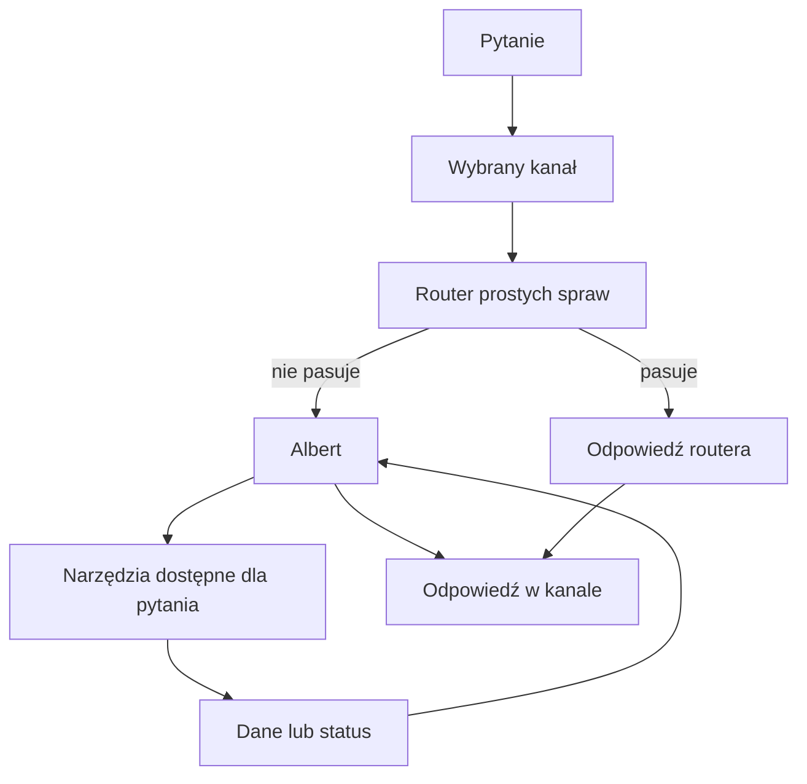

# Routing pytań

## Co to jest

Routing to wybór, kto odpowie na pytanie: prosty zestaw reguł czy Albert. To część [przepływu rozmowy](index.md), a nie osobna odpowiedź widoczna dla użytkownika.

## Po co

Proste i dobrze rozpoznane pytania mogą dostać odpowiedź krótszą drogą. Pytania wymagające interpretacji, kilka tematów naraz albo brak rozpoznania mogą trafić do Alberta.

## Skąd dane

Dla MCP wejście prowadzi przez adapter QBota. Przy włączonej nowej ścieżce zapytanie najpierw trafia do regułowego handlera; określone wyniki, błędy i pytania oznaczone do eskalacji przekazują je do Alberta. Telegram ma dodatkowe własne rozdzielenie wiadomości i komend; opisuje je [osobne hasło](telegram.md).

## Jak liczone

1. Użytkownik wysyła pytanie. Przykład kontrolny z kodu: „pokaż bilans za ostatnie 7 dni” jest przykładem tekstu przekazywanego w interfejsie Telegrama, a nie gwarancją wyniku dla konkretnej daty.
2. Adapter sprawdza, czy pytanie wymaga natychmiastowego przekazania do Alberta.
3. Jeśli nie, próbuje ścieżki regułowej. Tylko zaakceptowany wynik wraca tą drogą.
4. Gdy wynik ma status nierozpoznany, wymaga akcji lub wystąpi błąd, pytanie może przejąć Albert.
5. Albert dobiera czynność i odpowiada na podstawie jej wyniku.

Przepływ powyżej przedstawia logikę, nie zmierzone liczby. > DO SPRAWDZENIA: aktualny udział pytań obsługiwanych przez router i udział przekazywany Albertowi — nie pobrano porównywalnego zestawienia z produkcji.

## Gdzie to widać

Nie ma osobnego kafla routingu na zrzucie strony głównej. Rozpoznajesz go po drodze obsługi; jako użytkownik widzisz końcową odpowiedź.

## Jak czytać

Odpowiedź od routera nie jest dowodem, że Albert przeanalizował pytanie. Jeśli pytanie zawiera kilka tematów albo dotyczy analizy, może zostać przekazane dalej. Nie można na podstawie samego tekstu odpowiedzi ustalić ścieżki bez danych diagnostycznych.

## Decyzje i historia

Bieżący kod adaptera jest rozstrzygający. Starsze materiały o Plannerze v2 dla tras są nieaktualne: aktualna obsługa tras przez Alberta korzysta z narzędzi tras, nie z dawnego planera. Zobacz [narzędzia](narzedzia.md).

## Ograniczenia i pułapki

- Zmiana reguł lub flag może zmienić drogę pytania.
- Nie wszystkie kanały używają tego samego routera.
- Brak danych w odpowiedzi nie oznacza, że router ani Albert coś dopisali.
## Powiązane hasła

- [Narzędzia Alberta](narzedzia.md)
- [MCP](mcp.md)
- [Telegram](telegram.md)
- [Ograniczenia Alberta](ograniczenia.md)
- [Słowniczek](../slowniczek.md)

## Wpływa na / Zależy od

- Wpływa na: tego, czy pytanie odpowie router czy Albert
- Zależy od: kanału, treści pytania, ustawień i akceptacji wyniku routera

## Zrodla

- `/opt/qbot/app/qbot3/adapters/mcp_adapter.py — _classify_vnext_escalation, _should_accept_vnext_result, handle_qbot3_mcp`
- `/opt/qbot/app/qbot_query_handler.py — handle_query`
- `/opt/qbot/app/qbot3/agent_runtime.py — orchestrate_query`
