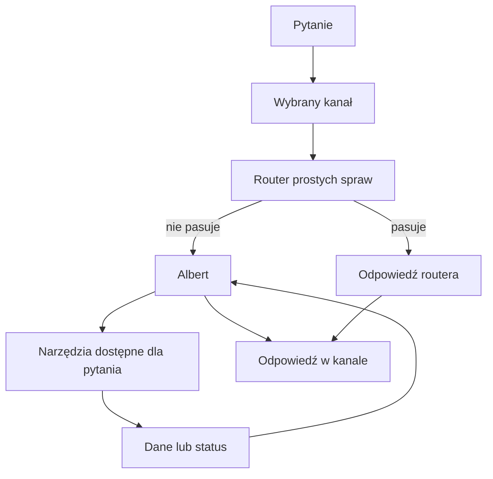

# Routing pytań

## Co to jest

Routing (wybór drogi obsługi pytania; [słowniczek](../slowniczek.md#routing-pytania)) to decyzja, czy odpowie prosty zestaw reguł, czy Albert. To część [przepływu rozmowy](index.md), a nie osobna odpowiedź widoczna dla użytkownika.

## Po co

Proste i dobrze rozpoznane pytania mogą dostać odpowiedź krótszą drogą. Pytania wymagające interpretacji, kilka tematów naraz albo brak rozpoznania mogą trafić do Alberta.

## Skąd dane

Dla MCP (protokołu łączenia aplikacji z QBotem; [słowniczek](../slowniczek.md#mcp)) wejście prowadzi przez adapter QBota. Przy włączonej szybkiej ścieżce część pytań przechodzi przez reguły, ale pytania o definicję, powód działania i sposób liczenia są kierowane do Alberta. Wynik nierozpoznany, błąd i prośba o zapis również mogą uruchomić Alberta. Telegram ma dodatkowe własne rozdzielenie wiadomości i komend; opisuje je [osobne hasło](telegram.md).

## Jak liczone

1. Użytkownik wysyła pytanie, na przykład „jaka była moja ostatnia jazda?”.
2. Dla zapytań MCP adapter kieruje do Alberta pytania o zapisy, architekturę, analizę, trasę oraz wybrane pytania łączące dziedziny.
3. Pozostałe pytania mogą przejść przez szybki router. Zwrócony wynik jest przyjmowany tylko wtedy, gdy status jest poprawny i pytanie należy do ograniczonej listy prostych odczytów.
4. Wynik nierozpoznany, wymagający akcji albo błąd może uruchomić Alberta.
5. Albert wybiera czynność i składa odpowiedź z otrzymanego wyniku.

Przykład z instrukcji Alberta: pytanie o ostatnią jazdę jest inną drogą niż prośba o analizę zaplanowanej trasy. Sam zwrot „ostatnia jazda” nie jest dowodem, że konkretne zapytanie z produkcji trafiło do danego routera; zależy to od kanału, jego ustawień i wyniku obsługi.

Przepływ powyżej przedstawia logikę, nie zmierzone liczby. W kodzie MCP są zapisy diagnostyczne zawierające nazwę silnika, status i czas obsługi, ale w tym etapie nie odczytano kompletnego i porównywalnego zestawienia produkcyjnego. Nie podaję więc procentowego udziału routera i Alberta.

## Gdzie to widać

Nie ma osobnego kafla routingu na zrzucie strony głównej. Rozpoznajesz go po drodze obsługi; jako użytkownik widzisz końcową odpowiedź.

## Jak czytać

Odpowiedź od routera nie jest dowodem, że Albert przeanalizował pytanie. Jeśli pytanie zawiera kilka tematów albo dotyczy analizy, może zostać przekazane dalej. Nie można na podstawie samego tekstu odpowiedzi ustalić ścieżki bez danych diagnostycznych.

## Decyzje i historia

19.10.2026: pytania „co to jest”, „dlaczego” i „jak liczone” mają trafiać do Alberta, aby odpowiedź mogła korzystać z Wiki. Publiczny kanał MCP pokazuje pytanie do QBota oraz pięć podglądów tylko do odczytu; dokument architektury wymienia tylko pytanie. To rozbieżność między kodem i dokumentem. Telegram ma własną regułę: pytanie poprzedzone `?` albo słowem „Albert” trafia do Alberta.

Bieżący kod adaptera jest rozstrzygający. Starsze materiały o Plannerze v2 dla tras są nieaktualne: aktualna obsługa tras przez Alberta korzysta z narzędzi tras, nie z dawnego planera. Zobacz [narzędzia](narzedzia.md).

## Ograniczenia i pułapki

- Zmiana reguł lub flag może zmienić drogę pytania.
- Nie wszystkie kanały używają tego samego routera.
- Brak danych w odpowiedzi nie oznacza, że router ani Albert coś dopisali.
- Ten sam tekst może zostać obsłużony inaczej zależnie od kanału i flag włączających poszczególne drogi.
## Powiązane hasła

- [Narzędzia Alberta](narzedzia.md)
- [MCP](mcp.md)
- [Telegram](telegram.md)
- [Ograniczenia Alberta](ograniczenia.md)
- [Słowniczek](../slowniczek.md)

## Wpływa na / Zależy od

- Wpływa na: tego, czy pytanie odpowie router czy Albert
- Zależy od: kanału, treści pytania, ustawień i akceptacji wyniku routera

## Zrodla

- `/opt/qbot/app/qbot3/adapters/mcp_adapter.py — _classify_vnext_escalation, _should_accept_vnext_result, handle_qbot3_mcp`
- `/opt/qbot/app/qbot_query_handler.py — handle_query`
- `/opt/qbot/app/qbot3/agent_runtime.py — orchestrate_query`
