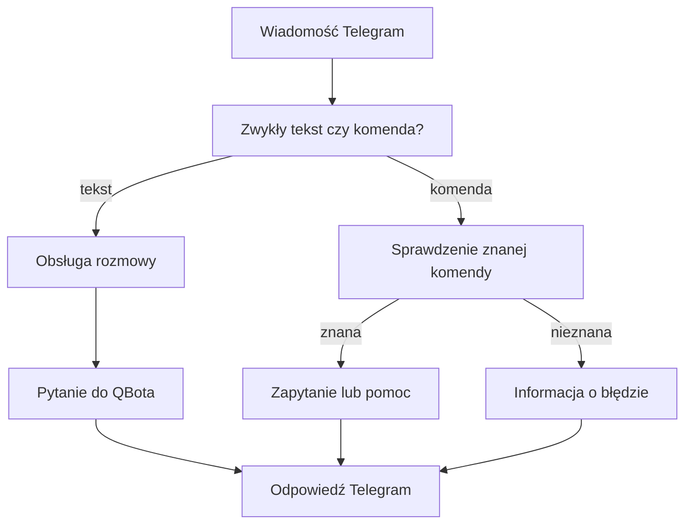

# Albert i QBot przez Telegram

## Co to jest

Telegram jest jednym z kanałów rozmowy z QBotem. Bieżący webhook rozdziela zwykły tekst od komend rozpoczynających się ukośnikiem. Nie każda wiadomość przechodzi tą samą drogą.

## Po co

Możesz wysłać pytanie tekstem albo użyć dostępnych skrótów, na przykład prośby o status. Nie musisz znać wewnętrznych nazw czynności.

## Skąd dane

Zwykły tekst trafia do obsługi rozmowy, która zachowuje kontekst ostatniej rozmowy i wywołuje usługę zapytań QBot. W kodzie ta usługa korzysta z osobnego routera zapytań. Komendy są rozpoznawane w webhooku; część wywołuje status, a część zamienia komendę na przygotowane pytanie. `/start` i `/help` zwracają pomoc.

## Jak liczone

1. Webhook sprawdza, czy wiadomość jest pusta i czy zaczyna się od ukośnika.
2. Zwykły tekst przekazuje do obsługi rozmowy, która sprawdza uprawnienie, oczekujące potwierdzenie i kontekst.
3. Tekst naturalny przechodzi do usługi zapytań QBota przez osobny router. Kod tej ścieżki nie jest tym samym wywołaniem handlera używanym przez adapter MCP; nie należy zakładać, że każda wiadomość Telegrama uruchamia tę samą drogę Alberta.
4. Komenda jest rozdzielana na nazwę i argument. Znane komendy statusowe mapują się na zapytania; `/ask` przekazuje tekst po komendzie.
5. Wynik jest formatowany i wysyłany do rozmowy Telegram.

Przykład sprawdzony w kodzie webhooka: `/ask` z argumentem przekazuje argument jako pytanie. Nie używam go jako przykładu wyniku liczbowego, bo nie wykonano rozmowy na żywo.

## Gdzie to widać

W rozmowie z botem Telegram. Zrzut strony głównej QBota nie pokazuje rozmowy ani pytania do Alberta. Przy oczekującej akcji obsługa może najpierw zajmować się jej potwierdzeniem.

## Jak czytać

Zwykły tekst i komendy mają różne ścieżki. Nieznana komenda zwraca informację, że bot jej nie zna. Lista komend i ich działanie mogą różnić się od starszej instrukcji Telegrama.

## Decyzje i historia

Dokument „przezroczystego interfejsu” z 28.05.2026 opisuje docelowy przepływ, w którym Telegram przekazuje surową wiadomość do tej samej rozmowy QBot. Bieżący webhook nadal rozpoznaje komendy, a obsługa rozmowy ma osobny router zapytań i reguły potwierdzeń. Kod potwierdza zatem, że kanały nie są dziś identyczne. Nie rozstrzyga, czy docelowo właściciel chce zrównać zwykły tekst z drogą MCP.

## Ograniczenia i pułapki

- Nie potwierdzono tutaj aktywnego routingu na żywym Telegramie.
- Nie każda komenda jest pytaniem do Alberta.
- Błędna lub nieznana komenda nie jest wykonywana jako swobodne polecenie.
- > DO SPRAWDZENIA: Czy zwykły tekst Telegrama ma docelowo korzystać z tej samej ścieżki QBot/Alberta co MCP? (Tak/Nie)
## Powiązane hasła

- [Routing pytań](routing.md)
- [MCP](mcp.md)
- [Narzędzia Alberta](narzedzia.md)
- [Ograniczenia Alberta](ograniczenia.md)
- [Powiadomienia Trenera](../trener/powiadomienia.md)
- [Słowniczek](../slowniczek.md)

## Wpływa na / Zależy od

- Wpływa na: odpowiedzi i dostępne skróty w Telegramie
- Zależy od: webhooka, rozmowy Telegrama, zapytań QBota i kontekstu

## Zrodla

- `/opt/qbot/app/qbot_api.py — webhook Telegrama, command_query_map`
- `/opt/qbot/app/qbot_qcal_telegram.py — handle_message`
- `/opt/qbot/app/qbot_tools.py — _tool_qbot_query`
- `/opt/qbot/app/docs/QBOT3_TELEGRAM_TRANSPARENT_UI.md`
