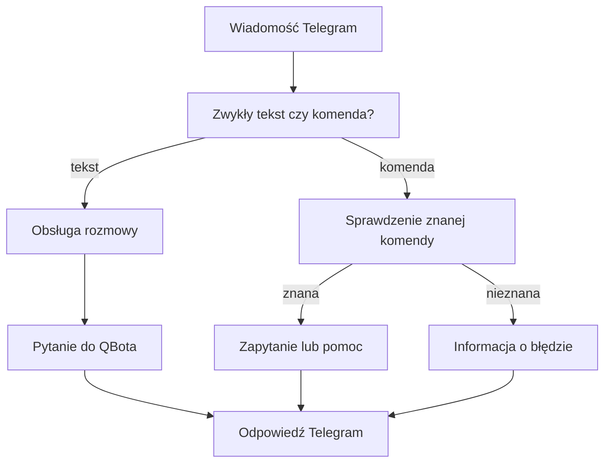

# Albert i QBot przez Telegram

## Co to jest

Telegram jest jednym z kanałów rozmowy z QBotem. Bieżący webhook rozdziela zwykły tekst od komend rozpoczynających się ukośnikiem. Nie każda wiadomość przechodzi tą samą drogą.

## Po co

Możesz wysłać pytanie tekstem albo użyć dostępnych skrótów, na przykład prośby o status. Nie musisz znać wewnętrznych nazw czynności.

## Skąd dane

Zwykły tekst trafia do obsługi rozmowy, która przekazuje naturalne pytanie do usługi zapytań QBot i zachowuje kontekst ostatniej rozmowy. Komendy są rozpoznawane w webhooku; część wywołuje status, a część zamienia komendę na przygotowane pytanie. `/start` i `/help` zwracają pomoc.

## Jak liczone

1. Webhook sprawdza, czy wiadomość jest pusta i czy zaczyna się od ukośnika.
2. Zwykły tekst przekazuje do obsługi rozmowy, która sprawdza uprawnienie, oczekujące potwierdzenie i kontekst.
3. Tekst naturalny przechodzi do zapytania QBota. To może dalej uruchomić router albo Alberta; sam kanał Telegram nie dowodzi, że odpowiedział model.
4. Komenda jest rozdzielana na nazwę i argument. Znane komendy statusowe mapują się na zapytania; `/ask` przekazuje tekst po komendzie.
5. Wynik jest formatowany i wysyłany do rozmowy Telegram.

Przykład sprawdzony w kodzie webhooka: `/ask` z argumentem przekazuje argument jako pytanie. Nie używam go jako przykładu wyniku liczbowego, bo nie wykonano rozmowy na żywo.

## Gdzie to widać

W rozmowie z botem Telegram. Zrzut strony głównej wiki/QBota nie pokazuje tej rozmowy. Przy oczekującej akcji obsługa może najpierw zajmować się jej potwierdzeniem.

## Jak czytać

Zwykły tekst i komendy mają różne ścieżki. Nieznana komenda zwraca informację, że bot jej nie zna. Lista komend i ich działanie mogą różnić się od starszej instrukcji Telegrama.

## Decyzje i historia

Dokument „przezroczystego interfejsu” opisuje projekt docelowy. Aktualny webhook nadal rozpoznaje komendy, a obsługa rozmowy zawiera osobne reguły komend i potwierdzeń. Zatem pełna przezroczystość nie wynika z bieżącego kodu.

## Ograniczenia i pułapki

- Nie potwierdzono tutaj aktywnego routingu na żywym Telegramie.
- Nie każda komenda jest pytaniem do Alberta.
- Błędna lub nieznana komenda nie jest wykonywana jako swobodne polecenie.
- > DO SPRAWDZENIA: Czy zwykły tekst Telegrama ma docelowo trafiać przez tę samą ścieżkę Alberta co MCP, czy obecny podział ma pozostać?
## Powiązane hasła

- [Routing pytań](routing.md)
- [MCP](mcp.md)
- [Narzędzia Alberta](narzedzia.md)
- [Ograniczenia Alberta](ograniczenia.md)
- [Powiadomienia Trenera](../trener/powiadomienia.md)
- [Słowniczek](../slowniczek.md)

## Wpływa na / Zależy od

- Wpływa na: odpowiedzi i dostępne skróty w Telegramie
- Zależy od: webhooka, rozmowy Telegrama, zapytań QBota i kontekstu

## Zrodla

- `/opt/qbot/app/qbot_api.py — webhook Telegrama, command_query_map`
- `/opt/qbot/app/qbot_qcal_telegram.py — handle_message`
- `/opt/qbot/app/qbot_tools.py — _tool_qbot_query`
- `/opt/qbot/app/docs/QBOT3_TELEGRAM_TRANSPARENT_UI.md`
