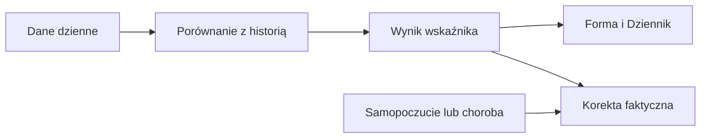

# Body Battery

## Co to jest

Body Battery to wskaźnik Garmina. W QBocie nie jest osobnym kaflem Formy. Jego dane są jednym ze składników korekty faktycznego zmęczenia.

## Po co

Jeśli korekta zmęczenia różni się od surowej, jednym z możliwych powodów jest relacja między dziennym zużyciem Body Battery i nocnym doładowaniem. Odczytuj ją razem z pozostałymi składnikami.

## Skąd dane

Wykorzystane są wartości doładowania w nocy i zużycia w dzień. Algorytm bierze dług akumulatora z trzech nocy.

## Jak liczone

1. Dla 18.10.2026 w bazie Formy zapisano zmęczenie surowe ATL 60,1 i faktyczne ATL 74,5.
2. Faktyczne obciążenie ciała jest średnią dostępnych sygnałów; każdy sygnał jest ograniczany do zakresu od −2 do +2.
3. Body Battery porównuje sumę dziennego zużycia i nocnego doładowania z typowym zużyciem; bez danych nie da się przypisać różnicy wyłącznie do tego składnika.

Wzór

Szczegóły matematyczne są opisane w kodzie źródłowym wymienionym niżej. Wartości przykładowe powyżej są zaokrąglone do dokładności widocznej w danych.

## Gdzie to widać

Na zrzucie Forma widać kafel świeżości faktycznej, ale nie kafel Body Battery. Karty Body Battery nie udało się potwierdzić w aktualnym widoku.

## Jak czytać

Nie utożsamiaj porannego poziomu baterii z jej zmianą przez ostatnie dni. Algorytm używa relacji doładowania i zużycia. Brak części pomiarów zmienia zestaw dostępnych sygnałów.

## Decyzje i historia

Bieżący opis opiera się na kodzie odczytanym 18.10.2026. Starszy opis układu nie zawsze odpowiada aktualnemu widokowi.

## Ograniczenia i pułapki

Wskaźniki zależą od dostępności i kompletności pomiarów. Dni bez pomiaru nie są automatycznie zerem. Zrzut ekranu jest ilustracją układu i nie zastępuje aktualnych danych.

## Wpływa na / Zależy od

Wpływ i wejścia: Wykorzystane są wartości doładowania w nocy i zużycia w dzień. Algorytm bierze dług akumulatora z trzech nocy. Szczegóły połączeń są w [mapie zależności](../zaleznosci.md).

## Powiązane hasła

- [Forma, zmęczenie i świeżość](ctl-atl-tsb.md)
- [Status dnia](status-dnia.md)

## Zrodla

- /opt/qbot/app/fitmodel/real_load.py — bb_debt_z, body_score, apply_real_load
- qbot_v2.wellness_daily — body_battery_charged i body_battery_drained
- qbot_v2.fitmodel_daily — obciążenie faktyczne
