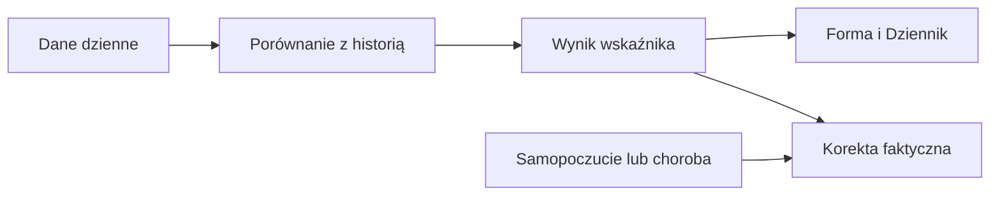

# Body Battery

## Co to jest

Body Battery to wskaźnik Garmina. W QBocie nie jest osobnym kaflem Formy. Jego dane są jednym ze składników korekty faktycznego zmęczenia.

## Po co

Jeśli korekta zmęczenia różni się od surowej, jednym z możliwych powodów jest relacja między dziennym zużyciem Body Battery i nocnym doładowaniem. Odczytuj ją razem z pozostałymi składnikami.

## Skąd dane

Wykorzystane są wartości doładowania w nocy i zużycia w dzień. Algorytm bierze dług akumulatora z trzech nocy.

## Jak liczone

1. Dla 18.10.2026 w bazie Formy zapisano krótkie obciążenie (ATL; [słowniczek](../slowniczek.md)) surowe 60,1 i faktyczne 74,5.
2. Od 12.10.2026 do 18.10.2026 zapisano dobowe doładowanie/zużycie: 60/48, 91/86, 78/82, 79/83, 62/67, 77/71 i 66/64 punktów.
3. Dla nocy 16.10.2026, 17.10.2026 i 18.10.2026 różnice zużycia poprzedniego dnia i nocnego doładowania wyniosły: 83−62=21, 67−77=−10 oraz 71−66=5. Razem to 16 punktów długu.
4. Typowe zużycie w zapisanej historii wynosiło 71 punktów. Po przeliczeniu dług wynosi 0,15 w skali używanej przez model; mieści się w limicie od −2 do +2.
5. Ten składnik jest tylko częścią stanu ciała, który współtworzy faktyczne krótkie obciążenie. Nie można z samego różnego ATL wywnioskować, ile zmieniła sama bateria.

Wzór

Przykład pełnych trzech nocy do 18.10.2026: (83−62) + (67−77) + (71−66) = 16. Typowe zużycie to 71, więc po normalizacji składnik wynosi 16 ÷ (3 × 71) × 2 = 0,15. Dodatnia wartość oznacza, że w tych nocach doładowanie nie nadrobiło całego wcześniejszego zużycia.

## Gdzie to widać

Na zrzucie Forma widać kafel świeżości faktycznej, ale nie kafel Body Battery. Karty Body Battery nie udało się potwierdzić w aktualnym widoku.

## Jak czytać

Nie utożsamiaj porannego poziomu baterii z jej zmianą przez ostatnie dni. Algorytm używa relacji doładowania i zużycia. Brak którejkolwiek pary dnia/nocy sprawia, że ta para nie wnosi wartości. Współczynnik typowego zużycia jest wyliczany z historycznych odczytów powyżej 20 punktów; w bieżącym haśle nie publikujemy jego mediany, bo jej osobno nie odczytano.

## Decyzje i historia

Bieżący opis opiera się na kodzie odczytanym 18.10.2026. Starszy opis układu nie zawsze odpowiada aktualnemu widokowi.

## Ograniczenia i pułapki

Wartość w punktach Body Battery nie jest obciążeniem jazdy. Nie można odjąć samej liczby doładowania od faktycznego zmęczenia: do wyniku wchodzą także pozostałe sygnały ciała. Dzienny odczyt może nie obejmować pełnej nocy, jeśli brakuje jednego z pomiarów. Brak wartości oznacza brak danych, nie zero.

## Wpływa na / Zależy od

Wpływ i wejścia: Wykorzystane są wartości doładowania w nocy i zużycia w dzień. Algorytm bierze dług akumulatora z trzech nocy. Szczegóły połączeń są w [mapie zależności](../zaleznosci.md).

## Powiązane hasła

- [Forma, zmęczenie i świeżość](ctl-atl-tsb.md)
- [Status dnia](status-dnia.md)

## Zrodla

- /opt/qbot/app/fitmodel/real_load.py — bb_debt_z, body_score, apply_real_load
- qbot_v2.wellness_daily — body_battery_charged i body_battery_drained
- qbot_v2.fitmodel_daily — obciążenie faktyczne
