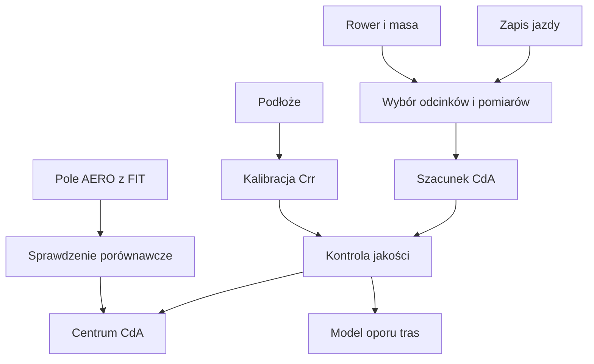

# Centrum CdA

## Co to jest

Centrum CdA szacuje, jak mocno powietrze i toczenie spowalniają rower. CdA (współczynnik oporu powietrza; [słowniczek](../slowniczek.md#cda)) opisuje łączny wpływ roweru i pozycji, a Crr (współczynnik oporu toczenia; [słowniczek](../slowniczek.md#crr)) opisuje toczenie opony po podłożu. To obliczenia z jazd, a nie bezpośredni pomiar w tunelu.

## Po co

Możesz porównywać powtarzalne jazdy na tym samym rowerze i sprawdzić, czy zmiana pozycji lub wyposażenia zbiega się ze zmianą szacowanego oporu. Pojedynczy wynik nie rozstrzyga, że jedna pozycja jest szybsza: wiatr, nawierzchnia, rower i jakość sygnału również mają znaczenie.

## Skąd dane

Obliczenie korzysta z próbek mocy, prędkości, nachylenia i wysokości z zapisu jazdy, masy oraz informacji o rowerze i mierniku. Wersja z 18.10.2026 dodaje kalibrację Crr po kategoriach nawierzchni, używając odcinków asfaltowych jako kotwicy. Zapis FIT (format zapisu aktywności; [słowniczek](../slowniczek.md#fit)) może też zawierać pole AERO, które jest porównywane z obliczeniem z jazdy.

## Jak liczone

Szczegółowe liczby dla konkretnej jazdy należy sprawdzić na ekranie Centrum CdA. Nie wpisuję tu przykładu liczbowego: dostępne materiały potwierdzają zmianę algorytmu i wejścia, ale nie dostarczają w tej sesji odczytu konkretnego wyniku z bazy.

1. Z jazdy pobierane są odcinki, dla których dostępne są potrzebne pomiary.
2. Moc potrzebna do toczenia jest oceniana według kategorii podłoża i aktualnego Crr.
3. Pozostała część mocy oraz prędkość służą do oszacowania CdA i wpływu wiatru.
4. Wyniki przechodzą kontrolę zakresu i jakości; odrzucony wynik nie powinien być traktowany jak pomiar.
5. Crr jest ponownie kalibrowany ze zbioru jazd; kod uruchamia tę kalibrację w cyklu tygodniowym.

Wzór

Uproszczony bilans mocy dzieli moc jazdy na składową toczenia i składową oporu powietrza. Wartości CdA i Crr są dobierane z danych w oknach jazdy. Szczegółowy wzór i warunki odrzucania zależą od wersji obliczeń opisanej w kodzie.

## Gdzie to widać

W kodzie strony Forma znajduje się zakładka Centrum CdA, a pomiary AERO mogą być dołączane z zapisu aktywności. W tej aktualizacji nie potwierdzono zrzutu otwartej zakładki ani aktualnych wartości na stronie.

> DO SPRAWDZENIA: zrzut ekranu zakładki Centrum CdA oraz przykład wartości CdA/Crr dla wskazanej jazdy.

## Jak czytać

Porównuj wyniki dla tego samego roweru, podobnych warunków i porównywalnych odcinków. Większe CdA oznacza większy szacowany opór powietrza. Crr zależy od kategorii podłoża i nie jest oceną samej opony. Jeżeli wynik ma status odrzucony albo mało danych, nie używaj go do wniosków o sprzęcie.

## Decyzje i historia

18.10.2026 dodano Centrum CdA, kalibrację Crr z jazd z kotwicą asfaltową, porównanie pola AERO z FIT, wspólny kanon CdA/Crr dla raportu jazdy oraz wykorzystanie tych danych w oporze fizycznym tras. Kalibracja uwzględnia współczynnik zmienności i jest wykonywana co tydzień. Szczegółowe uzasadnienie i zakres zmian są zapisane w decyzjach projektu.

## Ograniczenia i pułapki

- Wynik jest oszacowaniem z jazdy, a nie laboratoryjnym pomiarem.
- Porównanie jest wrażliwe na jakość mocy, prędkości, wysokości, masy i rozpoznania nawierzchni.
- Pole AERO z FIT jest dodatkowym źródłem do sprawdzenia; sama obecność pola nie potwierdza zgodności.
- Niepotwierdzonych progów kolorów i opisów statusów nie należy dopowiadać.

## Wpływa na / Zależy od

**Wpływa na:** fakty aerodynamiczne raportu jazdy i fizyczny model oporu tras.

**Zależy od:** próbek z jazdy, opisu roweru, masy oraz kalibracji podłoża.

## Powiązane hasła

- [Raport jazdy](../raport-jazdy/index.md)
- [Plik FIT](../raport-jazdy/plik-fit.md)
- [Analiza trasy](../trasy/analiza-trasy.md)
- [Forma](index.md)
- [Słowniczek](../slowniczek.md)

## Zrodla

- `/opt/qbot/app/fitmodel/cda.py` — obliczenia jazd, kalibracja Crr i podsumowanie.
- `/opt/qbot/app/fitmodel/qext2_aero.py` — sprawdzenie pola AERO.
- `/opt/qbot/app/fitmodel/fit_ingest.py` — odczyt pola z FIT.
- `/opt/qbot/app/qbot3/routes/route_xss_phys.py` — model oporu tras.
- `/opt/qbot/web/public/forma-cda.js` — zakładka Centrum CdA.
- `/opt/qbot/app/docs/DECISIONS.md` — decyzje z 18.10.2026.
