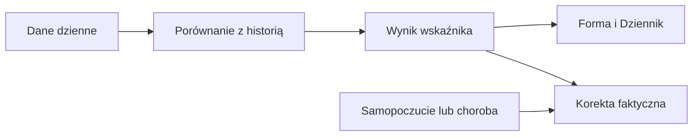

# Forma, zmęczenie i świeżość

## Co to jest

Długie obciążenie treningowe nazywa się CTL, a krótkie ATL; ich różnica to świeżość TSB ([wyjaśnienia w słowniczku](../slowniczek.md)). Te średnie pokazują, jak trening odkłada się w dłuższej i krótszej pamięci. W QBocie istnieje kilka wariantów tych liczb; ekran Dziennik pokazuje wariant faktycznego zmęczenia.

## Po co

Pomaga odróżnić dużą bazę treningową od zmęczenia ostatnimi dniami. Jeśli rano świeżość jest mocno ujemna, sprawdź też status dnia i samopoczucie; sama liczba nie nakazuje konkretnego treningu.

## Skąd dane

Jazdy dostarczają dziennych punktów obciążenia. Warianty surowy, skorygowany i faktyczny są publikowane osobno. Faktyczne zmęczenie uwzględnia gotowość, akumulator Body Battery, chorobę i samopoczucie.

## Jak liczone

1. Dnia 18.10.2026 długie obciążenie wynosiło 58,0, surowe krótkie 60,1, a faktyczne krótkie 74,5.
2. Wariant surowy dawał świeżość −2,1 (58,0 − 60,1); faktyczny dawał −16,5 (58,0 − 74,5). To różne wersje, mimo podobnej nazwy.
3. Od 12.10.2026 do 18.10.2026 faktyczne krótkie obciążenie kolejno wynosiło 71,8; 63,7; 63,8; 39,5; 49,5; 41,9; 74,5, a długie: 59,3; 57,9; 58,0; 56,7; 57,0; 55,6; 58,0. Wartości są odczytami dziennymi z bazy.
4. Faktyczne krótkie obciążenie uwzględnia gotowość obiektywną, dług Body Battery, odczucie i chorobę. Każdy sygnał jest ograniczony, by jeden pomiar nie zmienił nadmiernie wyniku.

Wzór

Świeżość faktyczna = długie obciążenie − faktyczne krótkie obciążenie. Faktyczne krótkie obciążenie = krótkie surowe + 0,5 × stan ciała × długie obciążenie. Stan ciała jest średnią dostępnych sygnałów gotowości i Body Battery, po ograniczeniu każdego z nich do zakresu −2…+2; choroba i odczucie dodają osobne korekty. Współczynnik 0,5 dobrano na znanych epizodach treningu z 2026 roku.

## Gdzie to widać

Forma → Dziennik pokazuje faktyczną świeżość i obciążenie treningowe. Trendy pozwalają włączyć serie obciążenia. Na dołączonym zrzucie Forma kafel „Świeżość (faktyczna) TSB” pokazuje −17; wykres poniżej zestawia obciążenia z 28 dni.

## Jak czytać

Ujemna świeżość mówi, że krótkie obciążenie przewyższa długie. Na przykład −16,5 z 18.10.2026 czytaj razem z werdyktem dnia: tego dnia było „w normie”. Werdykt łączy osobne sygnały i reguły. Wartości na zrzucie zaokrąglono do liczb całkowitych, więc rachunek z ekranu może różnić się o 0,1. Dla ModelQ używaj określenia próg mocy (TP); [wyjaśnienie progu](../modelq/tp.md).

## Decyzje i historia

Bieżący opis opiera się na kodzie odczytanym 18.10.2026. Starszy opis układu nie zawsze odpowiada aktualnemu widokowi.

## Ograniczenia i pułapki

Wskaźniki zależą od dostępności i kompletności pomiarów. Dni bez pomiaru nie są automatycznie zerem. Zrzut ekranu jest ilustracją układu i nie zastępuje aktualnych danych.

## Wpływa na / Zależy od

Wpływ i wejścia: Jazdy dostarczają dziennych punktów obciążenia. Warianty surowy, skorygowany i faktyczny są publikowane osobno. Faktyczne zmęczenie uwzględnia gotowość, akumulator Body Battery, chorobę i samopoczucie. Szczegóły połączeń są w [mapie zależności](../zaleznosci.md).

## Powiązane hasła

- [Status dnia](status-dnia.md)
- [Gotowość](gotowosc.md)
- [Body Battery](body-battery.md)
- [Trendy](trendy.md)
- [Wykresy](wykresy.md)

## Zrodla

- /opt/qbot/app/fitmodel/modelq2/training_load.py — wygładzanie 42 i 7 dni
- /opt/qbot/app/fitmodel/real_load.py — faktyczne zmęczenie
- /opt/qbot/web/public/forma2-data.js — kafle i serie
- qbot_v2.fitmodel_daily — dzienne wartości
