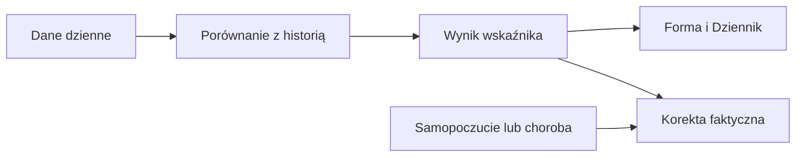

# Forma, zmęczenie i świeżość

## Co to jest

Trzy średnie obciążenia opisują, jak trening odkłada się w dłuższej i krótszej pamięci. Świeżość to ich różnica. W QBocie istnieje kilka wariantów tych liczb; ekran Dziennik pokazuje wariant faktycznego zmęczenia.

## Po co

Pomaga odróżnić dużą bazę treningową od zmęczenia ostatnimi dniami. Jeśli rano świeżość jest mocno ujemna, sprawdź też status dnia i samopoczucie; sama liczba nie nakazuje konkretnego treningu.

## Skąd dane

Jazdy dostarczają dziennych punktów obciążenia. Warianty surowy, skorygowany i faktyczny są publikowane osobno. Faktyczne zmęczenie uwzględnia gotowość, akumulator Body Battery, chorobę i samopoczucie.

## Jak liczone

1. Dla 18.10.2026 długie obciążenie wynosiło 58,0, surowe krótkie 60,1, skorygowane krótkie 74,6, a faktyczne 74,5.
2. Świeżość surowa wynosiła −2,0, skorygowana −16,5, a faktyczna −16,5.
3. Odejmując 74,5 od 58,0 otrzymujesz −16,5 po zaokrągleniu. Różne świeżości wynikają z różnych wersji krótkiego obciążenia.

Wzór

Szczegóły matematyczne są opisane w kodzie źródłowym wymienionym niżej. Wartości przykładowe powyżej są zaokrąglone do dokładności widocznej w danych.

## Gdzie to widać

Forma → Dziennik pokazuje faktyczną świeżość i obciążenie treningowe. Trendy pozwalają włączyć serie obciążenia. Na dołączonym zrzucie Forma kafel „Świeżość (faktyczna) TSB” pokazuje −17; wykres poniżej zestawia obciążenia z 28 dni.

## Jak czytać

Ujemna świeżość mówi, że krótkie obciążenie przewyższa długie. Na przykład −16,5 z 18.10.2026 czytaj razem z werdyktem dnia: tego dnia było „w normie”. To nie jest sprzeczność: werdykt łączy też inne sygnały. Nie przenoś progów z jednego wariantu na drugi.

## Decyzje i historia

Bieżący opis opiera się na kodzie odczytanym 18.10.2026. Starszy opis układu nie zawsze odpowiada aktualnemu widokowi.

## Ograniczenia i pułapki

Wskaźniki zależą od dostępności i kompletności pomiarów. Dni bez pomiaru nie są automatycznie zerem. Zrzut ekranu jest ilustracją układu i nie zastępuje aktualnych danych.

## Wpływa na / Zależy od

Wpływ i wejścia: Jazdy dostarczają dziennych punktów obciążenia. Warianty surowy, skorygowany i faktyczny są publikowane osobno. Faktyczne zmęczenie uwzględnia gotowość, akumulator Body Battery, chorobę i samopoczucie. Szczegóły połączeń są w [mapie zależności](../zaleznosci.md).

## Powiązane hasła

- [Status dnia](status-dnia.md)
- [Gotowość](gotowosc.md)
- [Body Battery](body-battery.md)
- [Trendy](trendy.md)
- [Wykresy](wykresy.md)

## Zrodla

- /opt/qbot/app/fitmodel/modelq2/training_load.py — wygładzanie 42 i 7 dni
- /opt/qbot/app/fitmodel/real_load.py — faktyczne zmęczenie
- /opt/qbot/web/public/forma2-data.js — kafle i serie
- qbot_v2.fitmodel_daily — dzienne wartości
