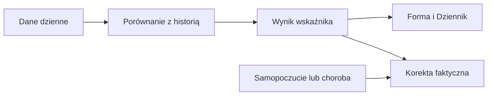
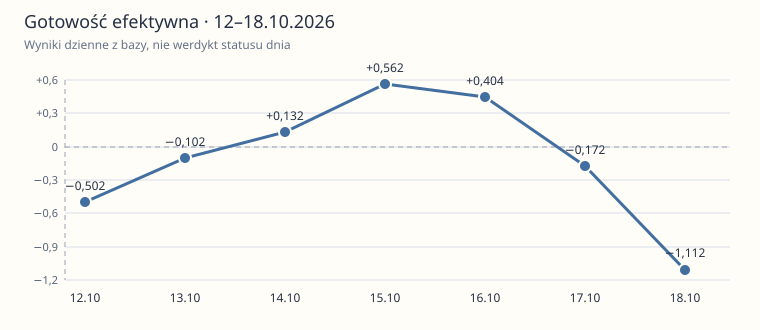

# Gotowość

## Co to jest

Gotowość porównuje HRV (zmienność odstępów między uderzeniami serca), puls spoczynkowy i długość snu z własną historią. Każdy z tych terminów ma osobne hasło: [HRV](hrv.md), [norma pulsu](norma-tetna.md), [sen](sen.md).

## Po co

Jeśli gotowość jest niska, sprawdź trzy składowe i status dnia. Pojedynczy słaby wynik nie przesądza o treningu; status dnia wygładza gotowość z trzech dni.

## Skąd dane

Dane nocne z Garmina; osobiste odniesienie obejmuje do 60 wcześniejszych dni. Wystarczy co najmniej 20 pomiarów dla sygnału.

## Jak liczone

1. 18.10.2026 baza zawiera HRV (zmienność rytmu serca; [wyjaśnienie](hrv.md)) 67 ms, puls 49 uderzeń/min i 344 min snu, czyli 5,73 h.
2. Każdy sygnał z ostatnich 3 dni porównuje się z osobistą średnią i odchyleniem z maksymalnie 60 wcześniejszych dni. Potrzeba co najmniej 20 wcześniejszych pomiarów.
3. W porównaniu z osobistą bazą składniki wyniosły: HRV −0,90, puls −0,57, sen −1,61. Są to odchylenia od własnej normy.
4. Rachunek: 40% × −0,90 + 35% × −0,57 + 25% × −1,61 = −0,962. Tyle wyniosła gotowość obiektywna. Wpis odczucia obniżył wersję efektywną o 0,15, do −1,112.
5. Wagi to 40% dla HRV, 35% dla pulsu i 25% dla snu. Jeśli sygnału brakuje, pozostałe wagi są proporcjonalnie przeliczane. Etykieta „zmęczony” zaczyna się przy −0,4.

Wzór

Najpierw każdy sygnał z ostatnich 3 dni porównuje się z własną średnią i odchyleniem ze 60 wcześniejszych dni. Puls ma odwrócony kierunek: wyższy niż zwykle oznacza gorszy wkład. Dnia 18.10.2026 obliczone składniki to −0,90, −0,57 i −1,61; średnia ważona daje wynik −0,962 zapisany w bazie.

## Gdzie to widać

Zrzut Formy pokazuje panel „Gotowość” po lewej stronie środkowego rzędu. Wartość na tarczy Dashboardu to −1,1; sam panel Formy pokazuje −1,4. Te liczby mogą opisywać bieżącą gotowość „teraz”, a nie zapis historyczny. W bazie 18.10.2026 zapisano wynik −0,962.

## Jak czytać

Wartość dodatnia oznacza lepszy wynik względem własnej bazy, ujemna gorszy. Od +0,4 kod nadaje etykietę „świeży”, do −0,4 „zmęczony”, a między nimi „neutralny”. Dnia 18.10.2026 gotowość była ujemna, lecz status dnia „w normie”: werdykt łączy wygładzenie z trzech dni i inne sygnały. To wskaźnik porównawczy, nie badanie medyczne.

Nie utożsamiaj wyniku obiektywnego, wyniku po wpisie samopoczucia i średniej z 3 dni. Nie odtwarzaj ich z zaokrąglonych cyfr na ekranie: podstawa używa historii oraz dokładniejszych wartości.

Wartość dodatnia oznacza lepszy wynik względem własnej bazy, ujemna gorszy. Od +0,4 kod nadaje etykietę „świeży”, do −0,4 „zmęczony”, a między nimi „neutralny”. To wskaźnik porównawczy, nie badanie medyczne.

## Decyzje i historia

Bieżący opis opiera się na kodzie odczytanym 18.10.2026. Starszy opis układu nie zawsze odpowiada aktualnemu widokowi.

## Ograniczenia i pułapki

Wskaźniki zależą od dostępności i kompletności pomiarów. Dni bez pomiaru nie są automatycznie zerem. Zrzut ekranu jest ilustracją układu i nie zastępuje aktualnych danych.

## Wpływa na / Zależy od

Wpływ i wejścia: Dane nocne z Garmina; osobiste odniesienie obejmuje do 60 wcześniejszych dni. Wystarczy co najmniej 20 pomiarów dla sygnału. Szczegóły połączeń są w [mapie zależności](../zaleznosci.md).

## Powiązane hasła

- [HRV — zmienność rytmu serca](hrv.md)
- [Sen](sen.md)
- [Norma tętna spoczynkowego](norma-tetna.md)
- [Status dnia](status-dnia.md)

## Zrodla

- /opt/qbot/app/fitmodel/readiness.py — compute_readiness i wagi
- /opt/qbot/app/fitmodel/day_status.py — wygładzenie
- /opt/qbot/app/fitmodel/real_load.py — użycie gotowości obiektywnej
- /opt/qbot/web/public/forma2-data.js — prezentacja
