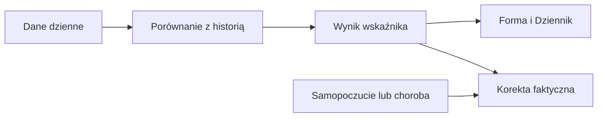

# Gotowość

## Co to jest

Gotowość porównuje HRV (zmienność odstępów między uderzeniami serca), puls spoczynkowy i długość snu z własną historią. Każdy z tych terminów ma osobne hasło: [HRV](hrv.md), [norma pulsu](norma-tetna.md), [sen](sen.md).

## Po co

Jeśli gotowość jest niska, sprawdź trzy składowe i status dnia. Pojedynczy słaby wynik nie przesądza o treningu; status dnia wygładza gotowość z trzech dni.

## Skąd dane

Dane nocne z Garmina; osobiste odniesienie obejmuje do 60 wcześniejszych dni. Wystarczy co najmniej 20 pomiarów dla sygnału.

## Jak liczone

1. 18.10.2026 zapisano HRV 67 ms, puls spoczynkowy 49 uderzeń/min i sen 5,73 h.
2. Gotowość obiektywna wyniosła −0,962, a po uwzględnieniu wpisów subiektywnych −1,112.
3. Składniki mają wagi: HRV 40%, puls 35%, sen 25%; brakujący sygnał pomija się i przelicza pozostałe wagi. Etykieta zmęczony zaczyna się przy wyniku ≤ −0,4.

Wzór

Szczegóły matematyczne są opisane w kodzie źródłowym wymienionym niżej. Wartości przykładowe powyżej są zaokrąglone do dokładności widocznej w danych.

## Gdzie to widać

Gotowość zasila Dziennik i obliczenia zmęczenia faktycznego. Zrzut dashboard pokazuje w tarczy wartość gotowości −1,1 oraz świeżość −17. Forma nie pokazuje osobnego kafla gotowości w każdym widoku.

## Jak czytać

Wartość dodatnia oznacza lepszy wynik względem własnej bazy, ujemna gorszy. Od +0,4 kod nadaje etykietę „świeży”, do −0,4 „zmęczony”, a między nimi „neutralny”. To wskaźnik porównawczy, nie badanie medyczne.

## Decyzje i historia

Bieżący opis opiera się na kodzie odczytanym 18.10.2026. Starszy opis układu nie zawsze odpowiada aktualnemu widokowi.

## Ograniczenia i pułapki

Wskaźniki zależą od dostępności i kompletności pomiarów. Dni bez pomiaru nie są automatycznie zerem. Zrzut ekranu jest ilustracją układu i nie zastępuje aktualnych danych.

## Wpływa na / Zależy od

Wpływ i wejścia: Dane nocne z Garmina; osobiste odniesienie obejmuje do 60 wcześniejszych dni. Wystarczy co najmniej 20 pomiarów dla sygnału. Szczegóły połączeń są w [mapie zależności](../zaleznosci.md).

## Powiązane hasła

- [HRV — zmienność rytmu serca](hrv.md)
- [Sen](sen.md)
- [Norma tętna spoczynkowego](norma-tetna.md)
- [Status dnia](status-dnia.md)

## Zrodla

- /opt/qbot/app/fitmodel/readiness.py — compute_readiness i wagi
- /opt/qbot/app/fitmodel/day_status.py — wygładzenie
- /opt/qbot/app/fitmodel/real_load.py — użycie gotowości obiektywnej
- /opt/qbot/web/public/forma2-data.js — prezentacja
