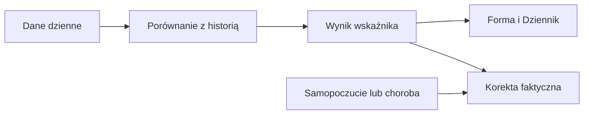

# HRV — zmienność rytmu serca

## Co to jest

HRV opisuje różnice odstępów między uderzeniami serca. Forma pokazuje je jako serię, a osobny status porównuje ostatnie noce z osobistą normą.

## Po co

Jeśli status jest „poniżej normy” lub „nisko”, potraktuj to jako sygnał do obserwacji i zestaw z samopoczuciem. Status HRV i gotowość to dwa różne obliczenia.

## Skąd dane

Dane HRV z nocy. Status własny używa 7 ostatnich nocy i 60 wcześniejszych nocy; do normy potrzeba co najmniej 30.

## Jak liczone

1. 18.10.2026 dzienny pomiar HRV wynosił 67 ms.
2. Gotowość używa mediany z 3 dni i 60-dniowej bazy, z udziałem HRV 40%.
3. Osobny status HRV liczy średnią z 7 nocy i porównuje logarytmy HRV z normą oraz odchyleniem standardowym; progi to 0,5 i 1,0 odchylenia.

Wzór

Szczegóły matematyczne są opisane w kodzie źródłowym wymienionym niżej. Wartości przykładowe powyżej są zaokrąglone do dokładności widocznej w danych.

## Gdzie to widać

Forma → Trendy pokazuje serię HRV. Status własny jest w Zdrowie → Serce; Forma nie pokazuje osobnego kafla statusu.

## Jak czytać

„Nisko” oznacza średnią 7 nocy poniżej normy o ponad 1 odchylenie. „Poniżej normy” to zakres od 0,5 do 1 odchylenia poniżej. „Powyżej” jest informacyjne, nie alarmowe.

## Decyzje i historia

Bieżący opis opiera się na kodzie odczytanym 18.10.2026. Starszy opis układu nie zawsze odpowiada aktualnemu widokowi.

## Ograniczenia i pułapki

Wskaźniki zależą od dostępności i kompletności pomiarów. Dni bez pomiaru nie są automatycznie zerem. Zrzut ekranu jest ilustracją układu i nie zastępuje aktualnych danych.

## Wpływa na / Zależy od

Wpływ i wejścia: Dane HRV z nocy. Status własny używa 7 ostatnich nocy i 60 wcześniejszych nocy; do normy potrzeba co najmniej 30. Szczegóły połączeń są w [mapie zależności](../zaleznosci.md).

## Powiązane hasła

- [Gotowość](gotowosc.md)
- [Sen](sen.md)

## Zrodla

- /opt/qbot/app/fitmodel/hrv_status.py — compute_series i progi
- /opt/qbot/app/fitmodel/readiness.py — użycie HRV
- /opt/qbot/web/public/forma2-data.js — seria HRV
- /opt/qbot/app/qbot_web.py — dane Formy
