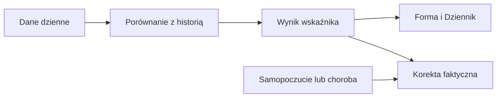

# HRV — zmienność rytmu serca

## Co to jest

HRV (zmienność rytmu serca; [słowniczek](../slowniczek.md)) opisuje różnice odstępów między uderzeniami serca. Forma pokazuje je jako serię, a osobny status porównuje ostatnie noce z osobistą normą.

## Po co

Jeśli status jest „poniżej normy” lub „nisko”, potraktuj to jako sygnał do obserwacji i zestaw z samopoczuciem. Status HRV i gotowość to dwa różne obliczenia.

## Skąd dane

Dane HRV z nocy. Status własny używa 7 ostatnich nocy i 60 wcześniejszych nocy; do normy potrzeba co najmniej 30.

## Jak liczone

1. 18.10.2026 nocny pomiar HRV wynosił 67 ms.
2. Gotowość porównuje medianę z dostępnych 3 dni z własną bazą do 60 poprzednich dni; HRV ma w niej wagę 40%.
3. Oddzielny status zestawia średnią geometryczną z 7 nocy z bazą do 60 wcześniejszych nocy. Do statusu potrzeba 30 nocy bazy.
4. Przykładowe dobowe pomiary od 12.10.2026 do 18.10.2026 wynosiły kolejno 68, 81, 93, 84, 73, 77 i 67 ms.
5. Dnia 18.10.2026 średnia 7 nocy wynosiła 77,1 ms, osobista norma 78,6 ms, a pasmo normy 75,4–81,9 ms. Status wyszedł „w normie”.

Wzór

Status pracuje na logarytmach pomiarów. W przykładzie z 18.10 średnia 7 nocy 77,1 ms leży między dolną i górną granicą 75,4–81,9 ms, więc status to „w normie”. „Poniżej normy” oznacza spadek ponad 0,5 odchylenia; „nisko” — ponad 1 odchylenie. Pełna norma pochodzi z 60 wcześniejszych nocy z danymi.

## Gdzie to widać

Forma → Trendy pokazuje serię HRV. Status własny jest w Zdrowie → Serce; Forma nie pokazuje osobnego kafla statusu.

## Jak czytać

„Nisko” oznacza średnią 7 nocy poniżej normy o ponad 1 odchylenie. „Poniżej normy” to zakres od 0,5 do 1 odchylenia poniżej. „Powyżej” (ponad 0,5 odchylenia) jest informacyjne, nie alarmowe. Nie myl tego statusu z wkładem HRV do gotowości: okna i zastosowania są różne.

Jeśli odczyt pojedynczej nocy spada, a status tygodnia nadal jest w normie, nie ma tu sprzeczności: status uśrednia kilka nocy. Jeśli status jest „nisko”, porównaj go z samopoczuciem, snem i pulsem. Pojedyncza wartość 67 ms z 18.10.2026 sama nie wystarcza do rozpoznania stanu ani do wniosku o przyczynie.

## Decyzje i historia

Bieżący opis opiera się na kodzie odczytanym 18.10.2026. Starszy opis układu nie zawsze odpowiada aktualnemu widokowi.

## Ograniczenia i pułapki

HRV reaguje na wiele czynników. Opisane progi są porównaniem do własnej historii, a nie uniwersalną granicą zdrowia. Status może być pusty, gdy w bazie jest mniej niż 30 wcześniejszych nocy. Wartości statusu w widoku Serce nie są tą samą rzeczą co gotowość. Brak pomiaru oznacza brak punktu, nie zero.

## Wpływa na / Zależy od

Wpływ i wejścia: Dane HRV z nocy. Status własny używa 7 ostatnich nocy i 60 wcześniejszych nocy; do normy potrzeba co najmniej 30. Szczegóły połączeń są w [mapie zależności](../zaleznosci.md).

## Powiązane hasła

- [Gotowość](gotowosc.md)
- [Sen](sen.md)

## Zrodla

- /opt/qbot/app/fitmodel/hrv_status.py — compute_series i progi
- /opt/qbot/app/fitmodel/readiness.py — użycie HRV
- /opt/qbot/web/public/forma2-data.js — seria HRV
- /opt/qbot/app/qbot_web.py — dane Formy
