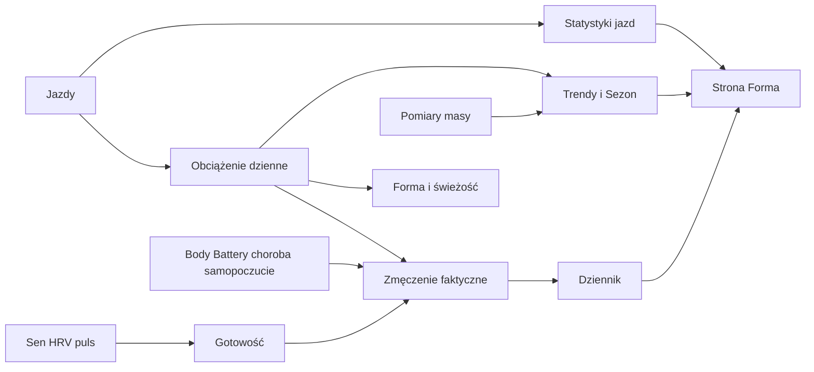
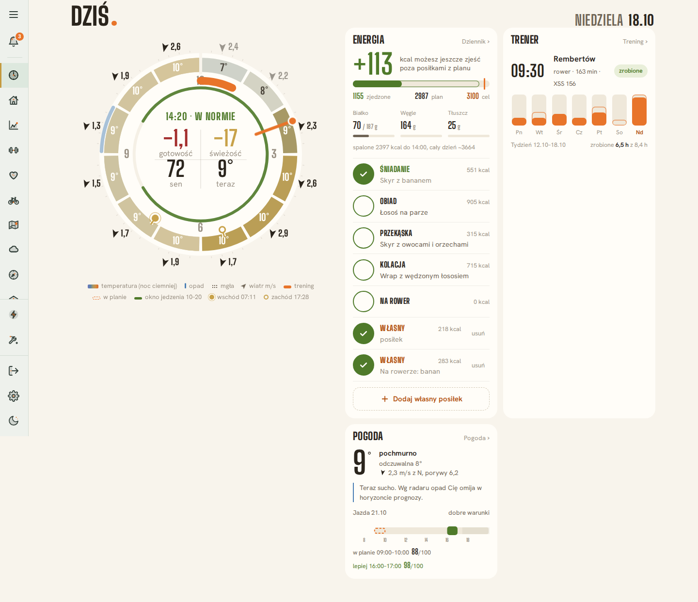

# Forma i Wellness

## Co to jest

Forma to strona, która zestawia treningi z wybranymi sygnałami organizmu i historią jazd. Zakładki to Dziennik, Trendy, Sezon i Statystyki. Dziennik odpowiada na pytanie „co widać dziś?”, Trendy pokazują przebieg serii, Sezon łączy tygodnie i kontekst sezonu, a Statystyki sumują jazdy.

## Po co

Użyj Dziennika do szybkiego odczytu dnia, Trendów do porównania zmian, a Statystyk do podsumowania przejechanych kilometrów i czasu. Jeżeli widzisz słabą gotowość albo ujemną świeżość, sprawdź wyjaśnienie i status dnia razem. Te wskaźniki pomagają w obserwacji treningu; nie rozpoznają chorób.

## Jak działa dział

## Co widzisz na ekranie

| Element ekranu | Hasło |
|---|---|
| Status „w normie”, „uwaga”, „zmęczony” lub „przeciążenie” | [Status dnia](status-dnia.md) |
| Wskaźnik gotowości i jego składowe | [Gotowość](gotowosc.md) |
| Świeżość (faktyczna) i obciążenie | [Forma, zmęczenie i świeżość](ctl-atl-tsb.md) |
| Moc progu i moc na kilogram | [Słowniczek](../modelq/tp.md) oraz [mapa zależności](../zaleznosci.md) |
| Waga | [Masa ciała](waga.md) |
| Wykres obciążenia i formy | [Wykresy](wykresy.md) |
| Dystans, jazdy i czas w okresie | [Statystyki jazd](statystyki.md) |
| Sen i HRV na wykresach | [Sen](sen.md), [HRV](hrv.md) |
| Zakładki Trendy i Sezon | [Trendy](trendy.md), kod sekcji Sezon wymieniony w źródłach niżej |

## Gdzie to widać

Główna strona to `/forma.html`. Na zrzucie poniżej górne panele pokazują status dnia i podsumowanie jazd; środkowy rząd zawiera gotowość, świeżość, próg, moc na kilogram, wagę i jedzenie. Wykres obciążenia jest niżej, a statystyki tygodnia, miesiąca i roku na dole.

Drugi zrzut pokazuje dashboard Dziś. Tarcza po lewej powtarza gotowość i świeżość, a karty po prawej pochodzą z innych działów. Nie jest to strona Forma.

## Jak czytać

Zacznij od werdyktu i jego powodów. Następnie sprawdź, czy świeżość i gotowość opisują podobny obraz. Przykładowo 18.10.2026 baza zapisała gotowość −0,962, gotowość po korekcie −1,112, świeżość faktyczną −16,5 i status „w normie”. Status dnia nie jest prostym przepisaniem gotowości.

Skróty CTL (długie obciążenie), ATL (krótkie obciążenie), TSB (różnica obciążeń), HRV (zmienność rytmu serca) i TP (próg mocy) wyjaśniają hasła [słowniczka](../slowniczek.md). Nie porównuj wartości z różnymi nazwami wariantu, jakby były tym samym pomiarem.

## Ograniczenia

Widok opisano na podstawie kodu strony i API. Interakcji każdego przycisku nie potwierdzono w zalogowanej przeglądarce. Szczegóły i otwarte punkty zapisano w [`_DO_SPRAWDZENIA.md`](../_DO_SPRAWDZENIA.md). Masa dzienna może powtarzać ostatni pomiar. Brak punktu na wykresie nie oznacza wartości zero.

## Wpływa na / Zależy od

Forma zbiera wyniki jazd, danych wellness, kalendarza i pomiarów masy. Wybrane wyniki są używane przez Trenera. Pełne strzałki i rozdzielenie wariantów są w [mapie zależności](../zaleznosci.md).

## Powiązane hasła
- [Body Battery](body-battery.md)
- [Norma tętna](norma-tetna.md)

- [ModelQ](../modelq/index.md)
- [Trener](../trener/index.md)
- [Mapa zależności](../zaleznosci.md)
- [Słowniczek](../slowniczek.md)

## Zrodla

- `/opt/qbot/web/public/forma.html` — zakładki i struktura widoku.
- `/opt/qbot/web/public/forma2-data.js` — Dziennik, Trendy i renderowanie danych.
- `/opt/qbot/web/public/forma-stats.js` — statystyki jazd.
- `/opt/qbot/app/qbot_web.py` — `_build_forma_data`, `/api/forma/data`, `/api/stats/rides`.
- `/opt/qbot/app/fitmodel/day_status.py` — status dnia.
- `/opt/qbot/app/fitmodel/real_load.py` — faktyczne zmęczenie.
