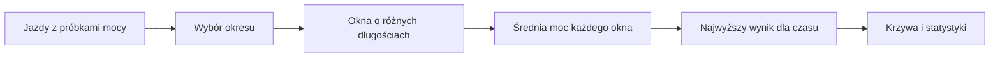

# Krzywa mocy

## Co to jest

Krzywa mocy pokazuje najwyższą średnią moc zarejestrowaną dla różnych długości wysiłku. W przeciwieństwie do pojedynczego wyniku jazdy pozwala zobaczyć, jak zmienia się najlepszy zapis od kilku sekund do wielu godzin.

## Po co

Użyj jej, aby porównać krótkie zrywy z dłuższym wysiłkiem albo zobaczyć, czy w wybranym okresie pojawił się nowy najlepszy wynik. Krzywa opisuje zapisane dane; sama nie ustala progu ani planu treningowego.

## Skąd dane

Obliczenie bierze próbki mocy w rozdzielczości 1 Hz (jedna próbka na sekundę) z jazd zapisanych w bazie. W kodzie określone są czasy od 1 sekundy do 8 godzin. Widok pozwala zestawiać pięć serii na jednym wykresie. Statystyki zawierają też osobną wartość maksymalnej średniej mocy z 20 minut.

## Jak liczone

1. Wybierany jest okres i zestaw jazd.
2. Dla każdej jazdy odczytywany jest szereg mocy z sekundowymi próbkami.
3. Dla każdego badanego czasu przesuwa się okno po szeregu i oblicza średnią moc w oknie.
4. Największa średnia z okien staje się wynikiem tej jazdy dla danego czasu.
5. Widok zestawia wyniki jako serie. Statystyka 20 minut jest liczona z tych samych sekundowych danych.

W tej sesji nie wykonano odczytu przykładowego rekordu krzywej z bazy, więc nie podaję przykładowych watów ani daty jazdy.

Wzór

Dla wybranego czasu długości N sekund: policz średnią z każdej kolejnej grupy N próbek mocy, a następnie wybierz najwyższą średnią. Dla 20 minut N wynosi 1200 sekund.

## Gdzie to widać

Forma → Krzywa mocy. W tej sesji potwierdzono istnienie zakładki i jej kod, ale nie sprawdzono zalogowanego ekranu. Zrzut głównej Formy nie pokazuje zawartości tej zakładki.

> DO SPRAWDZENIA: zrzut otwartej zakładki Krzywa mocy i konkretny przykład wyniku z datą.

## Jak czytać

Każdy punkt oznacza najlepszą średnią moc dla czasu opisanego na osi. Krótki wysiłek może mieć wysoką moc, a długi — niższą. Porównuj te same czasy i podobne zakresy dat. Brak jazdy w okresie oznacza brak podstaw do porównania, a nie wynik równy zero.

## Decyzje i historia

18.10.2026 dodano krzywą mocy w zakładce Forma. Statystyki rozszerzono do pięciu serii na jednym wykresie, a maksymalną moc z 20 minut oparto o próbki 1 Hz.

## Ograniczenia i pułapki

- Wynik zależy od tego, które jazdy i próbki zostały zapisane.
- Nie wszystkie czasy muszą być dostępne w każdym widoku.
- Porównanie różnych zakresów dat może zmieniać najlepszy wynik, nawet gdy forma się nie zmieniła.
- Sama krzywa nie pokazuje, czy moc była utrzymywana w planowanym treningu.

## Wpływa na / Zależy od

**Wpływa na:** podgląd najlepszych wyników mocy w Formie.

**Zależy od:** zapisanych sekundowych próbek mocy i wybranego zakresu jazd.

## Powiązane hasła

- [Forma](index.md)
- [Statystyki jazd](statystyki.md)
- [Wykresy Formy](wykresy.md)
- [Plik FIT](../raport-jazdy/plik-fit.md)
- [TP — próg mocy](../modelq/tp.md)

## Zrodla

- `/opt/qbot/app/qbot_power_curve.py` — czasy okien i obliczenie krzywej.
- `/opt/qbot/web/public/forma-curve.js` — wykres Krzywej mocy.
- `/opt/qbot/web/public/forma-stats.js` — zestawienie pięciu serii i Max.W20min.
- `qbot_v2.activity_record` — próbki 1 Hz.
