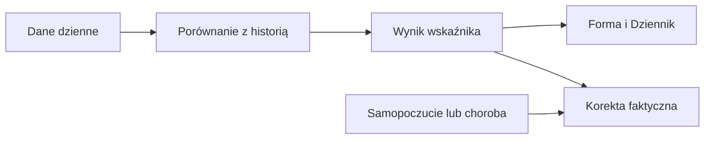

# Norma tętna spoczynkowego

## Co to jest

To osobiste odniesienie dla pulsu spoczynkowego. Status dnia porównuje z nim średnią z ostatniego tygodnia; osobna notatka wykrywa dłużej utrzymujący się trend.

## Po co

Jeśli średnia tygodniowa przekracza normę, status może oznaczyć organizm jako zmęczony. Sprawdź pomiary i inne sygnały; sama różnica nie rozpoznaje przyczyny.

## Skąd dane

Puls spoczynkowy z dziennych danych wellness.

## Jak liczone

1. 18.10.2026 puls dnia wynosił 49 uderzeń/min.
2. Sygnał statusu używa średniej z dostępnych 7 dni (minimum 3).
3. Norma ruchoma to średnia z dni 8–67 przed ocenianym dniem, powiększona o 1 uderzenie/min; potrzeba 30 pomiarów.

Wzór

Szczegóły matematyczne są opisane w kodzie źródłowym wymienionym niżej. Wartości przykładowe powyżej są zaokrąglone do dokładności widocznej w danych.

## Gdzie to widać

Forma → Dziennik i Trendy. Zrzut Forma zawiera w panelu gotowości opis „HRV 67 · tętno spocz. 49”.

## Jak czytać

Norma ruchoma nie jest tym samym co dzienny pomiar. Gdy brakuje 30 pomiarów, kod próbuje użyć marcowej bazy (minimum 10 pomiarów). Notatka trendowa ma inną regułę i nie jest werdyktem dnia.

## Decyzje i historia

Bieżący opis opiera się na kodzie odczytanym 18.10.2026. Starszy opis układu nie zawsze odpowiada aktualnemu widokowi.

## Ograniczenia i pułapki

Wskaźniki zależą od dostępności i kompletności pomiarów. Dni bez pomiaru nie są automatycznie zerem. Zrzut ekranu jest ilustracją układu i nie zastępuje aktualnych danych.

## Wpływa na / Zależy od

Wpływ i wejścia: Puls spoczynkowy z dziennych danych wellness. Szczegóły połączeń są w [mapie zależności](../zaleznosci.md).

## Powiązane hasła

- [Status dnia](status-dnia.md)
- [Gotowość](gotowosc.md)

## Zrodla

- /opt/qbot/app/fitmodel/day_status.py — rhr_norm, RHR_MARGIN, TREND_DAYS
- /opt/qbot/app/fitmodel/readiness.py — odczyt pulsu
- qbot_v2.fitmodel_daily — dzienny puls
