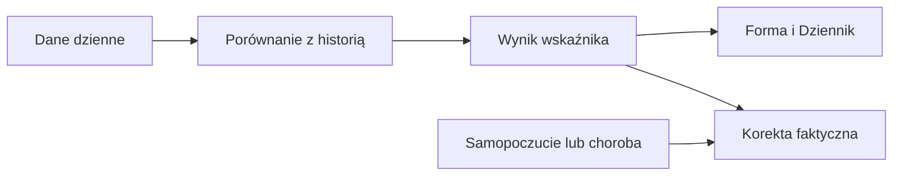
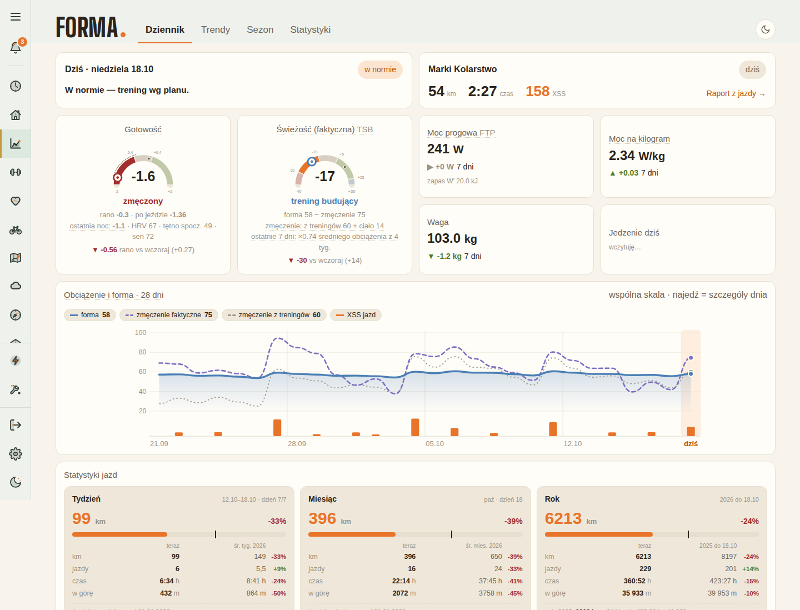

# Norma tętna spoczynkowego

## Co to jest

To osobiste odniesienie dla pulsu spoczynkowego. Status dnia porównuje z nim średnią z ostatniego tygodnia; osobna notatka wykrywa dłużej utrzymujący się trend.

## Po co

Jeśli średnia tygodniowa przekracza normę, status może oznaczyć organizm jako zmęczony. Sprawdź pomiary i inne sygnały; sama różnica nie rozpoznaje przyczyny.

## Skąd dane

Puls spoczynkowy z dziennych danych wellness.

## Jak liczone

1. 18.10.2026 dzienny puls spoczynkowy wynosił 49 uderzeń/min.
2. Status dnia uśrednia dostępne odczyty z 7 dni, jeśli są co najmniej 3.
3. Norma korzysta z 60 dni od 12.08.2026 do 10.10.2026, czyli dni od 67 do 8 przed oceną. Ostatni tydzień jest pominięty. Potrzeba 30 odczytów, a do średniej dodaje się 1 uderzenie/min.
4. Osobna notatka trendu używa marcowego odniesienia i wymaga 14 nieprzerwanych dni podwyższonej średniej. Nie jest to próg statusu dnia.

Wzór

Przykład kroku dla 18.10.2026: norma = średnia z pomiarów 12.08.2026–10.10.2026 + 1 uderzenie/min. Status porównuje ją ze średnim pulsem z dostępnych siedmiu dni. Nie podaję niezweryfikowanej średniej z 60 dni.

## Gdzie to widać

Forma → Dziennik i Trendy. Zrzut Forma zawiera w panelu gotowości opis „HRV 67 · tętno spocz. 49”.

## Jak czytać

Norma ruchoma nie jest tym samym co dzienny pomiar. Gdy brakuje 30 pomiarów w ruchomym oknie, kod próbuje użyć marcowej bazy (minimum 10 pomiarów). Decyzja z 15.10.2026 zmieniła normę z samego marca na okno ruchome, bo po infekcji stary próg przedłużał status „zmęczony”. Notatka trendowa nadal osobno odnosi się do marca.

Jeżeli poranny pomiar jest pojedynczo wyższy, sprawdź średnią tygodniową: sam pomiar dnia nie przesądza o sygnale statusu. Jeżeli w Dzienniku pojawia się notatka o utrzymującym się trendzie, oznacza to osobną regułę 14 dni, nie natychmiastową zmianę werdyktu. Dnia 18.10.2026 zanotowano 49 uderzeń/min; samo to nie ujawnia ani średniej siedmiodniowej, ani progu ruchomego.

## Decyzje i historia

Bieżący opis opiera się na kodzie odczytanym 18.10.2026. Starszy opis układu nie zawsze odpowiada aktualnemu widokowi.

## Ograniczenia i pułapki

W pierwszych tygodniach historii może zabraknąć 30 punktów w oknie ruchomym. Wtedy możliwy jest zapasowy próg z marca, jeśli są co najmniej 10 pomiarów. Brak obu baz oznacza, że porównania normy nie ma. Notatka trendowa wymaga ciągłości; przerwa kasuje licznik kolejnych dni. Brak pomiaru nie oznacza pulsu równego zero.

## Wpływa na / Zależy od

Wpływ i wejścia: Puls spoczynkowy z dziennych danych wellness. Szczegóły połączeń są w [mapie zależności](../zaleznosci.md).

## Powiązane hasła

- [Status dnia](status-dnia.md)
- [Gotowość](gotowosc.md)

## Zrodla

- /opt/qbot/app/fitmodel/day_status.py — rhr_norm, RHR_MARGIN, TREND_DAYS
- /opt/qbot/app/fitmodel/readiness.py — odczyt pulsu
- qbot_v2.fitmodel_daily — dzienny puls
