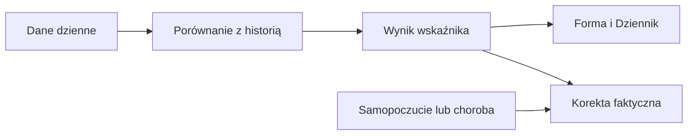

# Sen

## Co to jest

W Formie sen ma dwie odrębne miary: długość w godzinach i punktację. Długość wpływa na gotowość; punktacja jest osobną serią.

## Po co

Jeśli punktacja wygląda dobrze, ale spałeś krótko, nie traktuj tych wartości jako zamienników. Porównaj obie z własnym samopoczuciem i resztą sygnałów.

Sen jest jednym z trzech wejść gotowości, obok HRV i tętna spoczynkowego. Długość nocy pokazuje czas odpoczynku, a punktacja jest oceną urządzenia. Ich rozdzielenie pozwala odpowiedzieć na dwa różne pytania: ile trwał sen i jak urządzenie go oceniło.

## Skąd dane

Długość snu oraz punktacja z dziennych danych wellness. Gdy dla dnia istnieje kilka punktacji, widok wybiera najwyższą.

## Jak liczone

1. 18.10.2026 zapisano 344 min snu. 344 ÷ 60 = 5,73 h.
2. Dla gotowości liczy się długość snu, nie punktacja: ostatnie do 3 dni porównuje się z maksymalnie 60 wcześniejszymi dniami, a składnik snu ma wagę 25%.
3. Tego dnia punktacja snu wynosiła 72. Jest to osobna miara; nie zastępuje 5,73 h w obliczeniu gotowości.

Wzór

Przeliczenie długości: 344 min ÷ 60 min/h = 5,733... h, wyświetlane jako 5,73 h. Widok wybiera najwyższą dostępną punktację snu spośród wpisów danego dnia.

## Gdzie to widać

Forma → Trendy pokazuje punktację snu. Długość jest wejściem gotowości i może pojawić się w szczegółach Dziennika.

## Jak czytać

Brak pomiaru to brak punktu, nie zero. Dzienna punktacja wybiera najwyższy wynik, więc może różnić się od pojedynczego rekordu urządzenia. Długość snu i jego punktacja opisują inne cechy nocy; dobra punktacja nie oznacza długiego snu.

Jeśli chcesz zrozumieć gotowość po krótkiej nocy, sprawdź długość, a potem jej porównanie z własną historią. Punktacja 72 z 18.10.2026 opisuje jakość według skali urządzenia, ale sama nie podnosi ani nie obniża gotowości. Wartość 5,73 h jest wprowadzana jako minuty, a dopiero później przeliczana na godziny.

Najpierw sprawdź datę przy wartości. Jeśli dzień nie ma zapisu, wykres zostawia lukę; nie przenosi w to miejsce punktacji z poprzedniej nocy.

## Decyzje i historia

Bieżący opis opiera się na kodzie odczytanym 18.10.2026. Starszy opis układu nie zawsze odpowiada aktualnemu widokowi.

## Ograniczenia i pułapki

Punktacja snu nie jest zamiennikiem liczby godzin i nie jest bezpośrednim wejściem gotowości. Zestaw źródeł może różnić się pomiędzy dobami. Puste miejsce na wykresie oznacza brak wartości w danych, a nie noc bez snu. Jedna słaba noc nie wyznacza sama statusu tygodniowego.

## Wpływa na / Zależy od

Wpływ i wejścia: Długość snu oraz punktacja z dziennych danych wellness. Gdy dla dnia istnieje kilka punktacji, widok wybiera najwyższą. Szczegóły połączeń są w [mapie zależności](../zaleznosci.md).

## Powiązane hasła

- [Gotowość](gotowosc.md)
- [HRV — zmienność rytmu serca](hrv.md)

## Zrodla

- /opt/qbot/app/fitmodel/readiness.py — długość snu i gotowość
- /opt/qbot/app/qbot_web.py — wybór punktacji
- /opt/qbot/web/public/forma2-data.js — seria snu
- qbot_v2.qbot_wellness_daily
