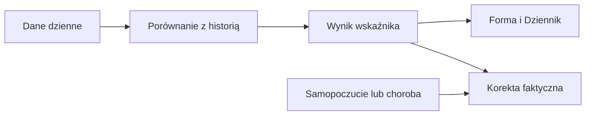

# Sen

## Co to jest

W Formie sen ma dwie odrębne miary: długość w godzinach i punktację. Długość wpływa na gotowość; punktacja jest osobną serią.

## Po co

Jeśli punktacja wygląda dobrze, ale spałeś krótko, nie traktuj tych wartości jako zamienników. Porównaj obie z własnym samopoczuciem i resztą sygnałów.

## Skąd dane

Długość snu oraz punktacja z dziennych danych wellness. Gdy dla dnia istnieje kilka punktacji, widok wybiera najwyższą.

## Jak liczone

1. 18.10.2026 zapisano 5,73 godziny snu i punktację 67.
2. Gotowość używa długości snu z udziałem 25%, porównując ostatnie 3 dni z bazą do 60 dni.
3. Punktacja 67 nie jest podstawiana do gotowości.

Wzór

Szczegóły matematyczne są opisane w kodzie źródłowym wymienionym niżej. Wartości przykładowe powyżej są zaokrąglone do dokładności widocznej w danych.

## Gdzie to widać

Forma → Trendy pokazuje punktację snu. Długość jest wejściem gotowości i może pojawić się w szczegółach Dziennika.

## Jak czytać

Brak pomiaru to brak punktu, nie zero. Kilka źródeł albo wpisów w tym samym dniu może powodować, że punktacja na wykresie nie odpowiada pojedynczemu rekordowi urządzenia.

## Decyzje i historia

Bieżący opis opiera się na kodzie odczytanym 18.10.2026. Starszy opis układu nie zawsze odpowiada aktualnemu widokowi.

## Ograniczenia i pułapki

Wskaźniki zależą od dostępności i kompletności pomiarów. Dni bez pomiaru nie są automatycznie zerem. Zrzut ekranu jest ilustracją układu i nie zastępuje aktualnych danych.

## Wpływa na / Zależy od

Wpływ i wejścia: Długość snu oraz punktacja z dziennych danych wellness. Gdy dla dnia istnieje kilka punktacji, widok wybiera najwyższą. Szczegóły połączeń są w [mapie zależności](../zaleznosci.md).

## Powiązane hasła

- [Gotowość](gotowosc.md)
- [HRV — zmienność rytmu serca](hrv.md)

## Zrodla

- /opt/qbot/app/fitmodel/readiness.py — długość snu i gotowość
- /opt/qbot/app/qbot_web.py — wybór punktacji
- /opt/qbot/web/public/forma2-data.js — seria snu
- qbot_v2.qbot_wellness_daily
