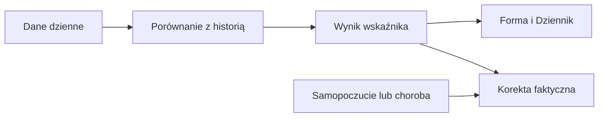

# Status dnia

## Co to jest

Jeden werdykt łączy gotowość z kilku dni, puls spoczynkowy, zmianę obciążenia oraz okres po chorobie. Etykiety to „w normie”, „uwaga”, „zmęczony” i „przeciążenie”.

## Po co

Jeśli rano widzisz „uwaga”, sprawdź powód: skok obciążenia albo niedawna choroba. Przy „zmęczony” kod zaleca lekko albo wolne; przy „przeciążenie” wolne albo bardzo lekko. Traktuj to jako podpowiedź, nie diagnozę.

## Skąd dane

Wykorzystuje dzienną gotowość, puls, obciążenie i wpis choroby w kalendarzu.

## Jak liczone

1. 12.10.2026 gotowość z 3 dni wynosiła −0,429, a status „zmęczony”.
2. Dnia 18.10.2026 efektywne wyniki z 16.10.2026, 17.10.2026 i 18.10.2026 wynosiły 0,404, −0,172 i −1,112.
3. Jeśli organizm jest w stanie „zmęczony”, przejście z niego wymaga wyniku powyżej −0,2; wejście zaczyna się przy −0,4. Skok obciążenia to stosunek średniego obciążenia z 7 dni do 28 dni równy co najmniej 1,3.
4. Werdykt „przeciążenie” wymaga skoku i przynajmniej jednego z sygnałów: zmęczenie organizmu, podwyższone tętno albo okres po chorobie. Sam skok lub sam okres po chorobie oznacza „uwaga”.

Wzór

Średnia efektywna: (0,404 − 0,172 − 1,112) ÷ 3 = −0,293. To wartość zapisana dla 18.10.2026. Mimo niej status końcowy jest „w normie”, bo sygnał zmęczenia nie przekroczył progu wejścia w stan zmęczenia, a inne warunki nie zmieniły werdyktu.

## Gdzie to widać

W Formie → Dziennik. Zrzut Forma pokazuje status „W normie — trening wg planu” w górnym lewym panelu.

## Jak czytać

Werdykt „w normie” nie oznacza, że każdy sygnał jest idealny. Dnia 18.10.2026 gotowość pojedynczego dnia wynosiła −0,962, a wygładzony werdykt nadal był „w normie”. „Przeciążenie” pojawia się, gdy skok obciążenia łączy się ze zmęczeniem, wysokim pulsem lub okresem po infekcji. Okres po chorobie trwa do 14 dni od jej końca. Przy „zmęczony” kod podaje „lekko albo wolne”; to podpowiedź, nie diagnoza.

Na wykresie statusu kod barwi tło na czerwono dla przeciążenia, pomarańczowo dla zmęczenia i żółto dla uwagi; „w normie” nie dostaje barwnego pola. W głównym panelu etykiety przeciążenia i zmęczenia korzystają z klasy ostrzegawczej, a „w normie” z klasy korzystnej. Kolor jest dodatkiem do tekstu i powodu statusu.

## Decyzje i historia

Bieżący opis opiera się na kodzie odczytanym 18.10.2026. Starszy opis układu nie zawsze odpowiada aktualnemu widokowi.

## Ograniczenia i pułapki

Wskaźniki zależą od dostępności i kompletności pomiarów. Dni bez pomiaru nie są automatycznie zerem. Zrzut ekranu jest ilustracją układu i nie zastępuje aktualnych danych.

## Wpływa na / Zależy od

Wpływ i wejścia: Wykorzystuje dzienną gotowość, puls, obciążenie i wpis choroby w kalendarzu. Szczegóły połączeń są w [mapie zależności](../zaleznosci.md).

## Powiązane hasła

- [Gotowość](gotowosc.md)
- [Norma tętna spoczynkowego](norma-tetna.md)
- [Forma, zmęczenie i świeżość](ctl-atl-tsb.md)

## Zrodla

- /opt/qbot/app/fitmodel/day_status.py — classify, progi i tekst zaleceń
- /opt/qbot/web/public/forma2-data.js — panel Dziennika
- qbot_v2.fitmodel_daily — zapis wyniku
- qbot_v2.calendar_entry — wpisy choroby
