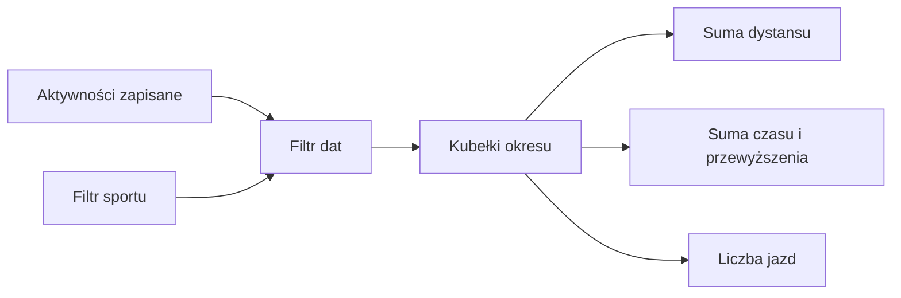

# Statystyki jazd

## Co to jest

Statystyki podsumowują zapisane jazdy w wybranym czasie. Widok obejmuje kilometry, czas ruchu, czas całkowity, przewyższenie i liczbę jazd.

## Po co

Sprawdź tu, ile jazd i czasu zebrało się w tygodniu, miesiącu albo roku. Jeśli czas całkowity jest większy od czasu ruchu, różnica obejmuje krótkie postoje zapisane w aktywności. Od 24.10.2026 postoje dłuższe niż 20 minut (np. mecz albo obiad w środku jazdy, gdy Karoo nie zakończył zapisu) nie wliczają się do czasu całkowitego — tak samo liczy model czasu przejazdu. Ich długość ma każda jazda w polu long_stop_s.

## Skąd dane

Strona pobiera kubełki aktywności z endpointu statystyk. Dostępny jest tydzień kalendarzowy (poniedziałek–niedziela), miesiąc, rok od początku oraz zakres własny. Filtr sportu może ograniczyć aktywności.

## Jak liczone

1. Wybierasz tydzień (poniedziałek–niedziela), miesiąc, rok albo zakres własny.
2. System bierze zapisane aktywności w tym przedziale i opcjonalnie ogranicza je filtrem sportu.
3. Dystans, czas ruchu, czas całkowity, przewyższenie i liczba jazd są sumowane osobno.
4. Od 12.10.2026 do 18.10.2026 zapisano 3 jazdy: 14.10.2026 — 64,2 XSS, 16.10.2026 — 69,7 XSS, 18.10.2026 — 157,7 XSS. Suma obciążenia to 291,6 XSS. XSS (punkty obciążenia; [słowniczek](../slowniczek.md)) nie jest kilometrami ani czasem.
5. W widoku głównym na zrzucie karta tygodnia pokazuje 99 km, 6 jazd, 6:34 h i 432 m; są to inne miary niż punkty XSS powyżej.

Wzór

Suma okresu = dodanie wartości każdej aktywności spełniającej filtr dat i sportu. Czas ruchu i całkowity są sumowane niezależnie. Liczby 99 km i 6:34 h na zrzucie są ilustracją, nie wynikiem odczytu aktualnego endpointu.

## Gdzie to widać

Forma → Statystyki. Główny zrzut Formy [pokazuje na dole statystyki](../img/ekrany/forma.png): trzy karty porównują tydzień, miesiąc i rok. Szczegółowa zakładka ma również wybór miar i zakresu.

## Jak czytać

Wykres może mieć dwie jednostki naraz, więc sprawdź legendę i oś. Czas ruchu nie jest czasem całkowitym. Pusty okres oznacza brak zapisanych aktywności spełniających filtry. Zrzut pokazuje karty podsumowania tygodnia, miesiąca i roku na dole strony; karta tygodnia obejmuje 12.10.2026–18.10.2026.

Przed porównaniem okresów sprawdź, czy oba obejmują tyle samo dni. Tydzień zaczyna się w poniedziałek. Rok w karcie rocznej może być liczony od początku roku do daty wskazanej na ekranie, więc nie porównuj go z pełnym poprzednim rokiem bez sprawdzenia etykiety. Jednostki minut, kilometrów i punktów obciążenia nie są sumowane razem.

## Decyzje i historia

Miary i zakresy sprawdzono w bieżącym JavaScripcie i API. Starszy opis układu Formy nie odpowiada wszystkim aktualnym zakładkom.

## Ograniczenia i pułapki

Statystyka opisuje zapisane aktywności i może różnić się od danych dziennych używanych do innych obliczeń, jeśli filtry lub moment importu są inne. Zrzut z 18.10.2026 jest przykładem wyglądu kart; bieżące wartości sprawdzaj w wybranym okresie i z wybranym filtrem. Przykład XSS pochodzi z zapisu obciążenia jazd, nie z widoku kilometrowego.

## Wpływa na / Zależy od

Statystyki są podsumowaniem do odczytu. Nie zmieniają treningu ani aktywności.

## Powiązane hasła

- [Trendy](trendy.md)
- [Wykresy](wykresy.md)
- [Raport jazdy](../raport-jazdy/index.md)

## Zrodla

- `/opt/qbot/web/public/forma-stats.js` — miary, filtry i zakresy.
- `/opt/qbot/web/public/forma.html` — zakładka Statystyki.
- `/opt/qbot/app/qbot_web.py` — `/api/stats/rides`.
- `qbot_v2.training_sessions` — aktywności.
- `qbot_v2.modelq2_ride` — XSS jazd użyte w przykładzie.
