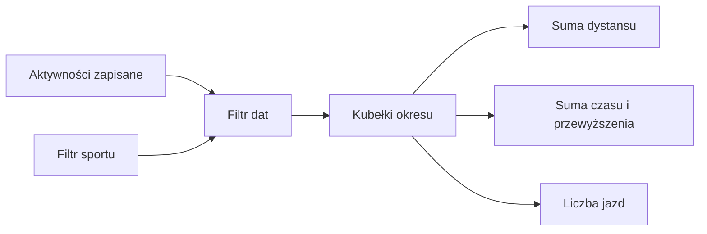

# Statystyki jazd

## Co to jest

Statystyki podsumowują zapisane jazdy w wybranym czasie. Widok obejmuje kilometry, czas ruchu, czas całkowity, przewyższenie i liczbę jazd.

## Po co

Sprawdź tu, ile jazd i czasu zebrało się w tygodniu, miesiącu albo roku. Jeśli czas całkowity jest większy od czasu ruchu, różnica obejmuje postoje i inne przerwy zapisane w aktywności.

## Skąd dane

Strona pobiera kubełki aktywności z endpointu statystyk. Dostępny jest tydzień kalendarzowy (poniedziałek–niedziela), miesiąc, rok od początku oraz zakres własny. Filtr sportu może ograniczyć aktywności.

## Jak liczone

1. API sumuje zapisane aktywności pasujące do okresu i filtra.
2. Widok dodaje wartości z kubełków dla wybranej miary.
3. Na jednym wykresie można zestawić do dwóch różnych jednostek.
4. Przykład z bazy, 12–18.10.2026: były 3 jazdy; 14.10 — 64,2 XSS, 16.10 — 69,7 XSS, 18.10 — 157,7 XSS. Suma tych jazd to 291,6 XSS. XSS (punkty obciążenia) nie jest jednostką czasu.

Wzór

Suma okresu = dodanie wartości każdej aktywności, która spełnia filtr dat i sportu. Czas ruchu i całkowity są sumowane niezależnie.

## Gdzie to widać

Forma → Statystyki. Główny zrzut Formy [pokazuje na dole statystyki](../img/ekrany/forma.png): trzy karty porównują tydzień, miesiąc i rok. Szczegółowa zakładka ma również wybór miar i zakresu.

## Jak czytać

Wykres może mieć dwie jednostki naraz, więc sprawdź legendę i oś. Czas ruchu nie jest czasem całkowitym. Pusty okres oznacza brak zapisanych aktywności spełniających filtry.

## Decyzje i historia

Miary i zakresy sprawdzono w bieżącym JavaScripcie i API. Starszy opis układu Formy nie odpowiada wszystkim aktualnym zakładkom.

## Ograniczenia i pułapki

Sumy zależą od poprawności zapisów aktywności. Przykład XSS powyżej pochodzi z tabeli obciążenia jazd, nie z widoku kilometrowego.

## Wpływa na / Zależy od

Statystyki są podsumowaniem do odczytu. Nie zmieniają treningu ani aktywności.

## Powiązane hasła

- [Trendy](trendy.md)
- [Wykresy](wykresy.md)
- [Raport jazdy](../raport-jazdy/index.md)

## Zrodla

- `/opt/qbot/web/public/forma-stats.js` — miary, filtry i zakresy.
- `/opt/qbot/web/public/forma.html` — zakładka Statystyki.
- `/opt/qbot/app/qbot_web.py` — `/api/stats/rides`.
- `qbot_v2.training_sessions` — aktywności.
- `qbot_v2.modelq2_ride` — XSS jazd użyte w przykładzie.
