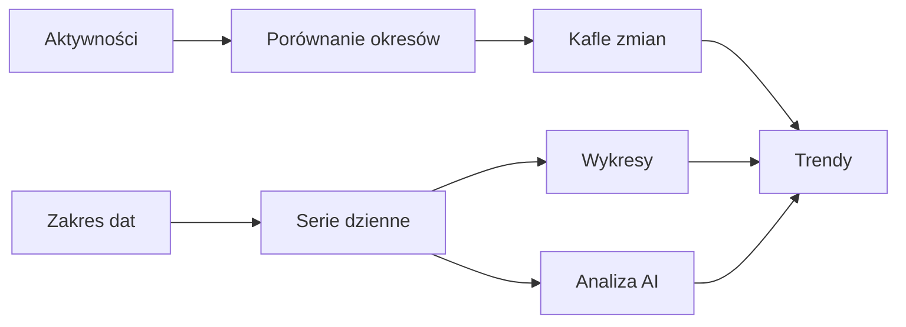

# Trendy

## Co to jest

Trendy to zakładka z dziennymi seriami treningowymi, mocy, wellness i masy. Możesz wybrać zakres 30 dni, 90 dni albo rok oraz włączać widoczne serie. Karta analizy AI opisuje wzorce w wybranych danych.

## Po co

Użyj Trendów, gdy chcesz sprawdzić kierunek zmian, a nie tylko dzisiejszą wartość. Jeśli porównujesz jazdy, porównaj okres z równie długim okresem poprzednim. Jeśli porównujesz moc, pamiętaj, że kod zestawia pierwszą i ostatnią dostępną wartość w zakresie.

## Skąd dane

Dane dzienne pochodzą z Formy, a liczba jazd, dystans i czas ruchu z osobnego zestawu statystyk. Punktacja snu, HRV i faktyczne pomiary masy są osobnymi seriami.

## Jak liczone

1. Wybierasz zakres 30, 90 dni lub rok i włączasz serie, które chcesz obejrzeć.
2. Dla liczby jazd, dystansu i czasu widok zestawia wybrany zakres z poprzednim, równie długim okresem.
3. Kafelek zmiany mocy porównuje ostatnią dostępną wartość z wartością sprzed 7 punktów szeregu. Moc na kilogram (W/kg) działa tak samo; wybór zakresu wykresu nie zamienia tego porównania w sumę całego okresu. Brak pomiaru nie staje się zerem.
4. 18.10.2026 dzienny zapis miał próg ModelQ (TP, moc progowa; [hasło TP](../modelq/tp.md)) 240,7 W oraz masę 103,04 kg. To dwie wartości jednego dnia, nie zmiana okresowa.
5. Starsza nazwa CP (moc krytyczna; [słowniczek](../slowniczek.md)) może wystąpić na wykresie. ModelQ opisujemy jako próg TP; nie należy utożsamiać dwóch nazw jako dwóch pomiarów.
6. Na zrzucie strony głównej widać wykres obciążenia za 28 dni, nie zakładkę Trendy. Nie przenoś jego osi i okna na serie z dłuższej zakładki.

Wzór

Zmiana aktywności = suma wybranego okresu − suma poprzedniego, równego okresu. Kafelek mocy pokazuje różnicę między ostatnim punktem i punktem o 7 pozycji wcześniejszym w szeregu. Procent zależy od wcześniejszej wartości. Dokładne wartości zależą od filtrów i dostępności pomiarów.

## Gdzie to widać

Forma → Trendy. Zrzut [Formy](../img/ekrany/forma.png) pokazuje również wykres dziennikowy obciążenia, ale zakładka Trendy zawiera wybór zakresu i serie wellness. Na stronie włączaj i wyłączaj serie w legendzie.

## Jak czytać

Wartość dzienna i zmiana okresowa odpowiadają na inne pytania. Brak punktu oznacza brak danych. Analiza AI może wskazać współwystępowanie zmian; nie dowodzi przyczyny. Skróty CTL (długie obciążenie), ATL (krótkie obciążenie) oraz TSB (ich różnica) opisuje hasło [Forma i świeżość](ctl-atl-tsb.md). Sprawdź filtr dat, bo zmiana procentowa zależy od wybranego okna.

Analiza w Trendach interpretuje zmiany w danych. Doradca treningowy uwzględnia najbliższą jazdę oraz wpisy zaplanowane w kalendarzu na kolejne tygodnie. Osobna analiza wykresu opiera się na zaznaczonych seriach i widocznym zakresie; jeśli seria nie ma danych, informacja o jej braku trafia do analizy. Odpowiedź jest podpowiedzią opartą na dostarczonych liczbach.

## Decyzje i historia

Aktualne zakładki sprawdzono w kodzie HTML z 18.10.2026. Starszy dokument układu opisuje wcześniejszą wersję strony.

## Ograniczenia i pułapki

Nie potwierdzono interakcji wszystkich przełączników na stronie po zalogowaniu. Zakres wybrany w interfejsie może zawierać dni bez pomiaru.

## Wpływa na / Zależy od

Pokazuje serie z dziennych obliczeń, pomiarów wellness i aktywności. Nie zmienia danych źródłowych.

## Powiązane hasła

- [Wykresy](wykresy.md)
- [Statystyki](statystyki.md)
- [HRV](hrv.md)
- [Sen](sen.md)
- [Masa ciała](waga.md)

## Zrodla

- `/opt/qbot/web/public/forma.html` — zakresy i zakładka Trendy.
- `/opt/qbot/web/public/forma2-data.js` — porównania i wykresy.
- `/opt/qbot/app/qbot_web.py` — `/api/forma/data`, `/api/trendy/ai`.
- `/opt/qbot/app/qbot_web.py` — `/api/forma/analyze`, analiza dnia, porada i analiza wykresu.
- `/opt/qbot/app/qbot_web.py` — `/api/stats/rides`.
