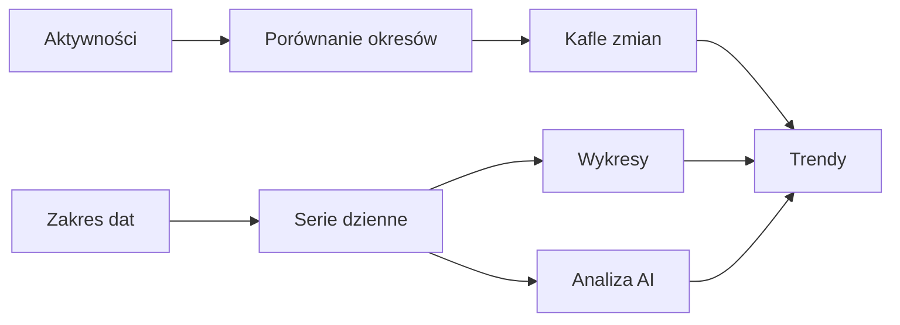

# Trendy

## Co to jest

Trendy to zakładka z dziennymi seriami treningowymi, mocy, wellness i masy. Możesz wybrać zakres 30 dni, 90 dni albo rok oraz włączać widoczne serie. Karta analizy AI opisuje wzorce w wybranych danych.

## Po co

Użyj Trendów, gdy chcesz sprawdzić kierunek zmian, a nie tylko dzisiejszą wartość. Jeśli porównujesz jazdy, porównaj okres z równie długim okresem poprzednim. Jeśli porównujesz moc, pamiętaj, że kod zestawia pierwszą i ostatnią dostępną wartość w zakresie.

## Skąd dane

Dane dzienne pochodzą z Formy, a liczba jazd, dystans i czas ruchu z osobnego zestawu statystyk. Punktacja snu, HRV i faktyczne pomiary masy są osobnymi seriami.

## Jak liczone

1. Wybierasz zakres 30, 90 dni lub rok.
2. Dla liczby jazd, dystansu i czasu system zestawia zakres z poprzednim, tak samo długim okresem.
3. Dla CP (historyczna nazwa progu w tym widoku) i W/kg różnica jest liczona między skrajnymi dostępnymi wartościami zakresu.
4. 18.10.2026 dzienny zapis miał próg ModelQ 240,7 W oraz masę 103,04 kg. To są wartości z jednego dnia; same nie wyznaczają zmiany okresu.

Wzór

Zmiana okresowa to różnica wartości bieżącego i poprzedniego okresu; procent zależy od wartości poprzedniego okresu. Szczegóły zaokrągleń i obsługi braków są w kodzie widoku.

## Gdzie to widać

Forma → Trendy. Zrzut [Formy](../img/ekrany/forma.png) pokazuje również wykres dziennikowy obciążenia, ale zakładka Trendy zawiera wybór zakresu i serie wellness. Na stronie włączaj i wyłączaj serie w legendzie.

## Jak czytać

Wartość dzienna i zmiana okresowa odpowiadają na inne pytania. Brak punktu oznacza brak dostępnych danych. Analiza AI może wskazać współwystępowanie zmian; nie dowodzi, że jedna rzecz spowodowała drugą. Skróty CTL (długie obciążenie), ATL (krótkie obciążenie) oraz TSB (ich różnica) opisuje hasło [Forma i świeżość](ctl-atl-tsb.md).

## Decyzje i historia

Aktualne zakładki sprawdzono w kodzie HTML z 18.10.2026. Starszy dokument układu opisuje wcześniejszą wersję strony.

## Ograniczenia i pułapki

Nie potwierdzono interakcji wszystkich przełączników na stronie po zalogowaniu. Zakres wybrany w interfejsie może zawierać dni bez pomiaru.

## Wpływa na / Zależy od

Pokazuje serie z dziennych obliczeń, pomiarów wellness i aktywności. Nie zmienia danych źródłowych.

## Powiązane hasła

- [Wykresy](wykresy.md)
- [Statystyki](statystyki.md)
- [HRV](hrv.md)
- [Sen](sen.md)
- [Masa ciała](waga.md)

## Zrodla

- `/opt/qbot/web/public/forma.html` — zakresy i zakładka Trendy.
- `/opt/qbot/web/public/forma2-data.js` — porównania i wykresy.
- `/opt/qbot/app/qbot_web.py` — `/api/forma/data`, `/api/trendy/ai`.
- `/opt/qbot/app/qbot_web.py` — `/api/stats/rides`.
