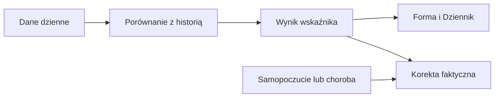

# Masa ciała

## Co to jest

Forma pokazuje ostatnią masę i jej punkty pomiarowe. Wartość dzienna może powtarzać poprzedni pomiar, więc nie każdy dzień na wykresie oznacza nowe ważenie.

## Po co

Patrz na serię, nie na pojedynczy skok. Jeśli porównujesz okresy, sprawdź daty faktycznych pomiarów.

## Skąd dane

Kanon pomiarów pochodzi z pomiarów ciała zsynchronizowanych z Withings/Garmin.

## Jak liczone

1. 18.10.2026 dzienna wartość wynosiła 103,04 kg.
2. Tego dnia istnieje też pomiar 103,04 kg z kompletnością 5.
3. 17.10.2026 dzienny zapis miał 102,92 kg, ale wykaz punktów pomiarowych nie zawiera ważenia z tego dnia.

Wzór

Szczegóły matematyczne są opisane w kodzie źródłowym wymienionym niżej. Wartości przykładowe powyżej są zaokrąglone do dokładności widocznej w danych.

## Gdzie to widać

Forma → Dziennik pokazuje kafel masy; Trendy pokazują punkty pomiarowe. Zrzut Forma ma kafel „Waga 103.0 kg”. Szczegółowy bilans i masa są na stronie Jedzenie.

## Jak czytać

Punkt pomiarowy to wykonane ważenie. Dzienna linia może przenosić ostatnią znaną wartość. Masa nie jest bezpośrednim składnikiem obecnej gotowości.

## Decyzje i historia

Bieżący opis opiera się na kodzie odczytanym 18.10.2026. Starszy opis układu nie zawsze odpowiada aktualnemu widokowi.

## Ograniczenia i pułapki

Wskaźniki zależą od dostępności i kompletności pomiarów. Dni bez pomiaru nie są automatycznie zerem. Zrzut ekranu jest ilustracją układu i nie zastępuje aktualnych danych.

## Wpływa na / Zależy od

Wpływ i wejścia: Kanon pomiarów pochodzi z pomiarów ciała zsynchronizowanych z Withings/Garmin. Szczegóły połączeń są w [mapie zależności](../zaleznosci.md).

## Powiązane hasła

- [Trendy](trendy.md)
- [Statystyki](statystyki.md)

## Zrodla

- /opt/qbot/app/qbot_web.py — _build_forma_data i pomiary
- /opt/qbot/app/fitmodel/readiness.py — przenoszenie ostatniej masy
- /opt/qbot/web/public/forma2-data.js — rysowanie pomiarów
- qbot_v2.body_measurements
