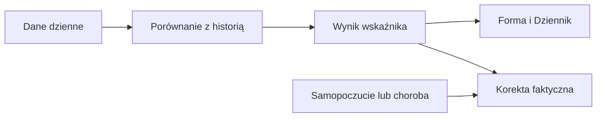

# Masa ciała

## Co to jest

Forma pokazuje ostatnią masę i jej punkty pomiarowe. Wartość dzienna może powtarzać poprzedni pomiar, więc nie każdy dzień na wykresie oznacza nowe ważenie.

## Po co

Patrz na serię, nie na pojedynczy skok. Jeśli porównujesz okresy, sprawdź daty faktycznych pomiarów.

## Skąd dane

Kanon pomiarów pochodzi z pomiarów ciała zsynchronizowanych z Withings/Garmin.

## Jak liczone

1. 18.10.2026 dzienny zapis wynosił 103,04 kg.
2. Tego dnia był również pomiar 103,04 kg. To jest nowe ważenie, nie tylko przeniesiona wartość.
3. Dnia 17.10.2026 dzienny zapis wynosił 102,92 kg, lecz nie ma punktu pomiarowego z tego dnia. To wartość przeniesiona z poprzedniego pomiaru.
4. Seria na wykresie rozdziela odczyty dzienne od rzeczywistych ważeń; patrz legenda i punkty, a nie sama ciągłość linii.

Wzór

Gdy nie ma nowego ważenia, dzienna wartość masy zachowuje ostatni znany pomiar. Dlatego dwie różne wartości dzienne w sąsiednich dniach nie muszą oznaczać, że oba dni zawierały pomiar.

## Gdzie to widać

Forma → Dziennik pokazuje kafel masy; Trendy pokazują punkty pomiarowe. Zrzut Forma ma kafel „Waga 103.0 kg”. Szczegółowy bilans i masa są na stronie Jedzenie.

## Jak czytać

Punkt pomiarowy to wykonane ważenie. Dzienna linia może przenosić ostatnią znaną wartość. Masa nie jest składnikiem gotowości z HRV (zmienność rytmu serca; [słowniczek](../slowniczek.md)), pulsu i snu. Zmianę masy porównuj między datami pomiarów; nie wyciągaj tempa utraty masy z samej dziennej linii.

Na zrzucie głównej Formy kafel „Waga” pokazuje 103,0 kg, czyli zaokrąglenie dziennego 103,04 kg z 18.10.2026. Odczyt 102,92 kg dzień wcześniej nie znaczy, że wykonano ważenie dokładnie tego dnia. Przy porównaniu dwóch dat sprawdź, czy oba końce zakresu są rzeczywistymi punktami.

## Decyzje i historia

Bieżący opis opiera się na kodzie odczytanym 18.10.2026. Starszy opis układu nie zawsze odpowiada aktualnemu widokowi.

## Ograniczenia i pułapki

Wartość przeniesiona może sprawić wrażenie codziennych pomiarów. Wykres rozdziela punkty pomiarowe od dziennej serii. Wartości z urządzeń mogą docierać z opóźnieniem, dlatego datą odniesienia jest data zapisana przy pomiarze. Brak punktu to brak pomiaru, nie masa zero.

Do oceny zmiany masy wybierz dwa rzeczywiste pomiary, najlepiej z odstępem obejmującym więcej niż jeden dzień. Dzienny zapis 102,92 kg z 17.10.2026 i ważenie 103,04 kg z 18.10.2026 różnią się o 0,12 kg, ale jeden pomiar nie opisuje trendu.

## Wpływa na / Zależy od

Wpływ i wejścia: Kanon pomiarów pochodzi z pomiarów ciała zsynchronizowanych z Withings/Garmin. Szczegóły połączeń są w [mapie zależności](../zaleznosci.md).

## Powiązane hasła

- [Trendy](trendy.md)
- [Statystyki](statystyki.md)

## Zrodla

- /opt/qbot/app/qbot_web.py — _build_forma_data i pomiary
- /opt/qbot/app/fitmodel/readiness.py — przenoszenie ostatniej masy
- /opt/qbot/web/public/forma2-data.js — rysowanie pomiarów
- qbot_v2.body_measurements
