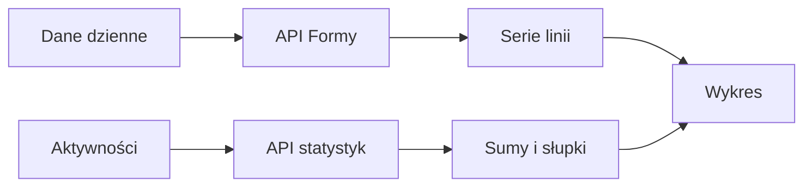

# Wykresy Formy

## Co to jest

Wykresy przedstawiają dzienne wartości treningowe i zdrowotne. W Formie ekran Dziennik pokazuje między innymi historię obciążenia z 28 dni, a zakładka Trendy pozwala przeglądać dłuższe serie.

## Po co

Wykres pomaga zauważyć, czy wartość rośnie, spada czy utrzymuje się. Jeśli linia przerywa się, sprawdź, czy brakowały pomiary; brak punktu nie oznacza zera.

## Skąd dane

Dziennik i Trendy pobierają dzienne serie z danych Formy. Statystyki aktywności korzystają z odrębnego API. Poszczególne serie mogą mieć inne źródła i jednostki.

## Jak liczone

1. API zwraca wartości z określonego zakresu.
2. Widok rysuje każdą miarę jako osobną serię; słupki jazd pokazują obciążenie przypisane do dnia.
3. 18.10.2026 wykres obciążenia odpowiadał między innymi wartościom CTL 58,0, ATL surowe 60,1, ATL faktyczne 74,5 i świeżość faktyczna −16,5.
4. [Wykres SVG](../img/forma-obciazenie-20261012-18.svg) przedstawia prawdziwe wartości z 12–18.10.2026; odczytuj go jako przykład danych, nie jako aktualny podgląd.

Wzór

Świeżość faktyczna = długie obciążenie − faktyczne krótkie obciążenie. Wygładzanie obciążenia opisuje [osobne hasło](ctl-atl-tsb.md).

## Gdzie to widać

Forma → Dziennik oraz Trendy. Zrzut ekranu [głównej Formy](../img/ekrany/forma.png) pokazuje wykres 28 dni pod kaflami; legenda nad wykresem identyfikuje serie.

## Jak czytać

Najpierw sprawdź nazwę serii i jednostkę. CTL (długie obciążenie), ATL (krótkie obciążenie) i TSB (różnica) nie są zamienne. Słupki jazd to inna miara niż linie. Jeśli punktu brakuje, nie łącz go z zerem.

## Decyzje i historia

Aktualna strona używa zakładek Dziennik, Trendy, Sezon i Statystyki. Starszy dokument układu opisuje wcześniejszy widok.

## Ograniczenia i pułapki

Nie sprawdzono każdego przełącznika na zalogowanej stronie. Kolory i interakcje mogą się zmienić; wartości i serie należy wiązać z legendą.

## Wpływa na / Zależy od

Wykresy pokazują dzienne serie i aktywności; nie wykonują zapisu treningu.

## Powiązane hasła

- [Forma, zmęczenie i świeżość](ctl-atl-tsb.md)
- [Trendy](trendy.md)
- [Statystyki](statystyki.md)
- [Sen](sen.md)
- [Masa ciała](waga.md)

## Zrodla

- `/opt/qbot/web/public/forma.html` — struktura zakładek i wykres Dziennika.
- `/opt/qbot/web/public/forma2-data.js` — serie i rysowanie.
- `/opt/qbot/app/qbot_web.py` — `_build_forma_data`, `/api/forma/data`.
- `qbot_v2.fitmodel_daily` — wartości dzienne.
