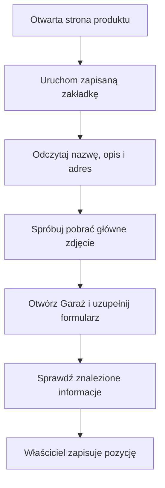
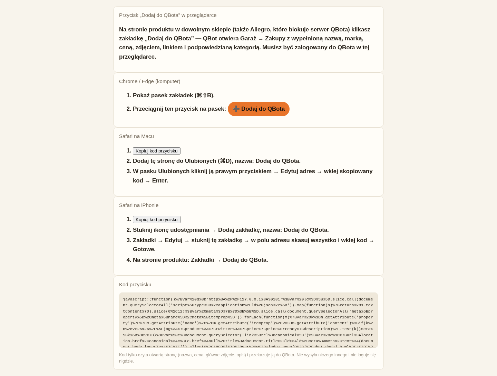

# Dodawanie produktu ze sklepu do Garażu

## Co to jest

„Dodaj do QBota” to przycisk zapisany jako zakładka w przeglądarce. Uruchomiony na stronie produktu otwiera formularz Zakupów w Garażu z danymi odczytanymi z tej strony.

## Po co

Pomaga zapisać produkt, który rozważasz kupić, bez przepisywania nazwy, ceny i adresu. Jest przydatny także wtedy, gdy sklep nie pozwala serwerowi QBota odczytać swojej strony.

## Skąd dane

Przycisk działa w Twojej przeglądarce i odczytuje tytuł strony, część informacji o produkcie, opis oraz główne zdjęcie, jeśli strona na to pozwala. Następnie przesyła te dane do QBota. QBot może podpowiedzieć markę, cenę i kategorię, ale sklep może opisywać produkty w różny sposób.

## Jak liczone

1. Otwierasz stronę „Dodaj do QBota” i zapisujesz przycisk w pasku zakładek. Na komputerze przeciągasz go na pasek. Na Safari kopiujesz kod i wklejasz go jako adres zakładki.
2. Otwierasz stronę produktu w tej samej przeglądarce, w której jesteś zalogowany do QBota.
3. Uruchamiasz zapisaną zakładkę „Dodaj do QBota”. Otwiera się strona odbioru. Przycisk odczytuje adres, nazwę i tekst widoczny na stronie; próbuje też pobrać zdjęcie w przeglądarce.
4. QBot przesyła odczytane dane do formularza Garaż → Zakupy. Jeśli zdjęcia nie udało się odczytać, pozostałe znalezione informacje nadal mogą dotrzeć.
5. Sprawdzasz i poprawiasz formularz, a następnie sam zapisujesz pozycję. Samo uruchomienie przycisku nie potwierdza zakupu i nie dodaje automatycznie rzeczy do roweru.

Strona produktu może zawierać do 18 000 znaków tekstu, które przycisk przekazuje jako fragment opisu. To limit kodu, a nie gwarancja, że sklep udostępni wszystkie szczegóły.

## Gdzie to widać

Otwórz stronę „Dodaj do QBota”, wybierz instrukcję dla przeglądarki i przeciągnij przycisk albo skopiuj jego kod. Po uruchomieniu na stronie produktu ekran potwierdza odbiór i przekazuje Cię do formularza zakupów.

## Jak czytać

- Pojawienie się formularza oznacza, że przeglądarka przekazała dane do QBota. Nie oznacza, że wszystkie pola są poprawne.
- Jeśli zdjęcie się nie przeniosło, sklep mógł zablokować pobieranie obrazu przez przeglądarkę. Możesz uzupełnić formularz ręcznie.
- Jeśli strona odbioru informuje, że dane nie dotarły, wróć do produktu i uruchom zakładkę ponownie. Sprawdź też, czy nowe okno nie zostało zablokowane.
- Zalogowanie jest wymagane w tej samej przeglądarce, bo formularz zapisuje dane w Garażu właściciela.

## Decyzje i historia

Rozwiązanie przenosi odczyt produktu do przeglądarki użytkownika. Dzięki temu działa dla stron, do których serwer QBota nie może wejść. Przycisk wysyła wybrane dane strony do QBota; nie loguje się do sklepu i nie wykonuje zakupu.

## Ograniczenia i pułapki

- Sklep może nie udostępniać ceny, marki, opisu albo zdjęcia w formie czytelnej dla przycisku.
- Przeglądarka może blokować otwieranie nowego okna lub kopiowanie do schowka.
- Nie instaluj przycisku na urządzeniu współdzielonym, jeśli nie chcesz, by inny użytkownik mógł otwierać produkt i wysyłać jego dane do Twojego QBota.
- > DO SPRAWDZENIA: potwierdzić, które pola formularza są uzupełniane dla każdej wspieranej przeglądarki; różne sklepy mogą udostępniać inny zestaw danych.

## Wpływa na / Zależy od

- **Wpływa na:** wstępnie wypełniony formularz Zakupów w Garażu.
- **Zależy od:** strony produktu, przeglądarki, zalogowanej sesji QBota i dostępnych danych produktu.

## Powiązane hasła

- [Zakupy](zakupy.md)
- [Sprzęt w Garażu](sprzet.md)
- [Strony WWW](../system/strony-www.md)

## Zrodla

- `/opt/qbot/web/public/qbot-dodaj.html` — instrukcja, odczyt strony i przekazanie danych.
- `/opt/qbot/app/qbot_web.py` — `api_garage_scrape_page` i obsługa formularza Garażu.
- `/opt/qbot/app/docs/ZAKUPY.md` — opis działania przycisku.
