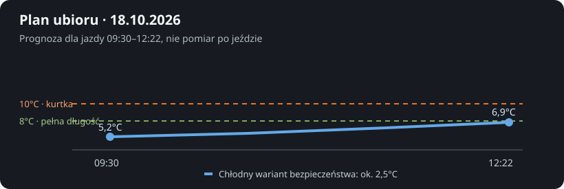
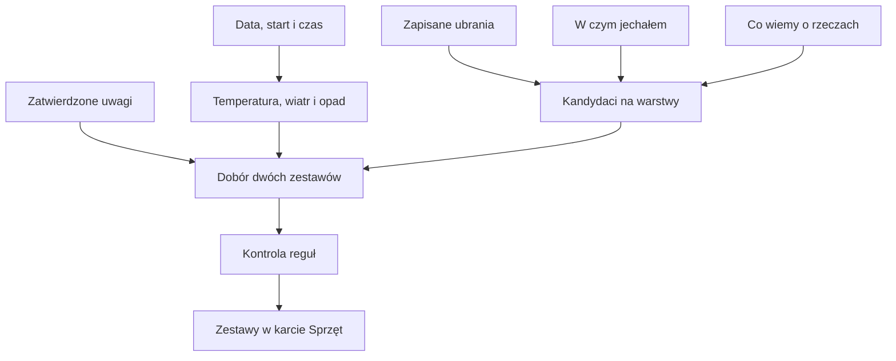

# Doradca ubioru

## Co to jest

W karcie Sprzęt Analizy trasy doradca pokazuje zwykle dwa zestawy ubrań: spokojniejszy i szybszy. Bierze pod uwagę godzinę i długość planu, pogodę, zapisane ubrania oraz doświadczenia z wcześniejszych jazd. [WBGT](../slowniczek.md#wbgt) to wskaźnik łączący temperaturę, wilgotność i promieniowanie; w opisie stroju jest jednym z danych o warunkach.

## Po co

Jeśli prognoza zmienia się w czasie jazdy, porównaj oba zestawy i sprawdź, co można zdjąć lub schować. Przy chłodnym starcie nie wystarczy spojrzeć na temperaturę końca trasy. Zwróć uwagę na wiatr, postoje, deszcz i najzimniejszy wariant, a także na wcześniejsze uwagi, na przykład „zimno w nogi”.

## Skąd dane

Warunki pochodzą z prognozy dla planowanej trasy i czasu. Ubrania biorą się z Garażu. Doświadczenia po jeździe i uwagi o konkretnych rzeczach mogą tworzyć wskazówki. Zatwierdzone ogólne wnioski są osobnym źródłem. Pojedyncza obserwacja jest poszlaką, a nie automatyczną zmianą oceny ubrania.

## Jak liczone

Przykład pochodzi z zapisanego doboru dla trasy z 18.10.2026. To prognoza i propozycja zapisana przed jazdą, nie pomiar faktycznej temperatury.

1. Dla trasy przewidziano start o 09:30, koniec o 12:22 i czas jazdy 2,86 godziny.
2. Temperatura do ubioru w zapisanym przebiegu rośnie od 5,2°C na starcie do 6,9°C około końca. Chłodny wariant z zapasem wynosi około 2,5°C.
3. Kod pilnuje dwóch twardych granic: poniżej 10°C na całą trasę potrzebna jest kurtka z rękawami, a poniżej 8°C dolna część stroju ma być pełnej długości. Sama bluza z długim rękawem i kamizelka nie zastępują kurtki według tych reguł.
4. Zapisana propozycja przewiduje brak deszczu, wiatr do 2,4 m/s i maksymalny wiatr czołowy 1,2 m/s. Gdy któryś warunek zmieni się przed wyjazdem, ponów dobór.
5. Z historii system przywołał jazdę z 11.10.2026: przy średnio 8,2°C na czujniku właściciel ocenił podobny zestaw jako „OK”. Zasady doradcy każą porównywać historię po temperaturze do porównania, ponieważ czujnik może być mokry.
6. W bazie zapisana propozycja zawiera dwa zestawy. Zestaw spokojniejszy zawierał długi rękaw, kurtkę, długie ocieplenie nóg, rękawice i buty. Wersja szybsza miała inne spodenki, ale również długą warstwę na nogi.
7. Po wygenerowaniu propozycji kod sprawdza komplet warstw, pakowność rzeczy do zdjęcia, temperaturę i ograniczenia dotyczące długich spodni. Może poprawić zestaw, jeśli narusza twardą regułę.

Wzór

Kod bierze temperaturę do ubioru z najzimniejszego wariantu przekazanego dla trasy. Jeśli tego pola brakuje, używa minimum przebiegu temperatury na rowerze. Dla granic warstw porównuje tę wartość z 10°C i 8°C. Na przykład przy 2,5°C spełniony jest zarówno warunek poniżej 10°C, jak i poniżej 8°C: potrzebna jest kurtka z rękawami oraz pełna długość na dole.

## Gdzie to widać

W Analizie trasy wybierz kartę Sprzęt, a następnie dobór ubioru. Zrzut [Analizy trasy](../img/ekrany/raport-trasy.png) pokazuje plan na dzień, start 09:30, 53,7 km, czas 2 h 52 min i wykres warunków pod mapą. Nie pokazuje otwartego panelu zestawów ubioru. [Indeks zrzutów](../img/ekrany/indeks.md) zawiera dostępne widoki.

## Jak czytać

Jeśli chłodny wariant jest bliski lub niższy niż 8°C, sprawdź, czy zestaw ma długie spodnie albo ocieplane długie spodenki z wkładką. Przy temperaturze do ubioru poniżej 10°C sprawdź kurtkę z rękawami. Jeżeli rzecz trzeba zdjąć, powinna nadawać się do schowania. Te reguły pochodzą z kodu, a nie z uniwersalnej porady medycznej.

## Decyzje i historia

Reguły właściciela i świeże doświadczenia mają większe znaczenie niż ogólne przypuszczenia o materiale. Kod obowiązujący 18.10.2026 wprowadza granicę 10°C dla kamizelki jako ochrony na całą trasę i granicę 8°C dla pełnej długości dołu. Gdy dokument reguł i kod się różnią, opisuję zachowanie kodu.

## Ograniczenia i pułapki

- Propozycja jest przygotowana na podstawie prognozy, która może się zmienić.
- Temperatura do ubioru nie jest tym samym co temperatura powietrza.
- Wspomniana jazda historyczna nie dowodzi, że ten sam zestaw będzie wygodny w innych warunkach.
- Nie każda rzecz z Garażu staje się kandydatem. Rzeczy wyłączone lub niedopuszczone przez ocenę dopasowania są pomijane.
- Zrzut pokazuje ekran planowania trasy, nie wszystkie warianty ubioru; pełnego przebiegu kliknięć nie sprawdzano.

## Wpływa na / Zależy od

**Wpływa na:** propozycję ubioru na dany dzień i zapisany zestaw dla trasy.

**Zależy od:** pogody, planu, odzieży w Garażu, historii, obserwacji i zatwierdzonych wniosków.

## Powiązane hasła

- [Faworyci ubioru](faworyci-ubioru.md)
- [Obserwacje sprzętu](obserwacje-sprzetu.md)
- [Wybór roweru do trasy](wybor-roweru.md)
- [Ubiór w prognozie](../pogoda/ubior.md)

## Zrodla

- `/opt/qbot/app/qbot3/routes/outfit_advisor.py` — `warunki`, `historia_jazd`, `advise`, `t_ubior`, `ladder`, `_checks`.
- `/opt/qbot/app/qbot3/routes/outfit_notes.py` — zatwierdzone wnioski o ubiorze.
- `/opt/qbot/app/docs/OUTFIT_ADVISOR_RULES.md` — hierarchia wiedzy i zasady doboru.
- Odczyt `qbot_v2.route_outfit` z 18.10.2026 — propozycja dla `komoot-2251353307`.
- `img/garaz-ubior-20261018.svg` — wykres temperatury z tej propozycji.
