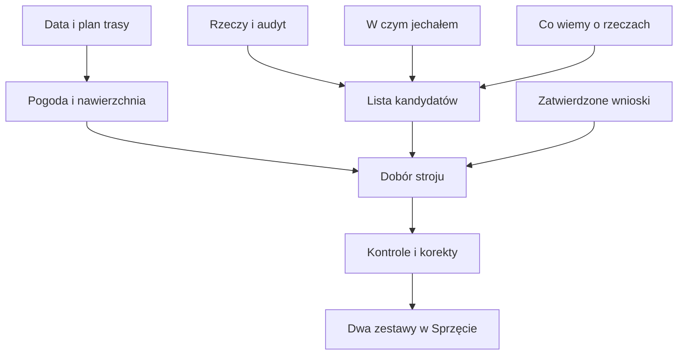

# Doradca ubioru

## Co to jest

Doradca w Analizie trasy proponuje dwa stroje na zaplanowaną jazdę: spokojniejszy i szybszy. Uwzględnia rzeczy dostępne w Garażu, warunki trasy oraz doświadczenia z wcześniejszych jazd.

## Jak liczone

1. Z planu pobierane są data, godzina, długość i postoje.
2. Do warunków dołączana jest prognoza; stan nawierzchni po opadach może pochodzić z modułu wyposażenia trasy.
3. Silnik wybiera kandydatów z Garażu. Rzeczy oznaczone `a_out` nie są proponowane.
4. Do kontekstu trafiają audyt rzeczy, historia „W czym jechałem”, obserwacje `co_wiemy` oraz zatwierdzone uwagi na przyszłość.
5. Powstają dwa warianty ubioru, a kod sprawdza ich zgodność i może je skorygować.

Zasady ubioru są rozbudowane i część z nich jest wymuszana w kodzie. Przykładowo kod ogranicza liczbę rzeczy w kieszeni i nie proponuje spodenek bez dodatkowej warstwy z wkładką. Szczegółowy przykład liczbowy z rzeczywistego doboru w bazie nie został pobrany.

> DO SPRAWDZENIA: Przykładu wyniku doradcy dla konkretnej trasy i daty z `qbot_v2.route_outfit` nie odczytano.
## Po co

Pomaga zrozumieć, jak QBot używa tej części Garażu.

## Skąd dane

Dane pochodzą z `garage.db` albo z tabel `qbot_v2` wskazanych poniżej.

## Jak liczone

Szczegóły zależą od konkretnej funkcji; sprawdzone kroki podano w opisie.

## Gdzie to widać

Garaż (`/garaz.html`) albo Analiza trasy, karta Sprzęt.

## Jak czytać

Wynik opiera się na zapisanych danych. Nie zastępuje sprawdzenia roweru ani własnej decyzji.

## Decyzje i historia

Opis zestawiono z kodem i dokumentacją.

## Ograniczenia i pułapki

Brak lub nieaktualność danych w Garażu może zmienić wynik.

## Wpływa na / Zależy od

Wplywa na: propozycje stroju w karcie Sprzęt i zapis `qbot_v2.route_outfit`.

Zależy od: planu trasy, pogody, odzieży, audytu, historii jazd i zatwierdzonych uwag.

## Powiązane hasła

- [Garaż](index.md)

## Zrodla

- [Faworyci ubioru](faworyci-ubioru.md)
- [Obserwacje sprzętu](obserwacje-sprzetu.md)
- [Wybór roweru](wybor-roweru.md)
- `/opt/qbot/app/qbot3/routes/outfit_advisor.py` — `kandydaci`, `advise`, kontrole; `/opt/qbot/app/qbot3/routes/gear_kit.py` — stan nawierzchni; `/opt/qbot/app/docs/OUTFIT_ADVISOR_RULES.md` — reguły doradcy.
