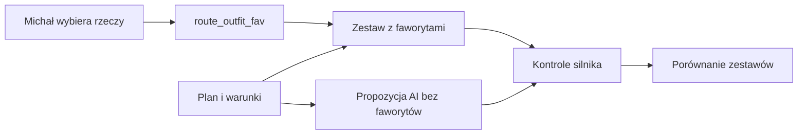

# Faworyci ubioru

## Co to jest

Faworyci to rzeczy wskazane przez Michała dla konkretnej trasy i daty. Gdy lista niepusta, karta Sprzęt pokazuje zestaw z faworytami oraz osobną propozycję AI.

## Jak działa

Faworyci są zapisywani w `qbot_v2.route_outfit_fav` dla pary trasa–data; można wskazać najwyżej 12 rzeczy. Zestaw A zawiera każdy faworyt, nawet jeśli normalny dobór nie uznałby go za kandydata. Zestaw B jest liczony w osobnym wywołaniu, które nie otrzymuje listy faworytów. Oba zestawy przechodzą kontrole silnika.

Jeśli faworyt słabo pasuje do warunków, QBot może pokazać ostrzeżenie, ale nie usuwa go z zestawu.

> DO SPRAWDZENIA: Nie odczytano rzeczywistego wpisu faworytów z bazy ani nie sprawdzono widoku po zalogowaniu.
## Po co

Pomaga zrozumieć, jak QBot używa tej części Garażu.

## Skąd dane

Dane pochodzą z `garage.db` albo z tabel `qbot_v2` wskazanych poniżej.

## Jak liczone

Szczegóły zależą od konkretnej funkcji; sprawdzone kroki podano w opisie.

## Gdzie to widać

Garaż (`/garaz.html`) albo Analiza trasy, karta Sprzęt.

## Jak czytać

Wynik opiera się na zapisanych danych. Nie zastępuje sprawdzenia roweru ani własnej decyzji.

## Decyzje i historia

Opis zestawiono z kodem i dokumentacją.

## Ograniczenia i pułapki

Brak lub nieaktualność danych w Garażu może zmienić wynik.

## Wpływa na / Zależy od

Wplywa na: jeden z dwóch zestawów prezentowanych przez [Doradcę ubioru](doradca-ubioru.md).

Zależy od: wskazań Michała dla tej trasy i daty.

## Powiązane hasła

- [Garaż](index.md)

## Zrodla

- [Doradca ubioru](doradca-ubioru.md)
- [Obserwacje sprzętu](obserwacje-sprzetu.md)
- `/opt/qbot/app/docs/OUTFIT_FAVORITES.md` — zasady faworytów; `/opt/qbot/app/qbot3/routes/outfit_fav.py` — `advise_fav`, tabela `qbot_v2.route_outfit_fav`; `/opt/qbot/app/qbot_web.py` — API outfit/fav.
