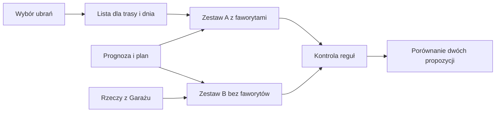

# Faworyci ubioru

## Co to jest

Faworyci to ubrania wybrane przez Ciebie dla konkretnej trasy i konkretnego dnia. Gdy wybierzesz co najmniej jedną rzecz, karta Sprzęt pokazuje zestaw z Twoimi faworytami oraz osobną propozycję bez nich.

## Po co

Użyj tej funkcji, gdy chcesz przetestować nową rzecz, zachować ulubiony element stroju albo sprawdzić, jak własny wybór wypada obok rekomendacji. Ostrzeżenie o warunkach pomaga zauważyć ryzyko, ale nie usuwa Twojego wyboru.

## Skąd dane

Lista faworytów jest przypisana do trasy i daty. Można zaznaczyć najwyżej 12 rzeczy. Doradca ubioru korzysta z tej listy i zapisuje wynikowe zestawy. W odczycie z 18.10.2026 znaleziono jedną zapisaną listę: dla trasy z 11.10.2026 były to dwie rzeczy.

## Jak liczone

1. Dla trasy z 11.10.2026 lista zawierała dwie pozycje: koszulkę z długim rękawem Albion Traverse i buty Shimano SH-EX700 GTX.
2. W zestawie A każda wskazana rzecz ma się znaleźć na sobie albo w kieszeni. System stara się nie kłaść dwóch faworytów na tę samą warstwę; jeśli zachodzi konflikt, jedna rzecz może trafić do kieszeni.
3. Faworyt pozostaje w zestawie nawet wtedy, gdy nie znalazł się na zwykłej liście kandydatów, na przykład z powodu zakresu temperatur. Karta może wtedy pokazać ostrzeżenie.
4. Zestaw B jest tworzony osobno i nie otrzymuje listy faworytów. Oba zestawy przechodzą kontrolę reguł stroju, ale automatyczna korekta zestawu A jest cofana, jeśli usunęłaby faworyta.
5. W tabeli zapisanych faworytów z odczytu z 18.10.2026 widoczny był jeden dzień i dwie pozycje z limitu 12. To przykład zawartości bazy, nie dowód, że lista ta nadal jest widoczna na ekranie.

## Gdzie to widać

W Analizie trasy wybierz kartę Sprzęt. Przycisk „Faworyci” otwiera listę rzeczy do zaznaczenia. Zrzut [Analizy trasy](../img/ekrany/raport-trasy.png) przedstawia plan, pogodę i mapę, ale panel faworytów nie jest na nim otwarty. Pełny wykaz obrazów jest w [indeksie zrzutów](../img/ekrany/indeks.md).

## Jak czytać

Zestaw A odpowiada na pytanie „jak można użyć moich wybranych rzeczy w tych warunkach?”. Zestaw B pokazuje propozycję doradcy bez narzuconych faworytów. Jeśli pojawia się ostrzeżenie, przeczytaj je przed jazdą; faworyt może być zachowany mimo słabego dopasowania do pogody.

## Decyzje i historia

Lista należy do jednej trasy i daty, bo ubiór jest wybierany na określony dzień. Zgodnie z decyzją właściciela faworyt jest zachowywany, a nie po cichu usuwany. Doradca może opisać, dlaczego wybór jest zrozumiały lub gdzie nie pasuje.

## Ograniczenia i pułapki

- Lista nie jest stałą listą ulubionych ubrań na wszystkie trasy.
- Faworyt może nie pasować do pogody; ostrzeżenie nie jest automatyczną blokadą.
- W odczycie danych znaleziono jedną listę. Nie potwierdzono widoku panelu i kliknięć w aktualnej przeglądarce.
- Dwa zapisane przykłady nie dowodzą, że użytkownik wybrał te same rzeczy w innych dniach.

## Wpływa na / Zależy od

**Wpływa na:** zestaw A i opis powodów wyboru w [doradcy ubioru](doradca-ubioru.md).

**Zależy od:** zapisanych rzeczy, trasy, daty i warunków.

## Powiązane hasła

- [Doradca ubioru](doradca-ubioru.md)
- [Obserwacje sprzętu](obserwacje-sprzetu.md)
- [Sprzęt w Garażu](sprzet.md)

## Zrodla

- `/opt/qbot/app/docs/OUTFIT_FAVORITES.md` — zasada dwóch zestawów i limit listy.
- `/opt/qbot/app/qbot3/routes/outfit_fav.py` — wybór i walidacja zestawu z faworytami.
- `/opt/qbot/app/qbot_web.py` — obsługa widoku faworytów.
- Odczyt `qbot_v2.route_outfit_fav` z 18.10.2026 — trasa `komoot-3340114493`, 11.10.2026, IDs rzeczy 249 i 98.
