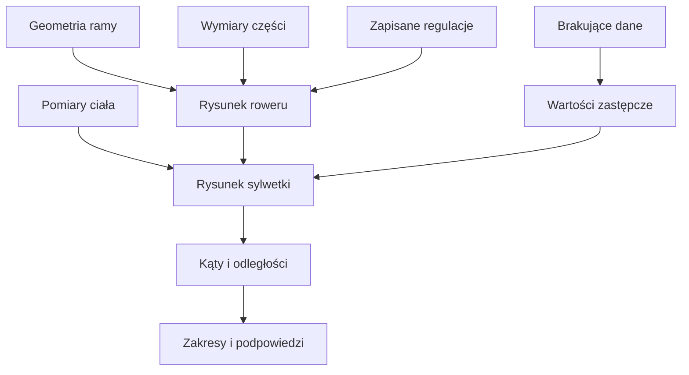

# Fitting — porównanie pozycji na rowerze

## Co to jest

Fitting pokazuje uproszczony rysunek roweru i sylwetki na podstawie geometrii, części, ustawień oraz pomiarów ciała. Możesz zapisać kilka konfiguracji i porównać ich liczby oraz kąty.

## Po co

Przydaje się do sprawdzenia, co zmieniła wymiana mostka, kierownicy lub ustawienia siodła. Wynik jest poglądowy. Nie zastępuje pomiaru u bike fittera ani konsultacji, gdy pozycja powoduje ból.

## Skąd dane

Fitting łączy geometrię ramy, części wybrane w konfiguracji, regulacje roweru i pomiary ciała. Dla brakujących danych program wstawia wartości domyślne i wypisuje je pod rysunkiem jako założenia. Ustawienia są zapisywane jako historia; jedno może być oznaczone jako bieżące.

## Jak liczone

Przykład reguły z kodu, nie wynik konkretnego pomiaru właściciela:

1. Jeśli brakuje wzrostu, model przyjmuje 1755 mm.
2. Jeśli brakuje długości mostka w danych części i ustawieniu, przyjmuje 90 mm.
3. Jeśli brakuje długości korby, przyjmuje 170 mm.
4. Jeśli brakuje podkładek, przyjmuje 0 mm; czapka sterów ma domyślnie 10 mm.
5. Z tych danych rysuje pozycję i oblicza kąty. Wynik pokazuje również listę przyjętych założeń.

To są wartości zastępcze z algorytmu. Nie należy ich przepisywać jako rzeczywistych wymiarów roweru.

## Gdzie to widać

W Garażu wybierz rower, a następnie zakładkę Fitting. W odróżnieniu od większości zakładek nie ma ona pola wyszukiwania. Można wybierać zapisane konfiguracje oraz części użyte w ustawieniu.

## Jak czytać

Kod podaje orientacyjne zakresy: kolano w dolnym położeniu korby 140–150°, biodro przy górze korby 45–60°, plecy 30–45° (na lemondce 20–35°), bark 80–95° (na lemondce 80–100°). Wynik poza zakresem wywołuje opis ostrzegawczy. Zakres nie jest diagnozą ani gwarancją komfortu.

Jeśli obok liczby widzisz „założenie”, najpierw uzupełnij rzeczywisty wymiar części lub pomiar. Dopiero potem porównuj konfiguracje. Rysunek nie modeluje między innymi pochylenia miednicy ani długości stopy; dokładność kątów jest opisana przez kod jako kilka stopni.

## Ograniczenia i pułapki

- Domyślne dane mogą zmienić pozycję na rysunku.
- Części bez wymiarów są uzupełniane zastępczo.
- Symulacja pokazuje uproszczoną sylwetkę i nie uwzględnia wszystkich cech ciała.
- Zmiana części lub ustawienia ma sens porównawczy tylko wtedy, gdy pozostałe wejścia są takie same.
- Nie znaleziono w sprawdzonych materiałach przykładu rzeczywistej sesji fittingu z kompletem pomiarów i datą.

> DO SPRAWDZENIA: Dodać przykład porównania dwóch rzeczywistych konfiguracji z zapisanymi wymiarami i datą.

## Wpływa na / Zależy od

**Wpływa na:** rysunek pozycji, podsumowanie wymiarów i kąty pokazywane w zakładce Fitting.

**Zależy od:** geometrii roweru, wybranych części, ustawień, pomiarów ciała oraz wartości zastępczych tam, gdzie brakuje danych.

## Powiązane hasła

- [Rowery i komponenty](rowery-komponenty.md)
- [Sprzęt](sprzet.md)
- [Wybór roweru](wybor-roweru.md)

## Zrodla

- `/opt/qbot/app/web_public/garaz-fit.js` — `makeModel`, `judge`, `TIPS`, wartości zastępcze i zakresy kątów.
- `/opt/qbot/app/docs/GARAZ.md` — model fittingu, wejścia i ograniczenia.
