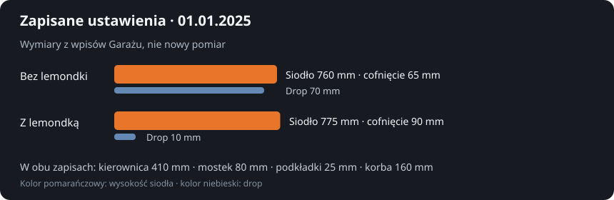
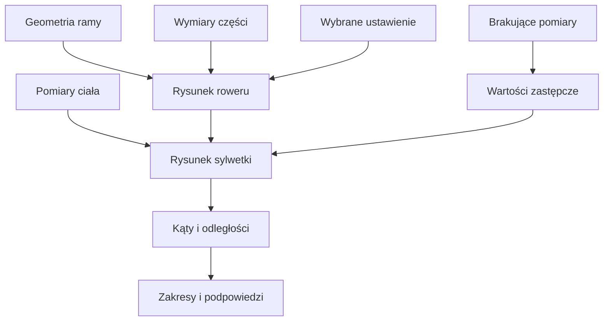

# Fitting — porównanie pozycji na rowerze

## Co to jest

Fitting (uproszczone dopasowanie [pozycji](../slowniczek.md#fitting)) to poglądowy rysunek roweru i sylwetki. Łączy geometrię ramy, zapisane części, ustawienia oraz wymiary ciała. Możesz zachować kilka konfiguracji i porównać podane liczby oraz kąty.

## Po co

Przydaje się, gdy chcesz sprawdzić, co zmienia wysokość siodła, długość mostka, podkładki lub kierownica. Gdy dwa ustawienia różnią się w wielu miejscach, porównaj te same wymiary i sprawdź, czy każdy ma rzeczywisty pomiar. Rysunek nie zastępuje wizyty u specjalisty ani oceny bólu.

## Skąd dane

Geometria opisuje ramę. Części dostarczają swoich wymiarów, jeśli zostały wpisane. Ustawienie zawiera regulacje, takie jak wysokość i cofnięcie siodła. Pomiary ciała mają daty; model korzysta z najnowszych dostępnych. Gdy czegoś brakuje, pokazuje wartość zastępczą i opisuje ją jako założenie.

## Jak liczone

W bazie z 18.10.2026 były dwa pełne wpisy ustawień fittera, oba z datą ustawienia 01.01.2025. Wymiary są podane poniżej w milimetrach; liczby te pochodzą z zapisów, a nie z ponownego pomiaru.

1. Wariant bez lemondki: wysokość siodła 760 mm, cofnięcie 65 mm, kąt siodła 3,8°, kierownica 410 mm, mostek 80 mm, podkładki 25 mm, korba 160 mm.
2. Wariant z lemondką: wysokość siodła 775 mm, cofnięcie 90 mm, kąt siodła 5°, kierownica 410 mm, mostek 80 mm, podkładki 25 mm, korba 160 mm.
3. Zapisane wartości reach (wysunięcie)/stack (wysokość)/drop (różnica wysokości) wynoszą odpowiednio 443/670/70 mm bez lemondki oraz 415/670/10 mm z lemondką. To wymiary opisujące pozycję; [słowniczek](../slowniczek.md#fitting) objaśnia ogólnie, jak czytać rysunek.
4. Zmieniają się przede wszystkim ustawienie siodła i zasięg do kierownicy/lemondki; szerokość kierownicy, mostek, podkładki i długość korby w obu zapisach są takie same.
5. Model rysuje punkty roweru, a następnie szacuje stawy na podstawie wymiarów ciała i ustawia nogę w wybranym położeniu korby. Porównanie może zawierać kąt kolana, biodra, pleców i barku.
6. Odrębny wpis „Moje – aktualne” z datą 24.09.2026 ma wysokość siodła 755 mm i podkładki 5 mm, ale nie ma cofnięcia siodła ani kompletu zmierzonych wartości. Nie należy więc traktować go jako pełnego porównania z dwiema konfiguracjami fittera.

Wzór

Położenie górnej części ramy wynika z jej wysokości i wysunięcia. Do niego kod dodaje długość mostka oraz wysokość podkładek i czapki sterów. Położenie chwytów uzupełnia wymiar kierownicy. Następnie model ustawia nogi i ręce, a z położenia stawów oblicza kąty. To uproszczony model geometryczny, a nie analiza ruchu z kamery.

## Gdzie to widać

W Garażu wybierz rower, a potem zakładkę Fitting. Możesz wskazać zapisane ustawienie i części. Dostępny [zrzut Garażu](../img/ekrany/garaz.png) pokazuje kartę roweru i tabelę komponentów, ale nie sam rysunek fittingu; nie ma osobnego zrzutu tej zakładki w [indeksie ekranów](../img/ekrany/indeks.md).

## Jak czytać

Orientacyjne zakresy kodu to: kolano w dolnym położeniu 140–150°, biodro w górnym położeniu 45–60°, plecy 30–45° (na lemondce 20–35°), bark 80–95° (na lemondce 80–100°). Zakres poza tymi granicami wywołuje opisową podpowiedź, nie diagnozę. Jeśli obok liczby widzisz założenie, uzupełnij rzeczywisty wymiar przed porównywaniem ustawień.

## Decyzje i historia

Ustawienia są historią, a nie nadpisywanym pojedynczym pomiarem. Wymiary katalogowe części składają się na pozycję; zapisane pomiary fittera mogą być prezentowane oddzielnie. Właściciel rozdzielił ustawienia fittera od swojej bieżącej konfiguracji z lemondką. Wpis bieżący z 24.09.2026 ma nieuzupełnione cofnięcie siodła.

## Ograniczenia i pułapki

- Brakujące wymiary są zastępowane wartościami domyślnymi. Sprawdź opis „Założenia” pod rysunkiem.
- Model nie uwzględnia pochylenia miednicy ani długości stopy; długości ud i podudzi mogą być szacowane ze wzrostu.
- Dokładność kątów ciała jest określona jako kilka stopni.
- Dwie daty ustawień w przykładzie są takie same; to dwa warianty wpisane do historii, a nie dowód na dwa pomiary wykonane tego dnia.
- Brak zrzutu samego panelu fittingu ogranicza potwierdzenie układu ekranu.

## Wpływa na / Zależy od

**Wpływa na:** rysunek pozycji oraz podawane kąty i wymiary w zakładce Fitting.

**Zależy od:** geometrii ramy, części, ustawienia, wymiarów ciała i jawnie pokazanych założeń.

## Powiązane hasła

- [Rowery i komponenty](rowery-komponenty.md)
- [Sprzęt w Garażu](sprzet.md)
- [Słowniczek: fitting](../slowniczek.md#fitting)

## Zrodla

- `/opt/qbot/app/web_public/garaz-fit.js` — `model`, `rider`, `judge`, wartości zastępcze i zakresy kątów.
- `/opt/qbot/app/docs/GARAZ.md` — model danych i opis rysunku.
- Odczyt `garage.db` z 18.10.2026 — trzy ustawienia Grizla, pomiary ciała i daty.
- `img/garaz-fitting-2025.svg` — wykres dwóch zapisanych wariantów fittera.
