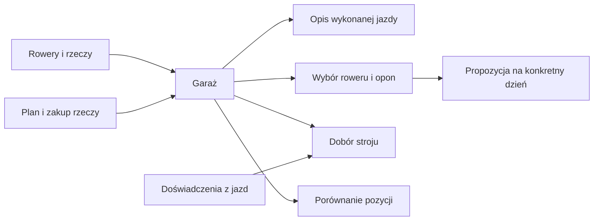

# Garaż

## Co to jest

Garaż to katalog Twoich rowerów, części, kół, ubrań, wyposażenia i zakupów. Wybrane wpisy są wykorzystywane w raportach jazdy, planowaniu trasy i doborze stroju. Garaż nie mierzy automatycznie stanu rzeczy: pokazuje to, co zapisano.

Na zrzucie z 18.10.2026 aktywna jest zakładka Rower. U góry są karty rowerów, filtr „wszystkie rowery”, wybór kolumn, przełącznik wycofanych pozycji i przyciski dodawania. Niżej w tabeli widać rower, kategorię, markę, model, pozycję, status, wagę i przebieg. Widoczny licznik pokazuje 68 komponentów.

## Po co

Przed wyjazdem możesz sprawdzić zapisany rower, koła i opony. Po wymianie części możesz uzupełnić model, masę lub pozycję. Gdy planujesz trasę, inna część systemu może wziąć pod uwagę zapisane rowery i ich opony. Przy zakupie możesz zachować planowaną pozycję oraz cenę zakupu.

## Skąd dane

Stan bazy odczytany 18.10.2026 obejmował 4 aktywne rowery, 72 wszystkie wpisy części, z których 68 było aktywnych, oraz 16 opon. Te 68 aktywnych części zgadza się z licznikiem strony i zrzutem; różnica względem 72 oznacza wpisy nieaktywne, których licznik nie obejmuje. Aktywne części dzieliły się na 54 zamontowane i 14 zapasowych. Baza miała także 3 ustawienia dopasowania pozycji, 2 wpisy pomiarów ciała i 1 notatkę warsztatową.

## Jak działa

1. Wybierz zakładkę odpowiadającą temu, czego szukasz: Rower, Odzież, Sprzęt, Wyprawy, Fitting, Instrukcje, Notatki lub Zakupy. Zalogowany odczyt strony z 18.10.2026 potwierdził jej tytuł i elementy potrzebne do wyświetlenia tych obszarów; nie potwierdzono każdego przycisku kliknięciem.
2. W tabeli użyj wyszukiwarki, filtra roweru lub wyboru kolumn. Te ustawienia porządkują widok, ale nie zmieniają zapisu części.
3. Sprawdź status. „Zamontowany” opisuje wpis jako używany, a „zapas” oznacza nieużywaną teraz rzecz. „Pokaż wycofane” odsłania elementy poza bieżącym użyciem.
4. Po aktualizacji wpisu inne funkcje mogą korzystać z nowych danych. Przykład: odczyt części z 18.10.2026 pokazał 72 wpisy ogółem, ale aktywna lista zawierała 68.
5. Jeśli informacja jest niepewna, najpierw ją uzupełnij. Brak wartości przy wadze lub przebiegu nie oznacza zera.

## Gdzie to widać

Strona Garaż jest dostępna z menu serwisu. Zrzut desktopowy i mobilny są opisane w [indeksie ekranów](../img/ekrany/indeks.md). Na pokazanym obrazie wyszukiwarka znajduje się w prawym górnym rogu, zakładki są pod nazwą GARAZ, a licznik komponentów po prawej stronie paska tabeli. Pozostałe hasła opisują każdą część osobno.

## Jak czytać

Liczba komponentów oznacza aktywne wpisy części, a nie wszystkie historyczne rekordy. Status w tabeli jest ręcznie utrzymywanym zapisem. Kreska przy wadze lub przebiegu oznacza brak wyświetlanej wartości. Karta roweru może pokazywać przebieg, nazwę opony i podstawowe informacje, ale nie jest pełną historią napraw.

## Decyzje i historia

Garaż ma odrębne listy dla rowerów i części oraz zakładki dla fittingu, notatek i zakupów. Zmiana filtrów lub widocznych kolumn nie powinna być mylona ze zmianą samego wpisu. Niektóre szczegóły, takie jak notatki warsztatowe, są przeznaczone do ręcznego odczytu i nie są automatycznie podawane doradcy.

## Ograniczenia i pułapki

- Dane zależą od tego, czy wpis został poprawnie uzupełniony i zaktualizowany.
- Ten sam wpis może być aktywny, zapasowy lub historyczny; sprawdź status przed wyciąganiem wniosków.
- Nie każda funkcja korzysta z wszystkich elementów Garażu.
- Lista komponentów w bazie liczyła 72 wpisy, ale 68 aktywnych. To wyjaśnia zgodność licznika ekranu 68 z filtrem aktywnych pozycji; nie stwierdzono tu błędu serwisu.
- Zalogowane pobranie strony i odczyt listy zakupów z 18.10.2026 działały. Nie sprawdzono interaktywnie wszystkich zakładek i formularzy.

## Wpływa na / Zależy od

**Wpływa na:** opis roweru w raporcie, rekomendację roweru i opon, dobór ubioru, fitting oraz przypomnienia o zapasach — zależnie od konkretnego wpisu.

**Zależy od:** danych wpisanych lub poprawionych przez właściciela oraz informacji z jazd, które są jawnie zapisywane.

## Powiązane hasła

- [Sprzęt w Garażu](sprzet.md)
- [Rowery i komponenty](rowery-komponenty.md)
- [Koła i opony](kola-opony.md)
- [Rozpoznawanie roweru](rozpoznawanie-roweru.md)
- [Wybór roweru](wybor-roweru.md)
- [Fitting](fitting.md)
- [Zakupy](zakupy.md)
- [Dodawanie produktu ze sklepu do Garażu](dodaj-zakup-ze-sklepu.md)
- [Kalibracja zdjęć na stronie Start](kalibracja-zdjec.md)
- [Planer wyposażenia wyprawy](planer-wyposazenia.md)
- [Symulator QExt2](../qext2/symulator.md) — podgląd przykładowych ekranów Karoo.
- [Doradca ubioru](doradca-ubioru.md)
- [Notatki warsztatowe](notatki-warsztatowe.md)

## Zrodla

- `/opt/qbot/app/docs/GARAZ.md` — zakres modułu i opis danych.
- `/opt/qbot/app/web_public/garaz.html`, `garaz-tabs.js`, `garaz-columns.js`, `garaz-search.js` — strona, zakładki, kolumny i wyszukiwanie.
- `/opt/qbot/app/qbot3/routes/gear_kit.py` — użycie rowerów i opon przy planowaniu trasy.
- Odczyt `garage.db` i zalogowany GET `/api/bike/config` z 18.10.2026 — 4 rowery, 68 aktywnych części i 16 opon.
- `img/ekrany/garaz.png`, `img/ekrany/indeks.md` — widok i spis zrzutów.
