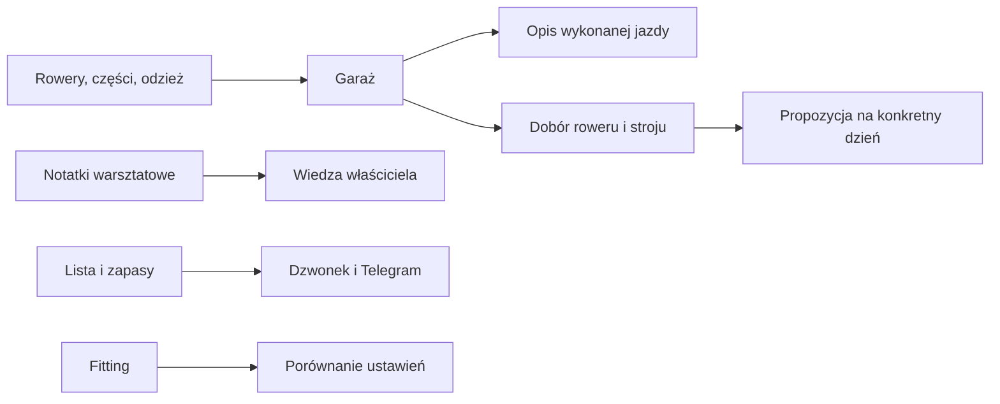

# Garaż

Garaż to katalog rowerów, części, odzieży i wyposażenia. Pomaga sprawdzić, co masz, przygotować rower oraz przekazać wybrane informacje do raportu jazdy i planu trasy.

Na zrzucie z 18.10.2026 aktywna jest zakładka **Rower**. U góry widać cztery karty rowerów. Niżej tabela komponentów z kolumnami rower, kategoria, marka, model, pozycja, status, waga i przebieg. Po prawej przy wierszach są przyciski edycji i wycofania. W górnym pasku są też wyszukiwarka, wybór rowerów, ustawienie kolumn oraz dodawanie roweru i komponentu. Licznik na zrzucie pokazuje 68 komponentów; jest to stan z chwili wykonania zrzutu, a nie gwarantowana liczba bieżąca.

## Jak działa dział

## Co widzisz na ekranie

| Na ekranie | Co oznacza | Hasło |
|---|---|---|
| Karty rowerów ze zdjęciem i przebiegiem | Skrót o każdym zapisanym rowerze; brak zdjęcia daje pustą kartę | [Rowery i komponenty](rowery-komponenty.md) |
| Filtr „wszystkie rowery” | Zawęża widok części do roweru | [Sprzęt](sprzet.md) |
| „Kolumny” | Pozwala wybrać widoczne pola tabeli | [Sprzęt](sprzet.md) |
| „Pokaż wycofane” | Włącza widok części poza bieżącym użyciem | [Sprzęt](sprzet.md) |
| „+ Dodaj rower” i „+ Dodaj komponent” | Otwiera formularze katalogu | [Rowery i komponenty](rowery-komponenty.md) |
| Tabela komponentów: pozycja, status, waga, przebieg | Dane zapisane o częściach, również zapasowych | [Sprzęt](sprzet.md) |
| Zakładka koła i opony | Koła roweru i przypisane do nich opony | [Koła i opony](kola-opony.md) |
| Zakładka Fitting | Rysunek pozycji i porównanie ustawień | [Fitting](fitting.md) |
| Zakładka Notatki | Notatki warsztatowe oznaczone rowerem | [Notatki warsztatowe](notatki-warsztatowe.md) |
| Zakładka Zakupy | Planowane zakupy, kupione rzeczy i zapasy | [Zakupy](zakupy.md) |

## Przykład z ekranu

1. Na zrzucie z 18.10.2026 pierwsza karta ma nazwę „Canyon Grizl CF SL 2025”, oponę „Pineapple Gummy” i przebieg 9791 km. To liczby pokazane przez ekran w chwili zrzutu.
2. W tabeli wiersz „MugGuard Front” ma status „zapas”. Nie jest więc pokazany jako zamontowany na rowerze.
3. Wiersz „Quick Release Aero Bars” ma status „zamontowany” i pozycję „kokpit”. W tabeli jest masa 343 g przy jednym z zestawów kasety; kreska oznacza brak pokazanej wartości, a nie zero.

Ten przykład opisuje wyłącznie zawartość zrzutu. Wartości bieżące mogą się zmienić po edycji wpisów.

## Po co

Przed jazdą możesz sprawdzić, który rower ma odpowiednie koła i wyposażenie. Po zakupie możesz dopisać część i jej dane. Przy planowaniu trasy QBot może skorzystać z zapisanych rowerów, kół, opon oraz odzieży.

## Ograniczenia

Garaż jest katalogiem wpisów, a nie automatycznym pomiarem stanu sprzętu. Przebieg, masa, dopasowanie i status są wiarygodne tylko w takim stopniu, w jakim zostały uzupełnione. Nie każda rzecz zapisana w Garażu trafia do każdej rekomendacji.

## Wpływa na / Zależy od

**Wpływa na:** przypisanie roweru do jazdy, podpowiedzi wyposażenia i ubioru, oraz informacje o kołach i oponach.

**Zależy od:** wpisów dodanych i poprawionych przez właściciela. Osobne hasła opisują poszczególne przepływy; zobacz [mapę zależności](../zaleznosci.md).

## Powiązane hasła
- [Faworyci ubioru](faworyci-ubioru.md)
- [Obserwacje sprzętu](obserwacje-sprzetu.md)
- [Przypomnienia zakupowe](przypomnienia-zakupowe.md)

- [Sprzęt](sprzet.md)
- [Rowery i komponenty](rowery-komponenty.md)
- [Koła i opony](kola-opony.md)
- [Rozpoznawanie roweru](rozpoznawanie-roweru.md)
- [Wybór roweru](wybor-roweru.md)
- [Zakupy](zakupy.md)
- [Doradca ubioru](doradca-ubioru.md)
- [Fitting](fitting.md)
- [Notatki warsztatowe](notatki-warsztatowe.md)

## Zrodla

- `img/ekrany/garaz.png` — zrzut interfejsu z 18.10.2026.
- `/opt/qbot/app/docs/GARAZ.md` — zakres zakładek i dane Garażu.
- `/opt/qbot/app/web_public/garaz-tabs.js` — zakładki Rower i komponenty.
- `/opt/qbot/app/web_public/garaz-columns.js` — wybór kolumn tabeli.
- `/opt/qbot/app/web_public/garaz-search.js` — wyszukiwanie zależne od zakładki.
- `mapa-serwisu.md` — strona Garaż.
