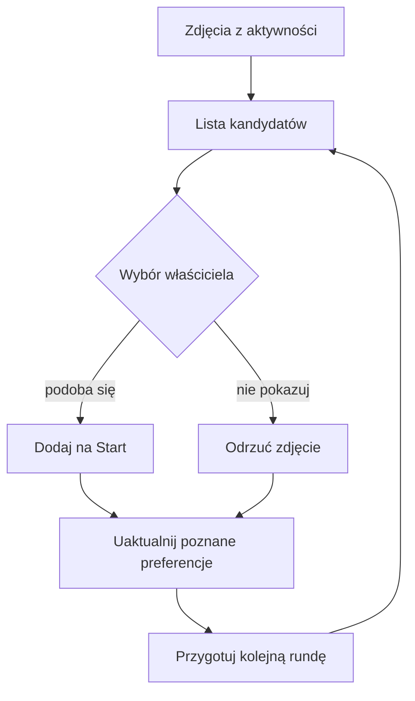
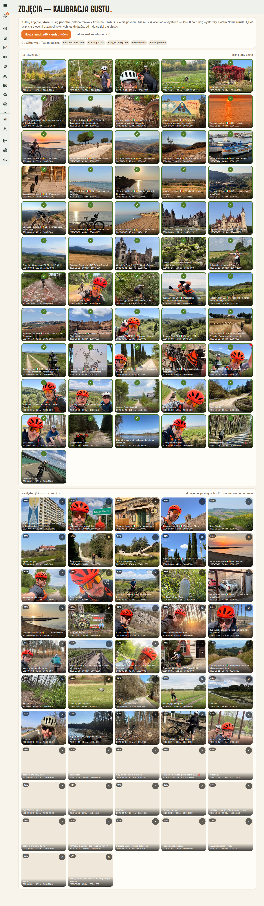

# Kalibracja zdjęć na stronie Start

## Co to jest

To ekran, na którym wskazujesz zdjęcia, które mają pojawiać się na stronie Start. QBot pokazuje kandydatów powiązanych z aktywnościami Stravy, a oceny pomagają mu wybierać kolejne.

## Po co

Użyj go, gdy chcesz poprawić zdjęcie główne lub zestaw zdjęć na Start. Zielona ramka oznacza zdjęcie wybrane. Krzyżyk odrzuca zdjęcie. Możesz oceniać tylko część propozycji.

## Skąd dane

Zdjęcia pochodzą z aktywności Stravy. Automat pobiera propozycje zdjęć z nowych jazd co trzy godziny między 07:00 a 22:00; pierwszą kontrolę wykonuje 10 minut po starcie usługi. Ekran pobiera listę zdjęć i wcześniejsze oceny. Może pokazać tytuł aktywności, dzień, dystans oraz rozmiar zdjęcia. Model gustu korzysta z ocen zapisanych wcześniej; przed pierwszymi ocenami wyświetla wstępne założenia. Zdjęcia i ich opisy są danymi prywatnymi, dlatego nie podaję tu przykładów konkretnych fotografii.

## Jak liczone

1. Otwierasz „Zdjęcia — kalibracja gustu”. Ekran pokazuje wybrane zdjęcia i kandydatów.
2. Klikasz zdjęcie, które chcesz widzieć na Start. Zielona ramka oznacza, że zostało dodane do wybranych.
3. Klikasz krzyżyk przy zdjęciu, którego nie chcesz. Odrzucenie usuwa je z bieżącej listy kandydatów.
4. Możesz zdjąć wcześniejszy wybór, klikając kafel w sekcji „Na START”.
5. Przycisk „Nowa runda” pobiera do 60 kolejnych kandydatów. Ekran podpowiada, że wygodna runda to około 15–20 ocen; nie musisz ocenić wszystkich zdjęć.
6. Po nowych ocenach ekran ponownie pokazuje kandydatów uszeregowanych według dopasowania do zapisanych preferencji.

Nie podaję liczbowego przykładu oceny z konkretnego dnia, bo odczyt bazy nie zawierał tutaj bezpiecznego, publicznego przykładu, który byłby potrzebny do zrozumienia działania. Liczby 60 i 15–20 pochodzą z tekstu widocznego na stronie.

## Gdzie to widać

Stronę otworzysz z menu QBota pod pozycją „Zdjęcia”. Na górze znajduje się przycisk nowej rundy i krótki opis działania. Niżej widać wybrane zdjęcia „Na START”, kandydatów oraz informację o poznanych preferencjach.

## Jak czytać

- Procent przy kandydacie oznacza dopasowanie do dotychczasowych ocen, a nie obiektywną jakość zdjęcia.
- „Nauczone z N ocen” oznacza liczbę ocen użytych w bieżącym opisie gustu. Nie jest to liczba zdjęć na stronie Start.
- Jeśli kandydatów brakuje, użyj „Nowa runda”. Jeśli przycisk jest wyłączony, trwa pobieranie lub przygotowanie zdjęć.
- Odrzucenie ma inne znaczenie niż usunięcie z „Na START”: pierwsze mówi, że nie chcesz tej propozycji, drugie wycofuje wcześniejszy wybór.

## Decyzje i historia

Ekran daje właścicielowi prosty sposób poprawiania zestawu zdjęć bez ręcznego układania reguł. Model zmienia kolejność kandydatów na podstawie ocen; końcowa decyzja o zdjęciu na Start pozostaje po stronie właściciela.

## Ograniczenia i pułapki

- Procent dopasowania nie gwarantuje, że zdjęcie zostanie wybrane.
- Zdjęcia muszą być dostępne po stronie usługi, z której pochodzą aktywności.
- Odrzucony kandydat może nie być oceną całej aktywności ani jej jakości.
- > DO SPRAWDZENIA: potwierdzić, czy bieżący ekran wyświetla tylko zdjęcia z aktywności Stravy, czy także zdjęcia dodane innymi drogami.

## Wpływa na / Zależy od

- **Wpływa na:** wybór zdjęć pokazywanych na stronie Start i kolejność następnych kandydatów.
- **Zależy od:** dostępnych zdjęć, zapisanych ocen i połączenia z usługą zdjęć.

## Powiązane hasła

- [Strava](../polaczenia/strava.md)
- [Automaty](../system/automaty.md)
- [Mapa serwisu](../mapa-serwisu.md)
- [Strony WWW](../system/strony-www.md)

## Zrodla

- `/opt/qbot/web/public/zdjecia.html` — tekst, przyciski i reakcje ekranu.
- `/opt/qbot/app/qbot_strava.py` — `/api/strava/review`, `/api/strava/round`, `/api/strava/rate` oraz automatyczna kontrola zdjęć.
- `qbot_v2.strava_photo`, `qbot_v2.strava_taste` — zdjęcia oraz zapis modelu preferencji.
