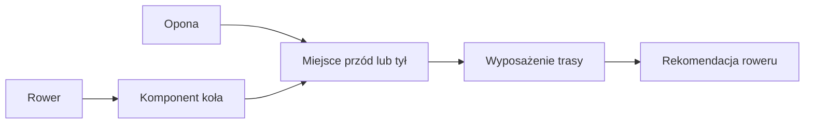

# Koła i opony

## Co to jest

Garaż łączy oponę z konkretnym kołem oraz pozycją: przód albo tył. Dzięki temu panel wyposażenia trasy może pokazać, jakie opony są założone na wybranym zestawie kół.

## Jak działa

W bazie opona ma `wheel_id` i `position`. Dokument Garażu mówi, że jedno miejsce na kole może wskazywać jedną oponę; gdy opona zostanie przypisana do zajętego miejsca, poprzednia wraca do Garażu. Dobór roweru odczytuje markę, model, szerokość, typ i pozycję opon przez `wheel_mounts`.

> DO SPRAWDZENIA: Nie udało się potwierdzić bieżących wpisów montażu opon przykładem z bazy; odczyt nie zakłada nieznanego schematu pól.
## Po co

Pomaga zrozumieć, jak QBot używa tej części Garażu.

## Skąd dane

Dane pochodzą z `garage.db` albo z tabel `qbot_v2` wskazanych poniżej.

## Jak liczone

Szczegóły zależą od konkretnej funkcji; sprawdzone kroki podano w opisie.

## Gdzie to widać

Garaż (`/garaz.html`) albo Analiza trasy, karta Sprzęt.

## Jak czytać

Wynik opiera się na zapisanych danych. Nie zastępuje sprawdzenia roweru ani własnej decyzji.

## Decyzje i historia

Opis zestawiono z kodem i dokumentacją.

## Ograniczenia i pułapki

Brak lub nieaktualność danych w Garażu może zmienić wynik.

## Wpływa na / Zależy od

Wplywa na: [Wybór roweru](wybor-roweru.md).

Zależy od: przypisania opon do kół w `garage.db`.

## Powiązane hasła

- [Garaż](index.md)

## Zrodla

- [Rowery i komponenty](rowery-komponenty.md)
- [Wybór roweru](wybor-roweru.md)
- `/opt/qbot/app/docs/GARAZ.md` — `tires`, `wheel_mounts`; `/opt/qbot/app/qbot3/routes/gear_kit.py` — `wheel_mounts` w danych wejściowych.
