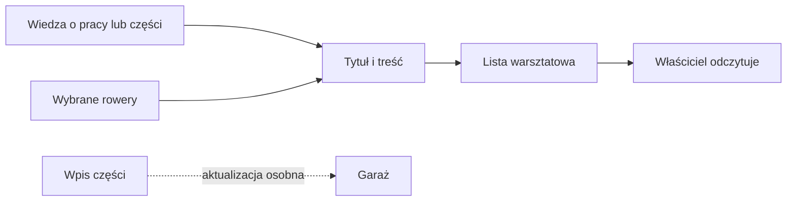

# Notatki warsztatowe

## Co to jest

Notatki warsztatowe są tekstowym miejscem na informacje o rowerach i pracach przy sprzęcie. Można oznaczyć, których rowerów dotyczy notatka. To osobna funkcja względem krótkiego opisu specyfikacji w karcie roweru.

## Po co

Zapisz tu np. sprawdzoną długość łańcucha, kolejność części albo informację, którą chcesz mieć pod ręką przed wyjazdem. Notatka pozostaje informacją dla właściciela: nie zmienia automatycznie części ani rekomendacji.

## Skąd dane

Notatki dodaje i aktualizuje użytkownik. Odczyt z 18.10.2026 zawierał jedną notatkę „Łańcuchy — długości i rotacja”, przypisaną do Grizla i Graila. Zapis miał datę utworzenia 09.10.2026.

## Jak działa

1. Nadaj notatce tytuł, wpisz treść i wybierz rowery, których dotyczy. Pusta lista rowerów oznacza notatkę ogólną.
2. W przykładzie z 09.10.2026 notatka obejmowała Grizla i Graila. Zawierała osobne zestawienia długości łańcuchów dla każdego roweru.
3. Dla Graila zapisano między innymi dwa łańcuchy Force o długości 116 ogniw jako główną rotację, a dla Grizla sprawdzone długości 110 i 112 ogniw przy kasecie 10–46.
4. Zapis możesz sformatować prostym tekstem, listami, pogrubieniem i tabelą. Notatka widoczna jest w zakładce Notatki.
5. Zmiana notatki nie zmienia wpisów o częściach. Jeśli chcesz zmienić status lub część, przejdź do [sprzętu](sprzet.md) i uaktualnij właściwy wpis.

## Gdzie to widać

W Garażu wybierz zakładkę Notatki. Na zrzucie [Garażu](../img/ekrany/garaz.png) widać etykietę „Notatki” w górnym pasku, ale nie otwartą listę; pełny wykaz zrzutów jest w [indeksie ekranów](../img/ekrany/indeks.md).

## Jak czytać

Sprawdź datę i rowery, których dotyczy wpis. Notatka może zawierać plan albo własną obserwację, a nie pomiar automatyczny. W przykładowym wpisie liczby długości łańcuchów są poradą zapisaną przez właściciela, nie wynikiem systemowego pomiaru.

## Decyzje i historia

Notatki warsztatowe są oddzielone od pola opisu roweru. Decyzja z 09.10.2026 stanowi, że Albert nie czyta tej listy. Informacje do rozmowy lub analizy są pobierane przez uprawnioną sesję z narzędziami do odczytu, a nie włączane do każdej odpowiedzi Alberta.

## Ograniczenia i pułapki

- Notatka nie aktualizuje katalogu części ani historii montażu.
- Daty i zalecenia wpisuje właściciel; nie są potwierdzane czujnikiem.
- W odczycie z 18.10.2026 była jedna notatka. Nie dowodzi to, że wszystkie prace zostały opisane.
- Nie potwierdzono widoku listy po zalogowaniu; zrzut przedstawia inną zakładkę.

## Wpływa na / Zależy od

**Wpływa na:** dostęp do zapamiętanych instrukcji i historii dla właściciela. Nie ma potwierdzonego automatycznego wpływu na wybór roweru ani dobór ubioru.

**Zależy od:** tekstu, daty i wybranych rowerów zapisanych przez użytkownika.

## Powiązane hasła

- [Garaż](index.md)
- [Rowery i komponenty](rowery-komponenty.md)
- [Sprzęt](sprzet.md)

## Zrodla

- `/opt/qbot/app/docs/GARAZ.md` — rozdział Notatki.
- `/opt/qbot/app/web_public/garaz-notatki.js` — ekran notatek.
- `/opt/qbot/app/qbot_web.py` — odczyt i zapis notatek.
- Odczyt `garage.db` z 18.10.2026 — notatka utworzona 09.10.2026, przypisana do rowerów 1 i 5.
- `img/ekrany/garaz.png`, `img/ekrany/indeks.md` — etykieta zakładki i spis zrzutów.
