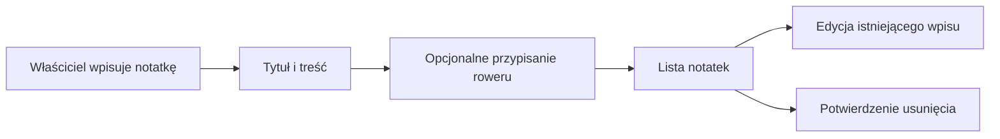

# Notatki warsztatowe

## Co to jest

Notatki warsztatowe to własne wpisy o naprawach, częściach i czynnościach przy rowerze. Można przypisać notatkę do jednego lub kilku rowerów albo zostawić ją jako ogólną.

## Po co

Zapisz tu na przykład wymianę łańcucha, wykonany serwis albo uwagę, którą chcesz mieć pod ręką przy następnej pracy. Notatka pomaga właścicielowi zachować historię, ale nie jest automatycznym dziennikiem serwisowym.

## Skąd dane

Wpisujesz tytuł i treść samodzielnie. Możesz dodać identyfikatory rowerów jako etykiety. Puste przypisanie oznacza notatkę ogólną. Wpis roweru ma osobne pole opisu/specyfikacji; nie jest ono tą samą funkcją co lista notatek.

## Jak działa

1. Otwórz zakładkę Notatki i dodaj tytuł oraz treść.
2. Opcjonalnie przypisz rower. Jedna notatka może dotyczyć kilku rowerów.
3. Zapisana treść może zawierać pogrubienie, listy, proste tabele i nagłówki.
4. Przy edycji zapis aktualizuje istniejący wpis. Usunięcie wymaga potwierdzenia.

## Gdzie to widać

W Garażu wybierz zakładkę Notatki. Można wyszukiwać notatki z pola wyszukiwania tej zakładki.

## Jak czytać

Treść jest zapisem właściciela, a nie potwierdzeniem, że praca została wykonana przez warsztat. Warto wpisywać datę, przebieg, nazwę części i rezultat, jeśli chcesz później odtworzyć historię. Taki sposób prowadzenia zapisu jest wskazówką dla użytkownika, nie automatyczną kontrolą aplikacji.

## Ograniczenia i pułapki

- Notatka nie zmienia automatycznie przebiegu ani statusu części.
- Albert nie odczytuje tych notatek; dokumentacja projektu wskazuje sesje Claude/DEV jako miejsce ich przeglądania.
- Nie potwierdzono bieżącego przykładowego wpisu ani widoku zakładki na zrzucie ekranu.

> DO SPRAWDZENIA: Dodać przykład notatki warsztatowej z rzeczywistą datą i rowerem po odczycie przykładowego wpisu.

## Wpływa na / Zależy od

**Wpływa na:** prywatną historię serwisową dostępną w Garażu. Potwierdzony kod nie przekazuje tych wpisów do rekomendacji roweru ani stroju.

**Zależy od:** treści wpisanej i przypisania do roweru przez właściciela.

## Powiązane hasła

- [Garaż](index.md)
- [Rowery i komponenty](rowery-komponenty.md)
- [Zakupy](zakupy.md)

## Zrodla

- `/opt/qbot/app/docs/GARAZ.md` — zakładka Notatki i tabela `bike_notes`.
- `/opt/qbot/app/web_public/garaz-notatki.js` — ekran i obsługa notatek.
- `/opt/qbot/app/qbot_web.py` — `/api/bike-notes/list`, `/api/bike-notes/save`, `/api/bike-notes/delete`, `_bike_notes_conn`.
