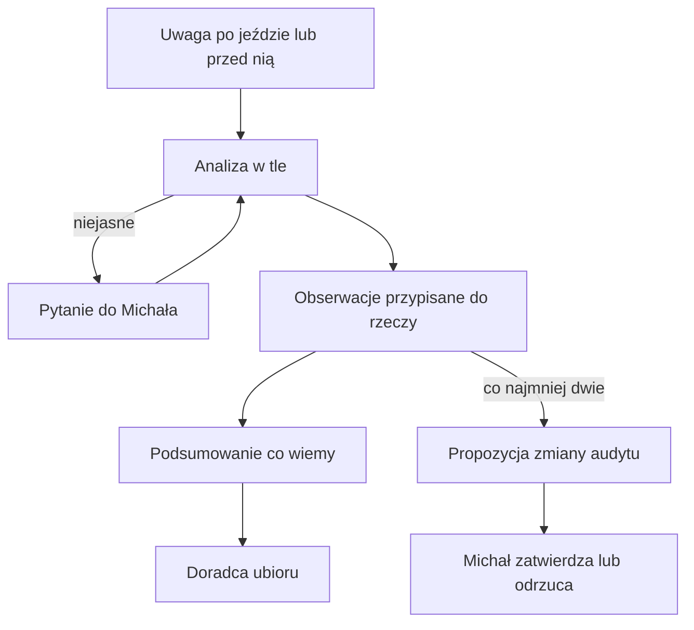

# Obserwacje sprzętu

## Co to jest

Obserwacje zbierają uwagi Michała po jeździe albo przed doborem stroju i przypisują je do rzeczy z Garażu. QBot tworzy krótkie podsumowanie „co wiemy”, z którego korzysta doradca ubioru.

## Jak działa

Uwaga jest analizowana w tle. Gdy jest niejasna, system może zadać jedno pytanie. Dla rzeczy zapisuje aspekt, wynik, opis, możliwe inne przyczyny i siłę obserwacji. Audyt pozostaje podstawą. Propozycja zmiany audytu powstaje dopiero przy co najmniej dwóch obserwacjach tego samego aspektu, z których nie wszystkie są słabe; Michał zatwierdza ją lub odrzuca.

Obserwacja nie zmienia automatycznie audytu. Podsumowanie może być użyte przy doborze, z uwzględnieniem poziomu pewności.

> DO SPRAWDZENIA: Aktualnych rekordów obserwacji i przykładowego podsumowania nie odczytano z `garage.db`.
## Po co

Pomaga zrozumieć, jak QBot używa tej części Garażu.

## Skąd dane

Dane pochodzą z `garage.db` albo z tabel `qbot_v2` wskazanych poniżej.

## Jak liczone

Szczegóły zależą od konkretnej funkcji; sprawdzone kroki podano w opisie.

## Gdzie to widać

Garaż (`/garaz.html`) albo Analiza trasy, karta Sprzęt.

## Jak czytać

Wynik opiera się na zapisanych danych. Nie zastępuje sprawdzenia roweru ani własnej decyzji.

## Decyzje i historia

Opis zestawiono z kodem i dokumentacją.

## Ograniczenia i pułapki

Brak lub nieaktualność danych w Garażu może zmienić wynik.

## Wpływa na / Zależy od

Wplywa na: pole `co_wiemy` używane przez [Doradcę ubioru](doradca-ubioru.md); propozycja audytu czeka na decyzję Michała.

Zależy od: uwag o konkretnych rzeczach oraz analizy w tle.

## Powiązane hasła

- [Garaż](index.md)

## Zrodla

- [Doradca ubioru](doradca-ubioru.md)
- [Faworyci ubioru](faworyci-ubioru.md)
- `/opt/qbot/app/docs/GEAR_OBS.md` — przepływ i tabele; `/opt/qbot/app/qbot3/routes/gear_obs.py` — `process_note`, `refresh_knowledge`; `/opt/qbot/app/qbot3/routes/outfit_advisor.py` — pole `co_wiemy`.
