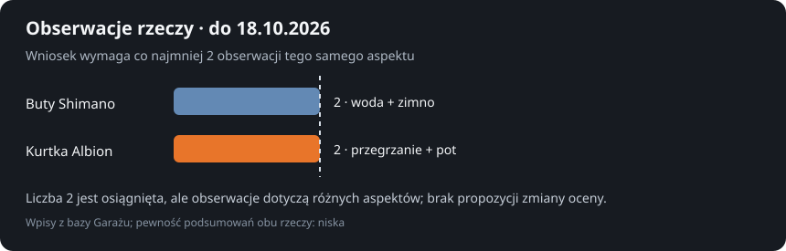
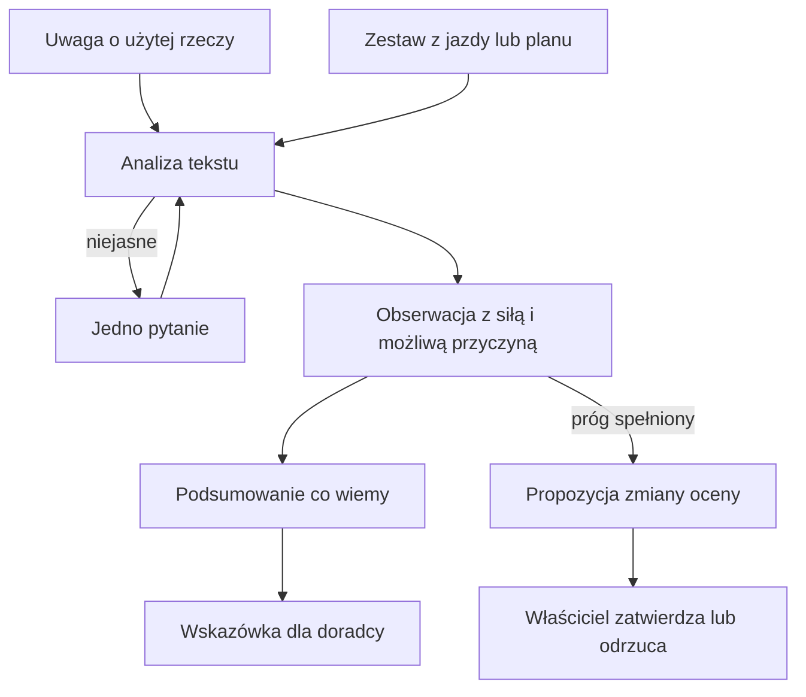

# Obserwacje sprzętu

## Co to jest

Obserwacje porządkują uwagi o tym, jak konkretna rzecz sprawdziła się podczas jazdy. QBot może z takiej uwagi wyciągnąć obserwację, przygotować krótkie podsumowanie „co wiemy” i przekazać je doradcy ubioru. [AI](../slowniczek.md#ai-sztuczna-inteligencja) pomaga rozpoznać, której rzeczy i cechy dotyczy tekst; wynik jest poszlaką.

## Po co

Po jeździe napisz konkretnie, co się stało, na przykład „stopy były zimne” albo „kurtkę trzeba było rozpinać”. Doradca może wtedy uwzględnić tę uwagę przy podobnych warunkach. Jeśli tekst jest niejasny, system może zadać jedno pytanie. Wniosek o ogólnej regule nie powstaje automatycznie po każdym komentarzu.

## Skąd dane

Uwagi pochodzą z opisu sprzętu użytego podczas jazdy albo z uwag przed planowaną jazdą. Analiza przypisuje tekst do rzeczy obecnych w odpowiednim kontekście, wskazuje cechę, wynik, możliwe inne przyczyny i siłę obserwacji. Audyt ubrania pozostaje odrębną, zatwierdzoną oceną.

## Jak liczone

1. W odczycie z 18.10.2026 baza zawierała 6 uwag, 18 obserwacji i 15 podsumowań rzeczy. Cztery uwagi miały stan „gotowa”, dwie — „bez obserwacji”. To stan zapisów, nie liczba osobnych jazd.
2. Przy butach Shimano SH-EX700 GTX zapisano 2 obserwacje o niskiej pewności. Jedna dotyczyła zimnych stóp z 18.10.2026, a wcześniejsza z 14.10.2026 opisywała przeciek przy zapięciu po 20–30 minutach deszczu.
3. Podsumowanie dla tych butów wspomina możliwość wpływu skarpet i warunków. Zapis nie zmienił samodzielnie oceny audytu i nie wyznaczył nowej granicy temperatury.
4. Dla kurtki Albion Men's Ultralight Insulated w dniu 18.10.2026 zapisano między innymi konieczność rozpięcia kurtki oraz mokre rękawy. Podsumowanie ma niską pewność i wskazuje, że przyczyną mogła być suma warstw albo wysiłek.
5. Propozycja zmiany oceny rzeczy wymaga co najmniej 2 obserwacji tego samego aspektu i nie może opierać się wyłącznie na słabych obserwacjach. Nawet wtedy zmiana czeka na decyzję właściciela.
6. Po zatwierdzeniu zmienia się ocena rzeczy. Po odrzuceniu tej samej propozycji system nie wraca do niej bez nowych obserwacji.

## Gdzie to widać

Po zapisaniu uwagi raport może pokazać jej analizę i pytanie uzupełniające. W Garażu, po otwarciu szczegółów rzeczy, dostępne są podsumowanie oraz historia obserwacji. Zrzut [Garażu](../img/ekrany/garaz.png) pokazuje ogólną tabelę części, nie otwarty panel obserwacji; jego położenie sprawdzisz w [indeksie zrzutów](../img/ekrany/indeks.md).

## Jak czytać

Jeśli podsumowanie ma niską pewność, potraktuj je jako powód, by zwrócić uwagę na tę rzecz, a nie jako rozstrzygnięcie. Jedna jazda może mieć inne przyczyny: skarpety, pozostałe warstwy, wysiłek lub pogodę. Ocena audytu zmienia się dopiero po osobnym zatwierdzeniu propozycji.

## Decyzje i historia

Obserwacja nie jest tym samym co preferencja. „Te rękawiczki są niewygodne” opisuje doświadczenie. „Na przyszłość wybieraj zielone” jest wskazówką doboru, która może zostać zapisana jako wniosek. Rozdzielenie tych dwóch rzeczy chroni przed zmianą oceny sprzętu przez pojedyncze zdanie.

## Ograniczenia i pułapki

- Analiza w tle może wymagać ponownego uruchomienia po restarcie; uwaga pozostaje zapisana.
- Dwie obserwacje nie muszą oznaczać dwóch niezależnych jazd. Sprawdź daty i opisy.
- W przykładzie butów jedna obserwacja o zimnie i jedna o przeciekaniu dotyczą różnych cech; nie należy ich sumować jako dowodu jednej wady.
- Doradca może korzystać z podsumowania, ale nie powinien wykreślać rzeczy z powodu jednej słabej obserwacji.
- Odczyt bazy nie potwierdza, że każda uwaga została pokazana użytkownikowi w przeglądarce.

## Wpływa na / Zależy od

**Wpływa na:** krótkie wskazówki przekazywane [doradcy ubioru](doradca-ubioru.md). Zmiana audytu wymaga oddzielnego zatwierdzenia.

**Zależy od:** treści uwagi, listy rzeczy użytych lub proponowanych oraz poprawnego przypisania obserwacji do rzeczy.

## Powiązane hasła

- [Doradca ubioru](doradca-ubioru.md)
- [Faworyci ubioru](faworyci-ubioru.md)
- [Sprzęt w Garażu](sprzet.md)

## Zrodla

- `/opt/qbot/app/docs/GEAR_OBS.md` — przepływ uwagi, warunek propozycji i miejsca wyświetlania.
- `/opt/qbot/app/qbot3/routes/gear_obs.py` — `process_note`, `refresh_knowledge`, `decide_proposal`; tabele obserwacji i podsumowań.
- `/opt/qbot/app/qbot3/routes/outfit_advisor.py` — użycie `co_wiemy` przy doborze.
- Odczyt `garage.db` z 18.10.2026 — liczby rekordów oraz przykłady rzeczy 98 i 139.
- `img/garaz-obserwacje-20261018.svg` — wykres obserwacji rzeczy 98 i 139.
- `slowniczek.md` — AI.
