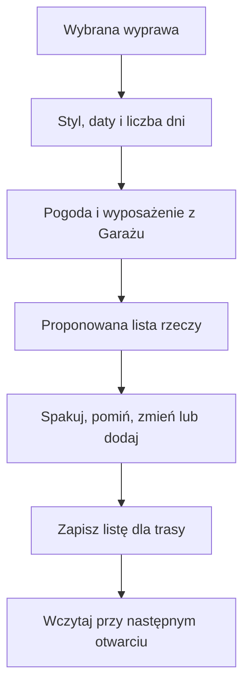
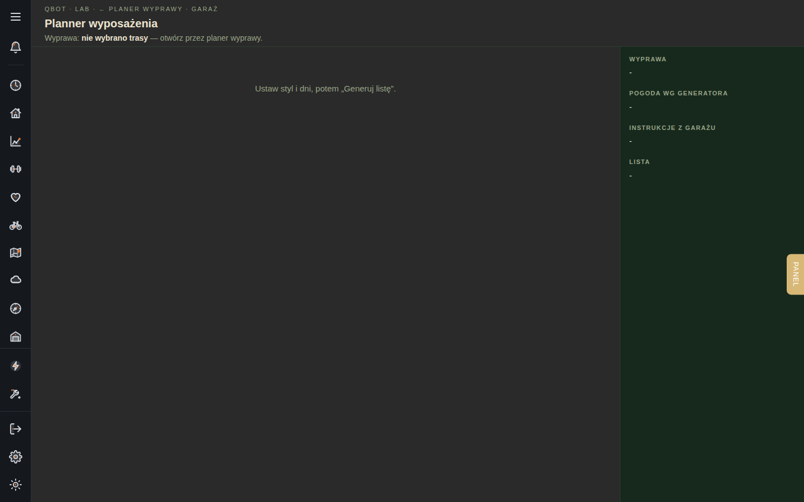

# Planer wyposażenia wyprawy

## Co to jest

To osobna strona do przygotowania listy rzeczy na wyprawę. Lista może uwzględniać długość wyjazdu, prognozę, styl podróży i przedmioty zapisane w Garażu.

## Po co

Użyj jej przed wyjazdem wielodniowym, gdy chcesz sprawdzić, czy masz podstawowe rzeczy i gdzie je spakujesz. Lista jest propozycją do przejrzenia. Sam wybierasz, co zabierasz, pomijasz albo dopisujesz.

## Skąd dane

Planer otwiera się z wybranej trasy w Planerze wyprawy. Strona pobiera listę kategorii, wyposażenie zapisane w Garażu, torby oraz reguły dla wybranego stylu i pory roku. Prognoza może dostarczyć warunki na kolejne dni. Zapisana lista pozostaje powiązana z trasą.

## Jak liczone

1. Wybierasz trasę w Planerze wyprawy i otwierasz Planner wyposażenia.
2. Ustawiasz styl: lekko, gdy planujesz noclegi w hotelach, albo ciężko, gdy planujesz biwak. Wskazujesz początek i długość wyprawy. Pole długości przyjmuje od 1 do 60 dni.
3. Wybierasz „Generuj listę”. Strona pobiera warunki i zestawia je z regułami oraz wyposażeniem, które może trafić do listy.
4. Oglądasz pozycje według kategorii. Możesz przypisać rzecz z Garażu, zaznaczyć spakowanie, pominąć pozycję, zmienić ilość albo dodać własną rzecz.
5. Zapisujesz listę, jeśli chcesz do niej wrócić. „Wczytaj zapisane” pobiera poprzedni zapis dla tej trasy.

Nie wpisuję przykładowego zestawu ani temperatury, bo nie pobierałem planu konkretnej wyprawy z tej strony. Sposób tworzenia listy wynika z kodu i widoku, nie z przykładu zapisanego planu.

## Gdzie to widać

Otwórz Planer wyprawy i wybierz narzędzie wyposażenia. Na stronie wybierasz styl, początek wyjazdu i liczbę dni. Lista zajmuje główną część ekranu, a panel po prawej pokazuje podsumowanie i informacje o pogodzie. Zrzut przedstawia widok Planera wyposażenia; może nie pokazywać najnowszego planu.

## Jak czytać

- „Lekko” i „Ciężko” oznaczają dwa różne style pakowania. Nie są oceną Twojej formy ani jakości sprzętu.
- Pozycja przypisana do rzeczy z Garażu wskazuje konkretny zapisany przedmiot. Sprawdź ją przed wyjazdem, jeśli masz kilka podobnych rzeczy.
- Ostrzeżenie o nieaktualnej prognozie mówi o wieku danych. Przy zmiennej pogodzie sprawdź prognozę ponownie bliżej wyjazdu.
- Lista nie oznacza, że rzecz została spakowana. Zaznaczenie i zapis odzwierciedlają Twoją decyzję.

## Decyzje i historia

Planer łączy listę rzeczy z wybraną trasą, żeby można było wrócić do ustawień konkretnej wyprawy. Nie zastępuje listy sprzętu w Garażu: zapisuje przygotowanie wyjazdu, a Garaż opisuje posiadane przedmioty i reguły.

## Ograniczenia i pułapki

- Nie potwierdzono na żywo, jak każda kategoria wpływa na automatycznie wygenerowaną listę.
- Sama prognoza nie gwarantuje warunków w terenie. Sprawdź ją przed pakowaniem i przed startem.
- Nie zakładaj, że zmiana listy automatycznie zmienia dane przedmiotu w Garażu.
- > DO SPRAWDZENIA: potwierdzić na zalogowanej stronie widok wygenerowanej listy i reguły, które wybierają rzeczy dla stylu „lekko” oraz „ciężko”.

## Wpływa na / Zależy od

- **Wpływa na:** listę pakowania zapisaną dla wyprawy.
- **Zależy od:** wybranej trasy, danych w Garażu, reguł pakowania i dostępnej prognozy.

## Powiązane hasła

- [Planer wyprawy](../trasy/planer-wyprawy.md)
- [Sprzęt w Garażu](sprzet.md)
- [Doradca ubioru](doradca-ubioru.md)
- [Pogoda](../pogoda/index.md)

## Zrodla

- `/opt/qbot/web/public/planer-wyposazenia.html` — ustawienia i obsługa listy.
- `/opt/qbot/web/public/planer-wyprawy3-render.js` — przejście z Planera i otwieranie widoku.
- `/opt/qbot/app/qbot_web.py` — `api_wyposazenie_generate`, `api_wyposazenie_save`, `api_wyposazenie_list`, `api_wyposazenie_summary`.
