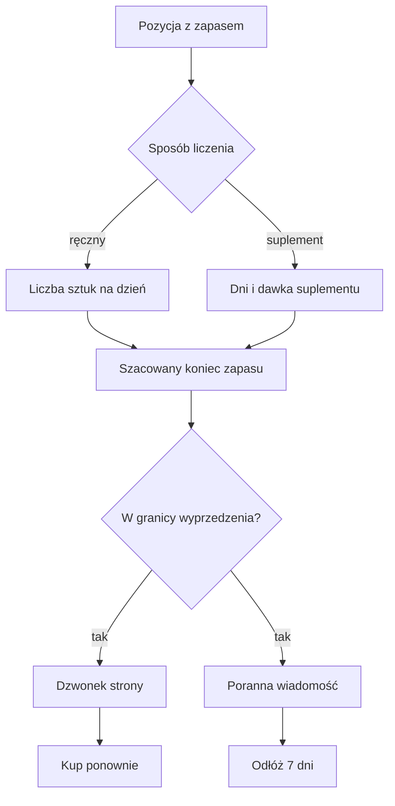

# Przypomnienia o zakupach i zapasie

## Co to jest

Garaż może przypominać o zapasie, który zbliża się do końca. Przypomnienie pojawia się w dzwonku strony i może trafić jako zbiorcza pozycja do porannej wiadomości Telegram.

## Po co

Pomaga zaplanować ponowny zakup z wyprzedzeniem. Szczególnie przy rzeczach zużywanych regularnie zapas można połączyć z harmonogramem suplementu. Dla innych rzeczy, na przykład zatyczek, można podać liczbę sztuk i tempo zużycia.

## Skąd dane

Źródłem jest pozycja zakupowa: liczba jednostek w opakowaniu, liczba opakowań, data otwarcia oraz wyprzedzenie przypomnienia. Można podać ręczne zużycie na dzień lub połączyć pozycję z harmonogramem suplementu.

## Jak liczone

Poniższe liczby pokazują przykład obliczeniowy z dokumentacji modułu, nie rzeczywisty rekord zakupowy:

1. Dla opakowania 90 kapsułek przy dwóch kapsułkach dziennie zapas wynosi 45 dni (90 ÷ 2).
2. Domyślnie przypomnienie ma wyprzedzenie 10 dni, więc przy stałym zużyciu pojawi się, gdy według szacunku zostanie 10 dni zapasu.
3. Jeżeli użytkownik odłoży przypomnienie, wróci po 7 dniach.
4. Przy połączeniu z harmonogramem suplementu system liczy dni zaplanowanego przyjęcia od otwarcia do wczoraj. Dni oznaczone jako pominięte odejmuje. Dni bez potwierdzenia traktuje jak przyjęte.

W przykładzie ręcznym 90 kapsułek / 2 dziennie daje 45 dni. Rzeczywisty koniec może być inny, jeśli zużycie się zmienia.

## Gdzie to widać

Lista zakupów w Garażu pokazuje pozycje do kupienia i kupione. Przypomnienie o zapasie pojawia się w dzwonku oraz jako wiersz porannej wiadomości. Z poziomu przypomnienia można utworzyć zakup ponowny albo odłożyć pozycję.

## Jak czytać

Traktuj termin jako szacunek. Przy suplemencie brak potwierdzenia jest liczony tak, jakby dawka została przyjęta, więc przypomnienie może przyjść wcześniej niż faktyczne zużycie. Jeśli suplement został wyłączony, kod nie wyznacza dla niego prognozowanego końca zapasu.

„Kup ponownie” tworzy pozycję na liście zakupów o priorytecie „Pilne”. Oryginał przestaje przypominać, a po usunięciu kopii może znów przypominać. Gmail nie potwierdza zakupów; zakup oznacza się ręcznie.

## Ograniczenia i pułapki

- Prognoza zależy od prawidłowej liczby jednostek, daty otwarcia i zużycia.
- Dla suplementów liczy się harmonogram i oznaczone pominięcia.
- Nie sprawdzono rzeczywistego aktywnego przypomnienia ani przykładowej pozycji z bazy.

> DO SPRAWDZENIA: Odczytać pozycję zakupową z zapasem i porównać wyliczony termin z bieżącym przypomnieniem.

## Wpływa na / Zależy od

**Wpływa na:** powiadomienia w Garażu i Telegramie oraz utworzenie nowej pozycji przy „Kup ponownie”.

**Zależy od:** konfiguracji pozycji zakupowej i, dla suplementów, harmonogramu oraz zapisanych pominięć.

## Powiązane hasła

- [Zakupy](zakupy.md)
- [Suplementy](../zdrowie/suplementy.md)
- [Centrum powiadomień](../system/centrum-powiadomien.md)

## Zrodla

- `/opt/qbot/app/docs/ZAKUPY.md` — etapy zapasu, wyprzedzenie i obsługa przypomnień.
- `/opt/qbot/app/qbot_zakupy_api.py` — `LEAD_DAYS`, `SNOOZE_DAYS`, obliczenie zapasu i przypomnień.
- `/opt/qbot/app/web_public/garaz-zakupy.js` — zakładka Zakupy.
